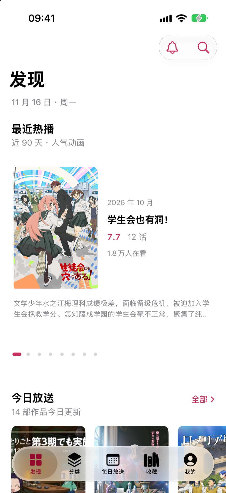
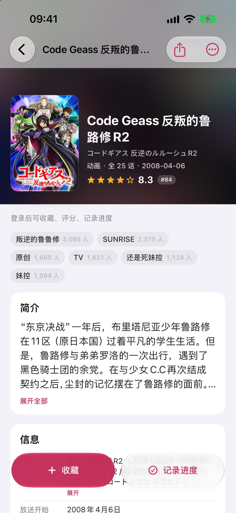
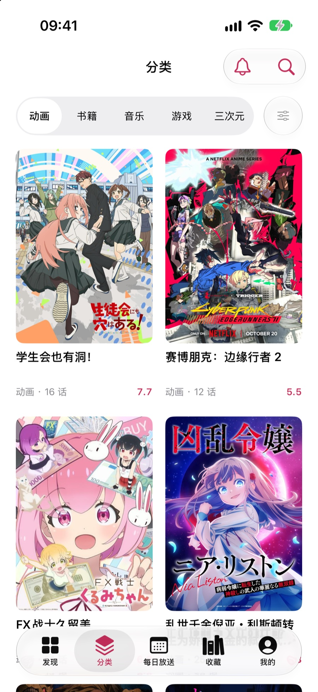
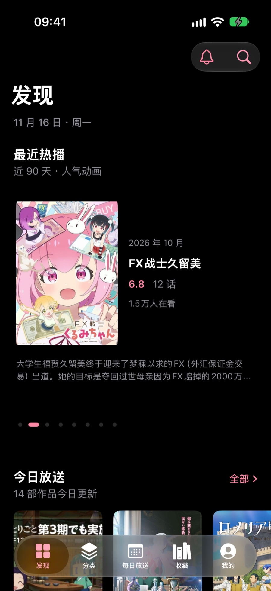
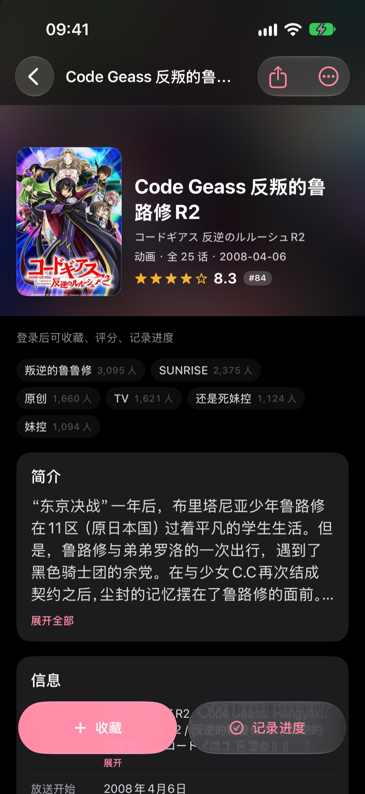
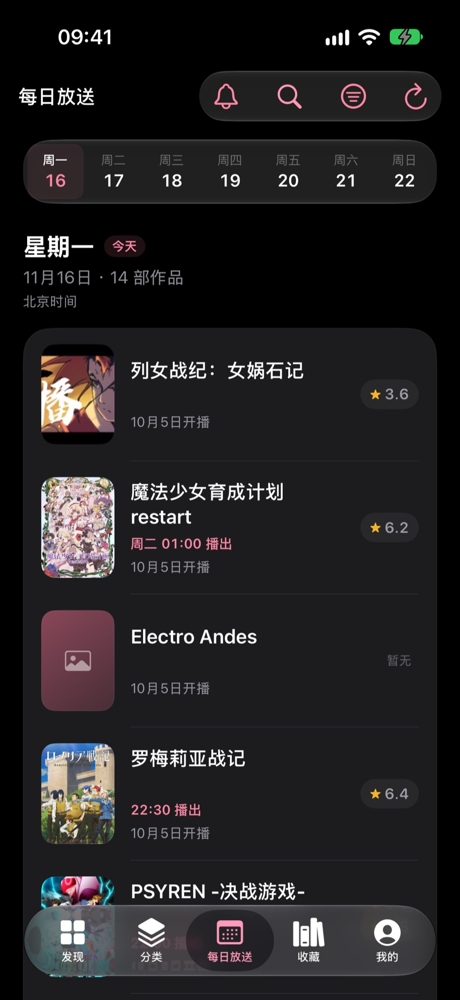
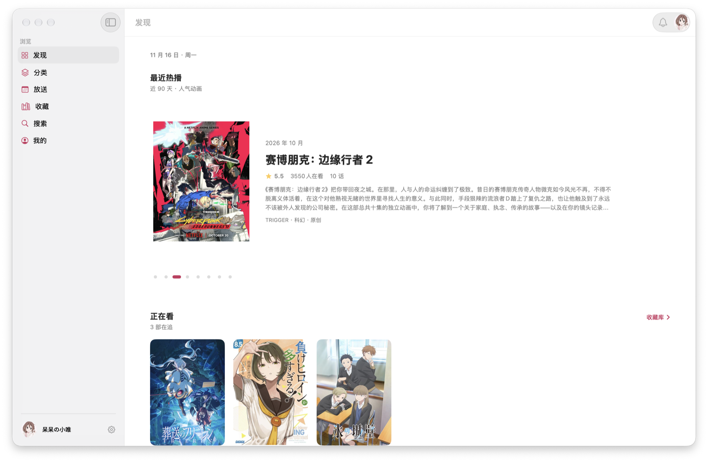
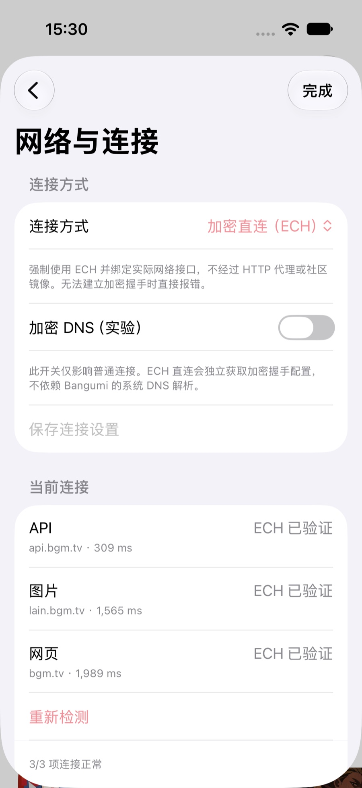

<div align="center">


<h1>Bgmori</h1>

<p><strong>一个原生、克制、带 Liquid Glass 质感的 Bangumi 客户端。</strong></p>

<p><sub>A native SwiftUI client for Bangumi — iPhone &amp; Mac.</sub></p>

<p><sub>非官方第三方客户端 · 与 Bangumi 官方无关联</sub></p>

<p>
  
  
  
  
  
  
</p>

</div>

> **Bgmori 不是 Bangumi 官方客户端。** 项目与 Bangumi 官方无关联，也不代表官方立场。
>
> 这是一个个人自用、仍在持续开发的项目；数据来自公开 API 与网页，界面和功能会随上游变化调整。

## 为什么是 Bgmori

Bangumi 是一个认真记录动画、书籍、音乐与游戏的地方。Bgmori 想做的，是一个**像系统应用一样自然**的客户端：

- **原生双端。** 同一套 SwiftUI 代码，iPhone 与 Mac 各自使用系统的导航、工具栏、菜单与 Liquid Glass 材质，而不是把网页装进壳里。
- **完整的收藏流。** 登录、评分、标签、短评、章节进度、取消收藏都在应用内完成，不用在网页和客户端之间来回跳。
- **在受限网络里也能连上。** 自动感知系统代理；没有代理时使用 ECH 加密直连；失败时可以回退镜像，凭证始终只发往官方或你明确配置的服务。

## 界面

<p align="center">
  
  
  
</p>

<p align="center"><sub>发现 · 条目 · 分类　—　iPhone 17 / iOS 27，浅色</sub></p>

<p align="center">
  
  
  
</p>

<p align="center"><sub>发现 · 条目 · 每日放送　—　深色</sub></p>

<p align="center">
  
</p>

<p align="center"><sub>Mac：原生三栏布局、系统工具栏与 Liquid Glass 材质</sub></p>

## 功能

### 浏览与发现

- **发现** — 最近热播分页主视觉、正在看、今日放送、本季新番、口碑佳作与剧场版精选；主视觉每 6 秒自动轮播，支持双向滑动与圆点切换。
- **每日放送** — 周日期切换、今天高亮、只看在看、评分与观看进度；通过 bgmlist 补充北京时间的播放时刻，保留开播日期，支持缓存、失败重试与网页回退。
- **分类** — 动画 / 书籍 / 音乐 / 游戏 / 三次元，同步官网的题材、来源、地区、受众及游戏平台选项；支持年份、搜索、组合筛选，以及排名 / 热度 / 收藏 / 日期 / 名称排序和滚动自动翻页。
- **条目详情** — 封面 Hero、评分与排名、标签、信息栏、章节、角色、制作人员、关联条目、吐槽预览；长列表保留预览，按需展开全部。
- **章节 / 角色 / 人物** — 播出信息、时长、简介与吐槽；声优、职业、参与作品与收藏。
- **搜索** — 条目 / 角色 / 人物，类型、年份与排序筛选；最近搜索、最近浏览、分类入口与本周热门。
- **社区只读** — 小组、讨论话题、日志、时光机；目录按 ID 查看，编辑历史只读。

### 收藏与账号

- **应用内登录** — 邮箱、密码、图片验证码；由官网生成一年有效的个人令牌，无需注册 OAuth 或手动复制 Token。
- **收藏编辑** — 想看 / 看过 / 在看 / 搁置 / 抛弃，十分制评分、标签、短评与私密标记。
- **进度** — 章节单话切换与批量「看到第 N 话」；书籍支持卷 / 话进度。
- **收藏库** — 按五类切换，组合状态筛选、个人评分排序，列表 / 网格两种布局；显示个人评分、更新日期与短评。
- **取消收藏** — 收藏列表或编辑页直接移除；使用登录时保存的官网会话调用网页删除入口，并用 API 复核结果。
- **我的** — 账号概览、继续观看、最近浏览、评分分布、好友、角色 / 人物收藏、时光机与社区入口。
- **追番提醒** — 未来 7 天的每日汇总、单番开播提醒、自选时间与提前量、夜间免打扰、单作排除；点击通知直达放送表或条目。

### 网络与连接

- **线路选择** — API、图片和网页可以分别选择自动、官方、自定义服务或镜像；失败冷却、成功线路复用、网络变化后重新检测。
- **代理优先** — 检测到适用于目标地址的系统代理时，优先由系统连接官方，遵循 HTTP/HTTPS、SOCKS、PAC 与直连例外。
- **ECH 直连** — 无代理时优先使用 ECH；严格模式只走加密直连，失败不会悄悄退回普通连接或镜像。
- **凭证保护** — 登录、收藏与取消收藏的凭证只发送到官方或明确配置的自定义服务，不发送给社区镜像。
- **加密 DNS 与诊断** — 可选择应用内加密 DNS；连接页提供脱敏诊断与 API / 图片 / 网页三项真实连接检测。

### 设计与可访问性

- **Liquid Glass** — 系统原生 Tab Bar、导航栏与工具栏优先；自定义玻璃只用于浮动控制层，同屏不超过两组。
- **两端原生** — iPhone 五栏导航与内嵌胶囊选中态；Mac 原生三栏 `NavigationSplitView`、菜单命令、⌘1–5 / ⌘R / ⌘, 与 Settings 场景。
- **适配** — 浅色 / 深色 / 跟随系统，Dynamic Type、VoiceOver 标签与 Reduce Transparency 降级。
- **深链** — `bgmori://subject/8`、`bgmori://episode/1027`、`bgmori://user/sai` 等。
- **图标** — 纯白底黑白漫画少女，附[源图与生成说明](docs/branding/README.md)。

## 国内加密直连（ECH）

在无法稳定直连的网络里，Bgmori 不只依赖镜像：

- **自动模式。** 有适用的系统代理时由系统连接官方；没有代理时优先 ECH，失败后再尝试其他可用线路。
- **严格 ECH。** 设置里可以强制只用 ECH：直接连接 Cloudflare IP，使用 TLS 1.3 加密握手，按真实域名验证证书，并绑定物理 Wi-Fi / 以太网 / 蜂窝接口；握手失败直接报错，不会降级为明文 SNI 或镜像。
- **只影响自己。** 绕过本应用的 HTTP/SOCKS 代理与 TUN 路由，但不修改其他软件的网络设置。
- **可验证。** `bash scripts/test-ech.sh --live` 会同时检查握手被接受、Cloudflare `sni=encrypted` 与物理接口三项证据。

<p align="center">
  
</p>

<p align="center"><sub>严格 ECH：三项连接均显示「ECH 已验证」</sub></p>

实现与国内网络验证记录见 [docs/screenshots/ech-direct/README.md](docs/screenshots/ech-direct/README.md)。ECH 连接层使用 Go 标准库实现，无外部 Go 模块；源码在 `Native/ECH/`，Xcode 构建时自动编译为静态库。

## 快速开始

### 环境

| 依赖 | 要求 |
| --- | --- |
| macOS | 27 |
| Xcode | 27.1 或更新 |
| Go | 1.27+（仅用于构建 ECH 静态库） |
| XcodeGen | 2.46+ |
| 模拟器 | iPhone 17 · iOS 27.0 |

### 构建与运行

```bash
git clone https://github.com/Yaronluo/Bgmori.git
cd Bgmori

# Mac：构建、校验签名、替换 /Applications/Bgmori.app 并重新打开
bash scripts/build-install-macos.sh

# iPhone 17 模拟器：构建、安装并启动
bash scripts/build-install-ios.sh --route subject:8
```

`Bgmori.xcodeproj` 由 XcodeGen 生成且不入库；脚本会自动调用 `scripts/check-project-sync.sh`，首次 clone 不需要手动生成工程。

用 Xcode 开发：

```bash
xcodegen generate --spec project.yml --project .
open Bgmori.xcodeproj
```

选择 `Bgmori` scheme；iOS 选择 `iPhone 17 (iOS 27.0)`，Mac 选择 `My Mac`。真机运行需要在 Signing & Capabilities 里选择自己的 Team。

命令行构建：

```bash
# iOS 模拟器
xcodebuild -project Bgmori.xcodeproj -scheme Bgmori \
  -destination 'platform=iOS Simulator,name=iPhone 17,OS=27.0' \
  -derivedDataPath build/DerivedData-ios \
  CODE_SIGNING_ALLOWED=NO build

# macOS
xcodebuild -project Bgmori.xcodeproj -scheme Bgmori \
  -destination 'platform=macOS,arch=arm64' \
  -derivedDataPath build/DerivedData-mac \
  CODE_SIGNING_ALLOWED=NO build
```

构建脚本会把构建缓存固定在当前 checkout 的 `build/` 下，并在运行时回收过期的开发产物。可随时预览清理规则：

```bash
python3 scripts/maintain-dev-storage.py          # 仅预览
python3 scripts/maintain-dev-storage.py --apply  # 永久回收过期产物
```

### 验证脚本

| 脚本 | 检查内容 |
| --- | --- |
| `bash scripts/test-categories.sh --live` | 分类目录、年份与标签组合筛选、连续翻页 |
| `bash scripts/test-navigation.sh` | Mac / iPhone 的搜索、放送、日志详情与返回路径 |
| `bash scripts/test-shell-ui.sh all` | 栏目切换、搜索历史、详情返回与浅深色界面 |
| `bash scripts/test-social.sh --live` | 日志列表与正文 HTML 解析 |
| `bash scripts/test-mirrors.sh --live` | 镜像目录、ETag、读取回退与凭证隔离 |
| `bash scripts/test-connections.sh --live` | 线路隔离、系统代理、加密 DNS、取消与图片并发 |
| `bash scripts/test-web-login.sh --live` | 真实登录页与验证码；不提交账号密码 |
| `bash scripts/test-cache.sh` | 取消收藏的乐观更新、API 复核与失败回滚 |
| `bash scripts/test-ech.sh --live` | ECH 握手、Cloudflare `sni=encrypted` 与物理接口 |

带 `--live` 的脚本会访问真实网络；离线时会明确跳过或只跑本地协议桩。

## 架构

```
Bgmori/
├─ App/          入口、Root Shell、路由、AppModel
├─ Core/
│  ├─ API/       URLSession 客户端、端点、限流、缓存、错误
│  ├─ Auth/      官网登录、临时会话、Keychain
│  ├─ Models/    Bangumi DTO
│  ├─ Settings/  外观与内容配置
│  ├─ Social/    HTML 只读解析（吐槽 / 小组 / 日志 / 时光机）
│  └─ Storage/   收藏状态、图片缓存、本地通知
├─ Design/       Design Tokens、玻璃组件、通用卡片
├─ Features/     Home / Calendar / Library / Search / Subject、
│                Episode / Person / Profile / Social / Settings
├─ Native/ECH/   Go 标准库 ECH 静态连接层
└─ Resources/    Assets、Info.plist
```

| 层 | 实现 |
| --- | --- |
| UI | SwiftUI；平台差异用 `#if os(iOS)` / `#if os(macOS)`，不使用 Catalyst |
| 网络 | URLSession + 自建限流与缓存；ECH 通过内嵌 Go 静态库直连 |
| 数据 | Bangumi API v0；官方没有接口的页面使用原生 HTML 只读解析 |
| 存储 | 本地 JSON 缓存、图片磁盘 / 内存缓存、Keychain |
| 构建 | XcodeGen 生成工程，Xcode 27 构建；iOS 27 / macOS 27 |

## 隐私

- 没有广告、统计 SDK 或第三方账号体系；不会把使用数据上传到任何分析服务。
- 密码不落盘。登录后生成的个人令牌与官网会话 Cookie 只存 Keychain；退出登录立即清除会话，并尝试在后台撤销这次登录生成的令牌。
- 社区页面保持匿名只读，不会为了读取公开内容携带你的登录 Cookie；登录凭证只发往官方或你明确配置的自定义服务。
- 官网会话 Cookie 仅用于应用内取消收藏的网页请求，不扩展到发帖、回帖或其他写操作。

## 已知限制

- 官方 API 没有评论、小组、日志与发布接口；这些页面采用匿名 HTML 只读解析，页面结构变化时可能失效，失效会回退到 Safari。
- 不支持发吐槽、回帖、发日志、发话题、提醒与维基编辑。好友列表、角色 / 人物收藏为只读。
- 条目收藏删除也没有 API；应用内取消收藏依赖登录后保存的官网会话，会话失效时需要重新登录或前往网页。
- 默认关闭 NSFW，可在设置中手动开启。公开分发前仍需处理 Bangumi 商标、UGC 举报与 R18 过滤。
- 系统级 Widget、App Intents、Handoff 与 Spotlight 尚未接入；Mac 多窗口未做专门优化。
- 当前验收范围是标准版 iPhone 17（iOS 27.0 模拟器）与作者的 Apple Silicon Mac，不承诺其他机型的显示效果。

## 文档

- [AGENTS.md](AGENTS.md)：给 AI 编码代理的构建命令、目录约定、Liquid Glass 规则与已知坑
- [截图索引](docs/screenshots/readme/README.md)：本文截图的拍摄说明与更多细节
- [ECH 实现与国内网络验证](docs/screenshots/ech-direct/README.md)
- [安全策略](SECURITY.md)
- [界面设计记录](docs/DESIGN-REFRESH.md) · [macOS 设计](docs/MACOS-DESIGN.md)
- [方案与计划](docs/PLAN.md)

## 致谢

- 数据与内容：[Bangumi 番组计划](https://bgm.tv)
- API 文档：[bangumi/api](https://github.com/bangumi/api)
- 新番播放时刻：[bgmlist](https://bgmlist.com)，数据来自 [bangumi-data](https://github.com/bangumi-data/bangumi-data)（CC BY 4.0）；本项目仅接入 bgmlist 的公开 on-air 接口
- 设计参考：Apple Human Interface Guidelines · Liquid Glass

## 声明

Bgmori 是非官方第三方客户端，与 Bangumi 官方无任何关联，也不代表官方立场。应用中的条目信息、封面与用户内容，版权归原作者及 Bangumi 用户所有。

## 许可

源码以 [MIT 许可证](LICENSE) 开源，Copyright © 2026 Yaron Luo。

MIT 许可证只覆盖本仓库的源代码。Bangumi 的条目数据、封面、商标与用户内容不在此许可范围内，版权归原作者及 Bangumi 用户所有。

内嵌 Go 运行时的 BSD 许可证见 [Bgmori/Resources/GoRuntime-LICENSE.txt](Bgmori/Resources/GoRuntime-LICENSE.txt)。
