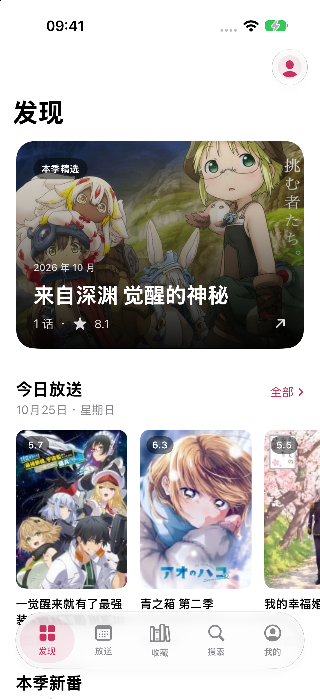
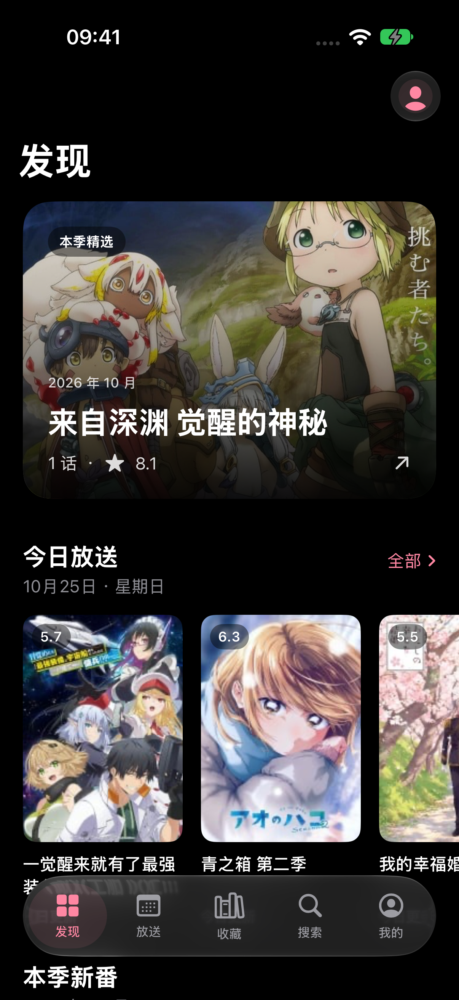
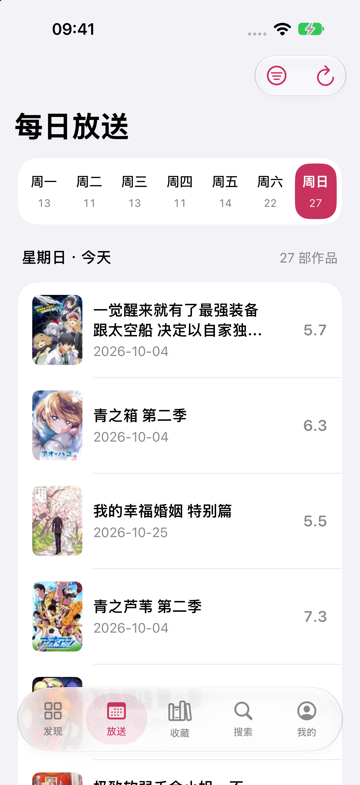
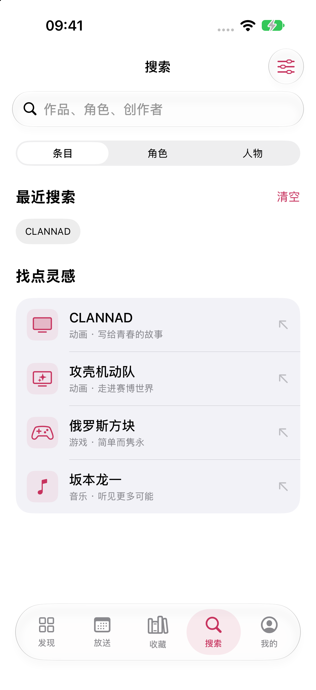
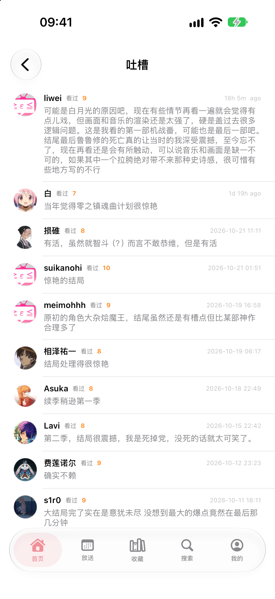
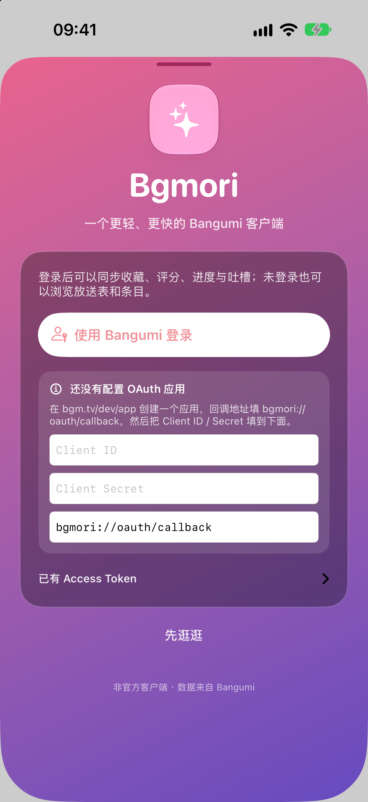
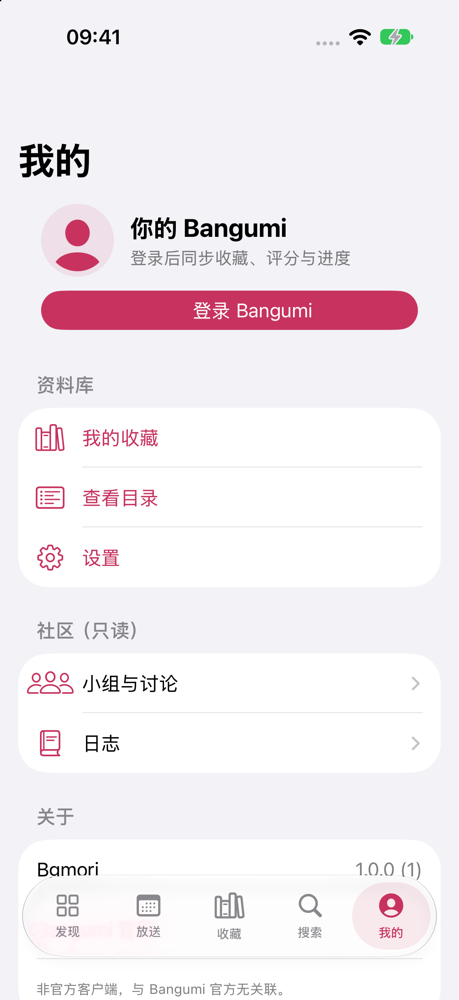
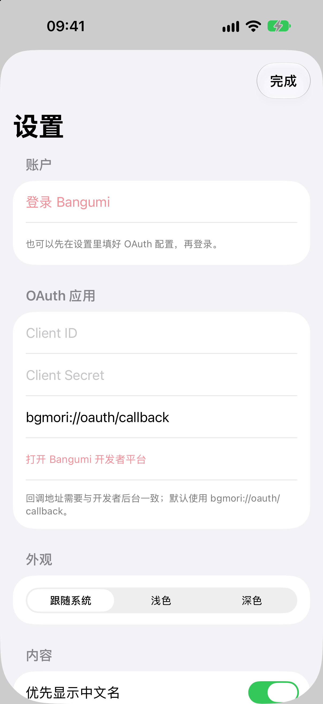

# Bgmori

> 一个原生、克制、带 Liquid Glass 质感的 Bangumi 客户端，支持 iPhone 与 Mac。
> **非官方第三方客户端，与 Bangumi 官方无关联。**

当前版本：`1.0.0 (1)` · 目标系统：**iOS 27 / macOS 27**（使用 Xcode 27.1 构建）



## 已实现

### 浏览

- [x] 首页：继续观看、今日放送、本季新番、排行榜、社区入口
- [x] 每日放送：周一–周日切换、只看在看、评分与进度
- [x] 分类：动画 / 书籍 / 音乐 / 游戏 / 三次元，同步官网的分类、题材、来源、地区、受众及游戏平台等选项，支持搜索与组合筛选、年份筛选、热度 / 排名 / 评分排序、滚动自动翻页
- [x] 条目详情：封面 Hero、评分/排名、标签、信息栏、章节、角色、制作人员、关联条目、吐槽预览
- [x] 章节详情：播出信息、时长、简介、吐槽
- [x] 角色 / 人物详情：简介、声优/职业、参与作品、收藏
- [x] 搜索：条目 / 角色 / 人物，类型、年份、排序筛选，最近搜索
- [x] 目录（Index）按 ID 查看、编辑历史（Revisions）只读
- [x] 小组、讨论话题、日志、时光机（HTML 匿名只读）
- [x] 深链：`bgmori://subject/8`、`bgmori://episode/1027`、`bgmori://user/sai` 等

### 收藏与账号

- [x] OAuth 2.0 登录（Authorization Code + ASWebAuthenticationSession）
- [x] 手动 Access Token 登录（方便私人使用）
- [x] Token 刷新、Keychain 存储、401 处理
- [x] 收藏状态：想看 / 看过 / 在看 / 搁置 / 抛弃
- [x] 评分（1–10）、标签、短评、私密标记
- [x] 章节进度：单话切换、批量“看到第 N 话”
- [x] 书籍卷/话进度
- [x] 收藏库：默认图文列表，显示个人评分、收藏更新日期与短评（空短评隐藏），顶部按动画 / 书籍 / 音乐 / 游戏 / 三次元分类，可组合收藏状态筛选、个人评分排序、可切换网格
- [x] 本地缓存：API JSON 缓存、图片磁盘/内存缓存、离线可读
- [x] 本地每日放送通知（完全本地计算）

### 设计

- [x] 纯白底黑白漫画少女图标，附[源图与生成说明](docs/branding/README.md)
- [x] iOS 原生大标题与轻量搜索栏、分组列表、随系统字号缩放的内容层级
- [x] 发现页：本季精选封面、作品横向书架、分组排行榜与社区入口
- [x] Liquid Glass：自定义玻璃 Tab Bar、发现/我的快捷操作栏、分类/搜索/放送/收藏悬浮筛选栏、玻璃登录/收藏/进度按钮、系统导航栏/Sheet 材质；[两端浅深色截图](docs/screenshots/compact-controls/README.md)
- [x] iPhone 四栏导航：发现 / 分类 / 收藏 / 我的，右上角搜索，今日放送从发现页进入
- [x] 封面取色英雄区、`backgroundExtensionEffect`
- [x] 浅色 / 深色 / 跟随系统
- [x] Dynamic Type、VoiceOver 标签、Reduce Transparency 降级
- [x] Mac 原生三栏 `NavigationSplitView`、菜单命令、⌘1–5 / ⌘R / ⌘,、Settings 场景

## 当前验证设备

当前仅要求适配和验收：**标准版 iPhone 17（iOS 27.0 模拟器）** 与 **用户当前这台 Mac（Apple M2、24 GB 内存，当前运行 macOS 27.0.1）**。默认不扩展其他机型和系统版本的测试矩阵；后续开发遵循 [AGENTS.md](AGENTS.md) 中的约束。部署目标仍为 iOS 27 / macOS 27。

## 运行

```bash
cd Bgmori
open Bgmori.xcodeproj
```

1. 选择 `Bgmori` scheme。
2. iOS 选择 `iPhone 17 (iOS 27.0)` 模拟器；Mac 选择当前这台 `My Mac`。
3. 真机运行需要在 Signing & Capabilities 里选择自己的 Team。
4. 最低系统：iOS 27 / macOS 27。若 Xcode 没有 iOS 27 运行时，请在 Xcode → Settings → Components 中安装。

命令行构建：

```bash
# iOS 模拟器
xcodebuild -project Bgmori.xcodeproj -scheme Bgmori \
  -destination 'platform=iOS Simulator,name=iPhone 17,OS=27.0' \
  CODE_SIGNING_ALLOWED=NO build

# macOS
xcodebuild -project Bgmori.xcodeproj -scheme Bgmori \
  -destination 'platform=macOS,arch=arm64' CODE_SIGNING_ALLOWED=NO build
```

分类页的官网分类解析、组合筛选、翻页、缓存和切换保护可用 `bash scripts/test-categories.sh` 验证；加上 `--live` 会读取五类官网筛选目录，并用真实 API 检查公共标签组合与翻页。官网分类目录缓存一天，也可在筛选面板的菜单中手动同步；同步失败时支持重试或在浏览器中查看。

导航回归检查：`bash scripts/test-navigation.sh`，分别运行 Mac 与 iPhone 17 模拟器上的搜索、放送、日志详情和返回路径检查。

日志解析检查：`bash scripts/test-social.sh`；加上 `--live` 会读取真实日志列表并验证前三篇正文。

## 登录配置

Bgmori 不内置任何第三方应用的 Client Secret，需要你自己注册一个 Bangumi OAuth 应用：

1. 打开 <https://bgm.tv/dev/app>，创建一个应用。
2. 回调地址填：`bgmori://oauth/callback`
3. 把 **Client ID / Client Secret** 填入 App 的「我的 → 设置 → OAuth 应用」；或修改 `project.yml` 里 `info.properties` 的以下字段后运行 `xcodegen generate`：
   - `BGMApiClientID`
   - `BGMApiClientSecret`
   - `BGMOAuthRedirect`（默认 `bgmori://oauth/callback`）
4. 回到登录页点「使用 Bangumi 登录」。

也可以点「已有 Access Token」手动粘贴一个 token；适合临时使用。

> 私人使用可以直接把配置写进 Info.plist；如果要分发，建议把换 token 的逻辑放到自己的 Cloudflare Worker，避免 Client Secret 被提取。

## 给 AI 代理的说明

仓库根目录有 `AGENTS.md`，里面是构建命令、目录约定、Liquid Glass 规则、密钥策略和已知坑。用 Codex 继续开发时，直接在仓库根目录启动即可，它会自动读取；Claude Code / Cursor / Copilot 也能识别这个文件。

## 目录结构

```
Bgmori/
├─ App/                  入口、Root Shell、路由、AppModel
├─ Core/
│  ├─ API/               URLSession API 客户端、限流、缓存、错误
│  ├─ Auth/              OAuth、Keychain
│  ├─ Models/            Bangumi DTO
│  ├─ Settings/          外观、内容、OAuth 配置
│  ├─ Social/            HTML 解析（吐槽/小组/日志/时光机）
│  └─ Storage/           收藏状态、图片缓存、本地通知
├─ Design/               Tokens、玻璃组件、通用卡片
├─ Features/             Home / Calendar / Library / Search / Subject / Episode / Person / Profile / Social / Settings
└─ Resources/            Assets、Info.plist
```

第三方依赖：**0**。网络、图片缓存、HTML 适配均为原生实现，避免 SPM 解析和构建环境差异。

## 已知限制

- 官方 API 没有评论/小组/日志/发布接口；这些页面采用 **匿名 HTML 只读解析**，页面结构变化时可能失效，失效会回退到 Safari。
- 不支持发吐槽、回帖、发日志、发话题、好友动态、提醒、维基编辑（没有公开写接口）。
- 审核/公开分发需要处理 Bangumi 商标、UGC 举报与 R18 过滤；当前是私人使用版本，默认关闭 NSFW，设置里可手动开启。
- OAuth 未预置 Client ID/Secret，需按上面的步骤配置。
- 系统级 Widget、App Intents、Handoff、Spotlight 尚未接入；当前版本聚焦客户端本体。
- 当前在 iOS 27 模拟器上，系统原生 Tab Bar 的 Liquid Glass 会出现截图层面的重影，因此使用了自定义玻璃 Tab Bar；真机表现以实际为准。
- 已适配 Mac 原生窗口，但未做多窗口/Stage Manager 的专门优化。

## 截图

| 首页（深色） | 放送 | 搜索 |
| --- | --- | --- |
|  |  |  |

| 条目 | 吐槽 | 登录 |
| --- | --- | --- |
|  |  |  |

| 收藏（游客） | 我的 | 设置 |
| --- | --- | --- |
|  |  |  |

## 致谢

- 数据与内容：<https://bgm.tv>
- API 文档：<https://github.com/bangumi/api>
- 设计参考：Apple Human Interface Guidelines · Liquid Glass
