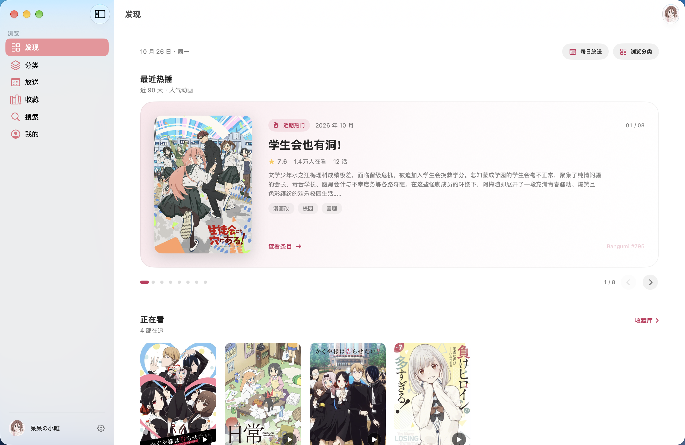
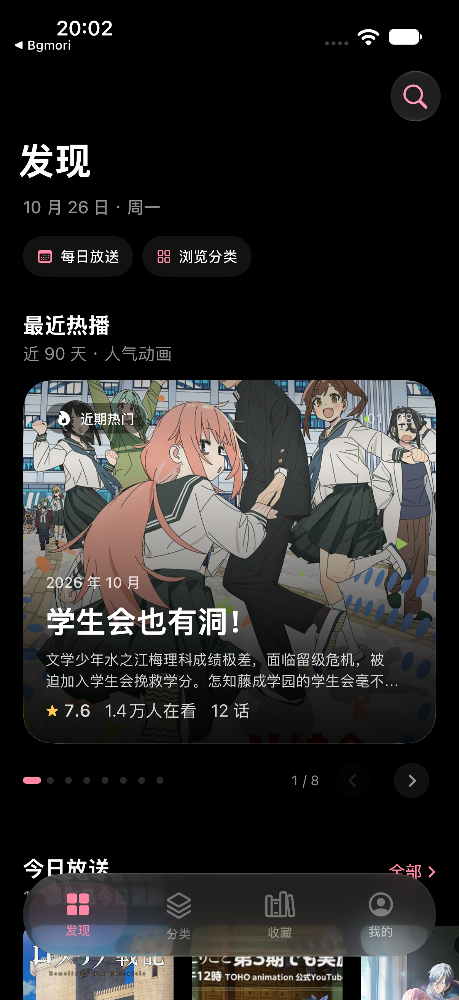
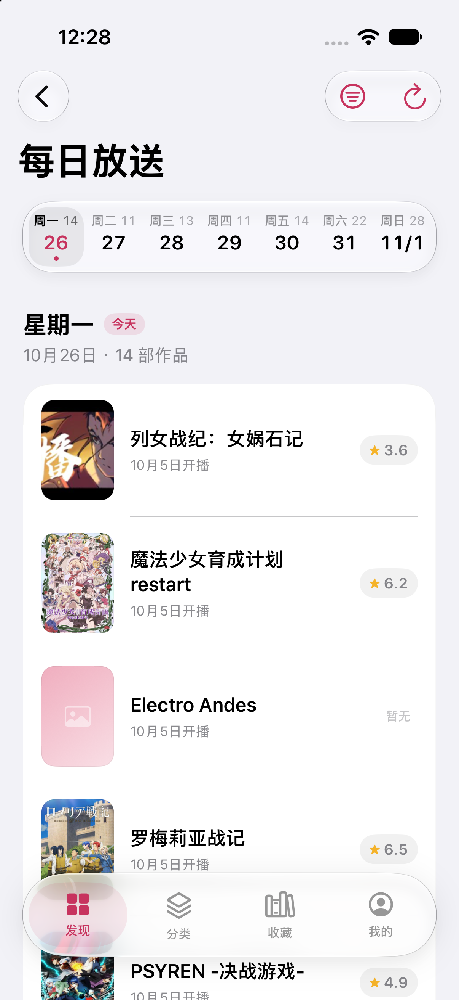
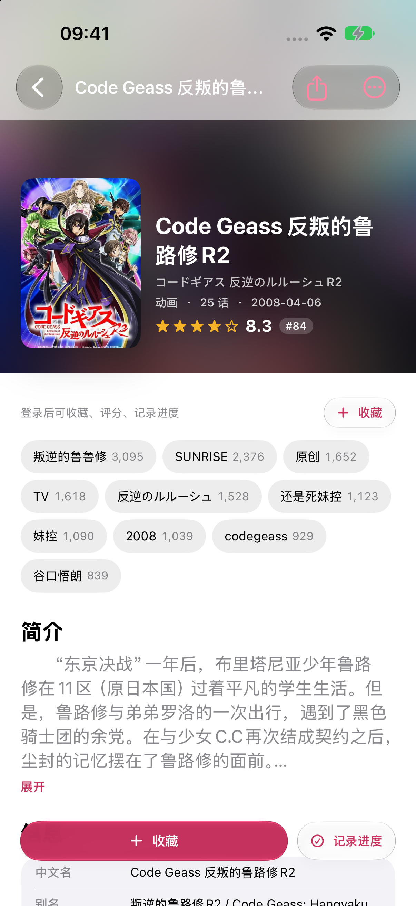
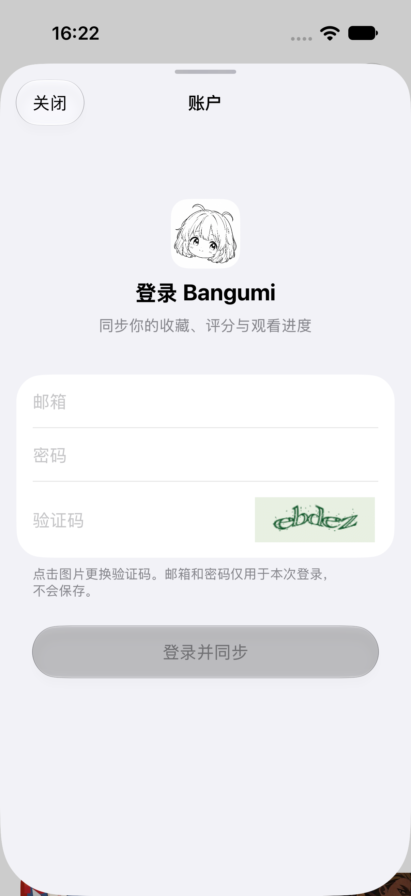
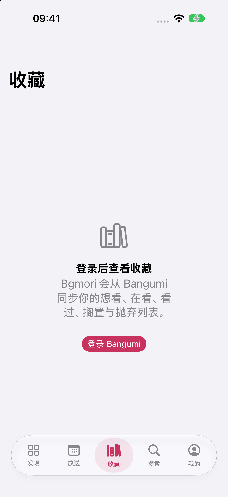
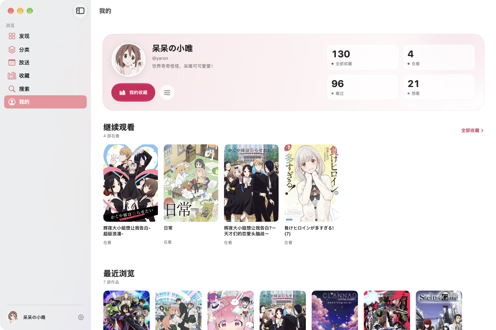

# Bgmori

> 一个原生、克制、带 Liquid Glass 质感的 Bangumi 客户端，支持 iPhone 与 Mac。
> **非官方第三方客户端，与 Bangumi 官方无关联。**

当前版本：`1.0.0 (1)` · 目标系统：**iOS 27 / macOS 27**（使用 Xcode 27.1 构建）



## 已实现

### 浏览

- [x] 发现：最近热播分页主视觉、正在看、今日放送、本季新番、口碑佳作、剧场版精选（社区入口已移出发现页）
- [x] 每日放送：周日期切换、今天高亮、只看在看、评分与观看进度；通过 bgmlist 为匹配到的新番补充北京时间的播放时刻，保留开播日期，支持缓存、失败重试与网页回退
- [x] 分类：动画 / 书籍 / 音乐 / 游戏 / 三次元，同步官网的分类、题材、来源、地区、受众及游戏平台等选项，支持搜索与组合筛选、年份筛选，按官网顺序提供排名 / 热度 / 收藏 / 日期 / 名称排序、滚动自动翻页
- [x] 条目详情：封面 Hero、评分/排名、标签、信息栏、章节、角色、制作人员、关联条目、吐槽预览；长列表保留预览，在下方显示剩余数量并展开全部，[两端浅深色截图](docs/screenshots/detail-section-previews/README.md)
- [x] 标签浏览：从条目标签进入对应作品列表，滚动自动翻页、加载期间只展示完整网格行，支持失败重试；详情标签显示标记本作的用户数，标签列表不显示加载数量
- [x] 章节详情：播出信息、时长、简介、吐槽
- [x] 角色 / 人物详情：简介、声优/职业、参与作品、收藏
- [x] 搜索：条目 / 角色 / 人物，类型、年份、排序筛选，最近搜索 / 浏览、分类入口与本周热门
- [x] 目录（Index）按 ID 查看、编辑历史（Revisions）只读
- [x] 小组、讨论话题、日志、时光机（HTML 匿名只读）
- [x] 深链：`bgmori://subject/8`、`bgmori://episode/1027`、`bgmori://user/sai` 等

### 收藏与账号

- [x] 应用内邮箱、密码、图片验证码登录：通过官网生成一年有效的个人令牌，无需配置 OAuth 或复制 Token
- [x] 密码不保存、临时 Cookie 会话隔离、令牌 Keychain 存储、过期与 401 处理；退出时后台撤销本次登录生成的令牌
- [x] 收藏状态：想看 / 看过 / 在看 / 搁置 / 抛弃；收藏编辑采用分段状态、十分制评分滑杆、进度条与轻量输入区，Mac 评分与进度并排；[两端浅深色截图](docs/screenshots/collection-editor/README.md)
- [x] 评分（1–10）、标签、短评、私密标记
- [x] 移除收藏入口：收藏列表的「…」菜单或编辑收藏页底部 → 前往 Bangumi 网页移除 → 返回自动同步（官方 API 暂未提供条目收藏删除接口）
- [x] 章节进度：单话切换、批量“看到第 N 话”
- [x] 书籍卷/话进度
- [x] 收藏库：网格采用对齐的两行标题、单行状态评分与短评预览，默认图文列表，显示个人评分、收藏更新日期与短评（空短评隐藏），顶部按动画 / 书籍 / 音乐 / 游戏 / 三次元分类，可组合收藏状态筛选、个人评分排序、可切换网格
- [x] 我的：账号概览、继续观看、最近浏览、评分分布与收藏构成、好友、角色 / 人物收藏、时光机与社区入口；[两端浅深色截图](docs/screenshots/profile-dashboard/README.md)
- [x] 我的评分：平均分、评分分布、按评分 / 更新 / 标题排序的短评列表
- [x] 本地缓存：API JSON 缓存、图片磁盘/内存缓存、离线可读
- [x] 网络与连接：API、图片和网页分别选择线路，有系统代理时优先通过代理连接官方、无代理时优先 ECH；失败冷却、成功线路复用、网络变化后重新检测；镜像目录在后台更新，凭证仅发送到官方或明确配置的自定义服务；支持仅官方、自定义服务、应用内加密 DNS、脱敏诊断与三项真实连接检测；[两端浅深色与验证说明](docs/screenshots/network-connections/README.md)
- [x] 本地每日放送通知（完全本地计算）

### 设计

- [x] 启动页：图标轻微呼吸，冷启动准备首屏数据与少量图片后切入；有缓存立即展示、后台静默刷新，首页按作品 ID 保留卡片与封面，文字独立更新；更换封面时保留旧图直到新图就绪，滚动期间暂缓更新；无缓存时保留加载与失败重试，支持减少动态效果；[启动页](docs/screenshots/startup/README.md) · [稳定刷新两端浅深色截图](docs/screenshots/stable-home-refresh/README.md)
- [x] 纯白底黑白漫画少女图标，附[源图与生成说明](docs/branding/README.md)
- [x] iOS 原生大标题与轻量搜索栏、分组列表、随系统字号缩放的内容层级；搜索与收藏的顶部控件独立布局，滚动内容在控件下方裁切
- [x] 发现页：最近热播每 6 秒自动轮播，支持双向循环滑动与圆点切换，清晰圆角封面配日期、简介与观看信息；书架评分统一放在封面下方，正在看默认隐藏逐话进度，可在设置中开启，支持长按／右键标记整部看过；角色和人物卡片优先加载大图并适配屏幕像素密度；[两端浅深色截图](docs/screenshots/home-cover-polish/README.md)
- [x] 搜索落地页：紧凑图标文字分类入口、行式灵感列表、最近浏览与热门书架；[两端浅深色截图](docs/screenshots/compact-browsing/README.md)
- [x] 年份选择使用紧凑滚动列表，弹窗缩窄、年份行距收紧，封面标题固定预留两行并在超长时省略；[两端浅深色截图](docs/screenshots/compact-browsing/README.md)
- [x] 收藏筛选对齐与层级、分类和搜索筛选面板、人物图完整缩放、最近浏览类型文字移至封面下方；[两端浅深色截图](docs/screenshots/filter-portrait-polish/README.md)
- [x] Mac 分类、收藏类型、搜索范围、周历和吐槽筛选使用原生工具栏的玻璃背景；收藏搜索使用较矮的普通输入框并限制宽度，账号导航使用轻量胶囊；[两端浅深色截图与窗口恢复检查](docs/screenshots/glass-hierarchy-restore/README.md)
- [x] 发现快捷入口与标题对齐，分类使用紧凑文字导航，放送使用轻量周历；手机分类筛选合并为一行，年份和排序收进筛选面板；[两端浅深色截图](docs/screenshots/page-navigation/README.md)
- [x] Liquid Glass：原生 Tab Bar / 导航栏、顶部搜索与筛选、分类与收藏切换、放送周历、吐槽筛选和收藏/进度等主要操作；正文、内联跳转、展开收起、分页圆点与次要操作保持轻量样式；[两端浅深色截图](docs/screenshots/glass-hierarchy-restore/README.md)
- [x] 我的页重做为个人仪表盘，新增好友、角色/人物收藏与本页评分列表；[两端浅深色截图](docs/screenshots/profile-dashboard/README.md)
- [x] iPhone 五栏导航：发现 / 分类 / 每日放送 / 收藏 / 我的；底栏使用系统原生 Liquid Glass 与内嵌胶囊选中态，右上角搜索；[两端浅深色截图](docs/screenshots/native-tabbar/README.md)
- [x] 封面取色英雄区、`backgroundExtensionEffect`
- [x] 浅色 / 深色 / 跟随系统
- [x] Dynamic Type、VoiceOver 标签、Reduce Transparency 降级
- [x] Mac 原生三栏 `NavigationSplitView`、菜单命令、⌘1–5 / ⌘R / ⌘,、Settings 场景

## 当前验证设备

当前仅要求适配和验收：**标准版 iPhone 17（iOS 27.0 模拟器）** 与 **用户当前这台 Mac（Apple M2、24 GB 内存，当前运行 macOS 27.0.1）**。默认不扩展其他机型和系统版本的测试矩阵；后续开发遵循 [AGENTS.md](AGENTS.md) 中的约束。部署目标仍为 iOS 27 / macOS 27。

## 运行

在当前 Mac 上构建并更新日常使用的应用：

```bash
bash scripts/build-install-macos.sh
```

脚本会构建 arm64 Mac 版本、校验本地签名、备份旧应用、替换 `/Applications/Bgmori.app` 并重新打开，最后比对安装包与构建产物。旧应用保存在 `~/Library/Application Support/Bgmori/BuildBackups/`。只执行 `xcodebuild` 会更新构建目录，不会替换「应用程序」里的副本。

在 iPhone 17 模拟器上构建、安装并启动：

```bash
bash scripts/build-install-ios.sh --route subject:8 --screenshot /tmp/bgmori.png
```

脚本把 DerivedData 固定为当前 checkout 的 `build/DerivedData-ios`。DerivedData 目录名由工程绝对路径决定，每个 checkout / git worktree 各一份，而副本的 Bundle ID 都是 `com.yaron.bgmori`；用 `find ~/Library/Developer/Xcode/DerivedData/Bgmori-* … | head -1` 猜路径很容易把主工作树的旧安装包装进模拟器。脚本安装后会比对二进制哈希与构建号，构建号同时显示在「设置 → 关于软件」的版本里。

### 开发文件自动保留规则

构建、安装和 UI 测试脚本需要 Python 3（仅使用标准库），并在运行时自动回收过期开发产物：

| 文件 | 保留规则 |
| --- | --- |
| Mac 旧应用备份 | 最新 2 份，成功安装后再次回收 |
| UI 测试报告 `build/ui-results/` | 最多 3 次、合计 1 GiB、最多 7 天；超大单次报告同样会回收 |
| iPhone / Mac 编译缓存 | 分别复用固定目录；合计超过 4 GiB 时，在没有构建运行的维护点回收旧缓存 |
| 受管理的临时构建目录 `build/tmp/` | 正常退出时删除；遗留 7 天后回收，活跃任务保留 |
| 安装构建日志 `build/logs/` | 两端分别覆盖自己的最新日志 |

自动回收直接删除以上过期文件，不会移入废纸篓继续占用空间。执行中的构建和测试可能暂时超限；维护在下次运行这些脚本时触发，不是后台磁盘配额服务。源码、正式截图、应用数据、已安装应用、全局工具缓存和模拟器系统不在自动清理范围。

可随时预览或执行相同规则：

```bash
python3 scripts/maintain-dev-storage.py          # 仅预览
python3 scripts/maintain-dev-storage.py --apply  # 永久回收过期开发产物
```

UI 测试默认自动创建 `build/ui-results/<时间戳>/`。如需命名，`BGMORI_UI_RESULT_DIR` 必须指定该目录下尚不存在的直接子目录；需要长期保留的少量截图应复制到 `docs/screenshots/`。

工程文件由 XcodeGen 生成、不入库；新 clone 或新工作树里没有 `Bgmori.xcodeproj` 是正常的（`scripts/build-install-*.sh` 会自动生成）。

```bash
cd Bgmori
xcodegen generate --spec project.yml --project .
open Bgmori.xcodeproj
```

1. 选择 `Bgmori` scheme。
2. iOS 选择 `iPhone 17 (iOS 27.0)` 模拟器；Mac 选择当前这台 `My Mac`。
3. 真机运行需要在 Signing & Capabilities 里选择自己的 Team。
4. 最低系统：iOS 27 / macOS 27。若 Xcode 没有 iOS 27 运行时，请在 Xcode → Settings → Components 中安装。

命令行构建：

```bash
# iOS 模拟器
xcodebuild -project Bgmori.xcodeproj -scheme Bgmori \
  -destination 'platform=iOS Simulator,name=iPhone 17,OS=27.0' \
  -derivedDataPath build/DerivedData-ios \
  CODE_SIGNING_ALLOWED=NO build

# macOS
xcodebuild -project Bgmori.xcodeproj -scheme Bgmori \
  -destination 'platform=macOS,arch=arm64' -derivedDataPath build/DerivedData-mac CODE_SIGNING_ALLOWED=NO build
```

分类页的官网分类解析、组合筛选、翻页、缓存和切换保护可用 `bash scripts/test-categories.sh` 验证；加上 `--live` 会读取五类官网筛选目录，并用真实 API 检查公共标签组合与翻页。官网分类目录缓存一天，也可在筛选面板的菜单中手动同步；同步失败时支持重试或在浏览器中查看。

官网热度或名称排序遇到网页验证时，分类页会保留年份、标签和分类组合，自动改用公开 API 的收藏排序并提示；后续翻页保持该排序，刷新时重新尝试官网排序。可用 `bash scripts/test-categories.sh --live-filtered` 检查真实年份、分类组合和连续翻页。

导航回归检查：`bash scripts/test-navigation.sh`，分别运行 Mac 与 iPhone 17 模拟器上的搜索、放送、日志详情和返回路径检查。

界面回归检查：`bash scripts/test-shell-ui.sh`（也可指定 `ios` 或 `mac`），使用临时工程验证栏目切换、搜索历史、详情返回、后台返回和真实吐槽的浅深色显示，不改动仓库工程与签名设置；[修复说明与两端截图](docs/screenshots/navigation-comments-fix/README.md)。

日志解析检查：`bash scripts/test-social.sh`；加上 `--live` 会读取真实日志列表并验证三篇仍可访问的正文，列表中已删除的日志会明确跳过。

镜像接入检查：`bash scripts/test-mirrors.sh --live`，在 Mac 与 iPhone 17 上验证域名更新、目录缓存、ETag、读取回退、人机验证识别、写请求不重放，以及真实条目和封面加载。来源说明统一位于「设置 → 关于软件」；普通页面移除常驻网页按钮，解析失败时才提供网页回退，正文链接与必要的网页操作仍保留。

连接策略检查：`bash scripts/test-connections.sh --live`，验证线路隔离、凭证保护、配置持久化、网络恢复、请求时限、取消、图片并发，以及启用应用内加密 DNS 后的新连接。`bash scripts/check-native-ech.sh` 检查当前 SDK 的 ECH 接口可用性。连接设置的真实浅深色 UI 检查：`bash scripts/test-shell-ui.sh all testConnectionsLightAndDark`。

## ECH 国内加密直连

自动模式检测到适用于请求地址的系统代理时，优先由系统连接官方，遵循 HTTP/HTTPS、SOCKS、PAC 和直连例外设置；无代理时优先使用 ECH，失败后尝试其他可用线路。代理启停后会重新评估优先级，不受之前成功线路或失败冷却的影响。「设置 → 网络与连接 → 加密直连（ECH）」可强制只用 ECH，失败时不会借用普通连接或镜像。仅 ECH 线路直接连接 Cloudflare IP，使用加密握手并按真实域名验证证书，绑定物理 Wi-Fi/以太网或蜂窝接口，绕过本应用的 HTTP/SOCKS 代理和 TUN 路由，不修改其他软件的网络设置。

验证：`bash scripts/test-ech.sh --live`；两端严格 ECH UI：`bash scripts/test-shell-ui.sh all testECHOnlyConnectionsLightAndDark`。应同时看到握手被接受、Cloudflare `sni=encrypted` 和物理接口；[实现与国内网络验证记录](docs/screenshots/ech-direct/README.md)。

系统代理验收：启用系统代理后运行 `bash scripts/test-ech.sh --live-proxy`，在 Mac 与 iPhone 17 模拟器读取真实条目、网页、封面和登录页，并检查 URLSession 的连接指标确认 API、图片和网页确实经过代理；环境未配置适用代理时会明确跳过真实代理检查。普通回归同时覆盖代理启停、旧线路与冷却失效、严格 ECH 不回退以及自定义服务优先级。

账号登录在应用内完成，验证码、登录表单和令牌创建均可走 ECH；密码不会发送到社区镜像或自定义服务，临时 Cookie 不参与匿名网页浏览。

## 账号登录

在「我的 → 登录 Bangumi」填写邮箱、密码和图片验证码即可。登录成功后由应用创建一年有效的个人令牌并存入钥匙串；无需注册 OAuth 应用或手动复制 Token。点击验证码图片可换图。密码仅在本次操作中使用，临时 Cookie 在完成或关闭登录页时清除。

账号请求只走官方或 ECH，固定同一条线路完成会话，不发送到社区镜像和自定义服务；不自动重放密码或创建令牌的 POST。验证码错误会换图；令牌创建成功而账户验证临时失败时，重试只验证已有令牌。退出时清除本地登录，并尝试在后台撤销这次登录生成的令牌；网络不可达时服务器上的令牌仍可能有效，直至撤销或到期。

验证：`bash scripts/test-web-login.sh` 运行两端本地协议桩流程；`bash scripts/test-web-login.sh --live` 在严格 ECH 模式下读取真实登录页与验证码，不提交账号密码；`bash scripts/test-shell-ui.sh all testDirectLoginLightAndDark` 检查两端浅深色界面。[截图和验证边界](docs/screenshots/direct-login/README.md)。

## 给 AI 代理的说明

仓库根目录有 `AGENTS.md`，里面是构建命令、目录约定、Liquid Glass 规则、密钥策略和已知坑。用 Codex 继续开发时，直接在仓库根目录启动即可，它会自动读取；Claude Code / Cursor / Copilot 也能识别这个文件。

## 目录结构

```
Bgmori/
├─ App/                  入口、Root Shell、路由、AppModel
├─ Core/
│  ├─ API/               URLSession API 客户端、限流、缓存、错误
│  ├─ Auth/              账号登录、临时会话、Keychain
│  ├─ Models/            Bangumi DTO
│  ├─ Settings/          外观与内容配置
│  ├─ Social/            HTML 解析（吐槽/小组/日志/时光机）
│  └─ Storage/           收藏状态、图片缓存、本地通知
├─ Design/               Tokens、玻璃组件、通用卡片
├─ Features/             Home / Calendar / Library / Search / Subject / Episode / Person / Profile / Social / Settings
└─ Resources/            Assets、Info.plist
```

界面、普通网络、图片缓存和 HTML 适配使用 Apple 原生框架。ECH 加密直连额外嵌入 Go 标准库静态连接层，无外部 Go 模块；构建需要 **Go 1.27+**。Xcode 自动执行 `scripts/build-ech-library.sh`，分别生成 arm64 Mac、iPhone 模拟器和 iPhone 真机所需的库；产物位于忽略入库的 `build/ech/`，源码在 `Native/ECH/`，许可证随应用提供。

## 已知限制

- 官方 API 没有评论/小组/日志/发布接口；这些页面采用 **匿名 HTML 只读解析**，页面结构变化时可能失效，失效会回退到 Safari。
- 不支持发吐槽、回帖、发日志、发话题、提醒、维基编辑（没有公开写接口）。好友列表与角色/人物收藏为只读，不支持添加好友、好友动态或写操作。
- 审核/公开分发需要处理 Bangumi 商标、UGC 举报与 R18 过滤；当前是私人使用版本，默认关闭 NSFW，设置里可手动开启。
- 系统级 Widget、App Intents、Handoff、Spotlight 尚未接入；当前版本聚焦客户端本体。
- iPhone 底栏按用户指定改为系统原生 Tab Bar。早期模拟器曾出现截图图标重影，当前以本次原生底栏截图和真机表现为准。
- 已适配 Mac 原生窗口，侧栏明确显示图标与文字并独立着色；[台前调度恢复检查](docs/screenshots/stage-manager-sidebar/README.md)。多窗口尚未做专门优化。

## 截图

| 发现（深色） | 放送 | 搜索 |
| --- | --- | --- |
|  |  |  |

发现页改版的 Mac 浅深色首屏、板块长页与 iPhone 浅深色截图见 [discover-redesign](docs/screenshots/discover-redesign/README.md)。每日放送的周历、卡片细节与 Mac 截图见 [calendar-refresh](docs/screenshots/calendar-refresh/README.md)。

| 条目 | 吐槽 | 登录 |
| --- | --- | --- |
|  |  |  |

| 收藏（游客） | 我的（Mac） | 设置 |
| --- | --- | --- |
|  |  |  |

我的页的浅深色、概览、好友、人物收藏与评分列表见 [profile-dashboard](docs/screenshots/profile-dashboard/README.md)。

## 致谢

- 数据与内容：<https://bgm.tv>
- API 文档：<https://github.com/bangumi/api>
- 新番播放时刻：[bgmlist](https://bgmlist.com)，其数据来自 [bangumi-data](https://github.com/bangumi-data/bangumi-data)（CC BY 4.0）；仅接入 bgmlist 的公开 on-air 接口。
- 设计参考：Apple Human Interface Guidelines · Liquid Glass
