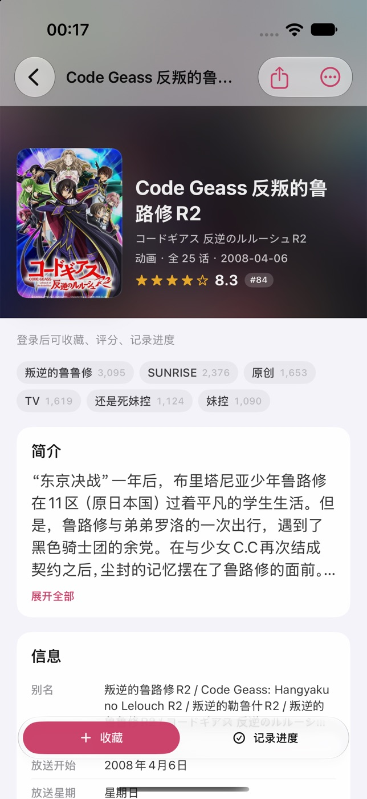
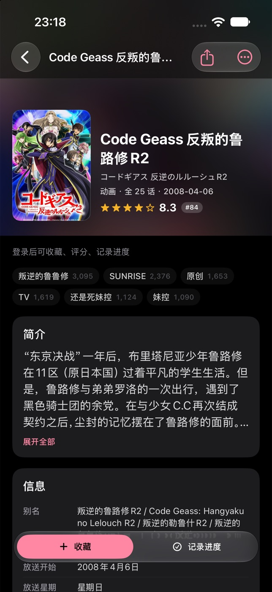
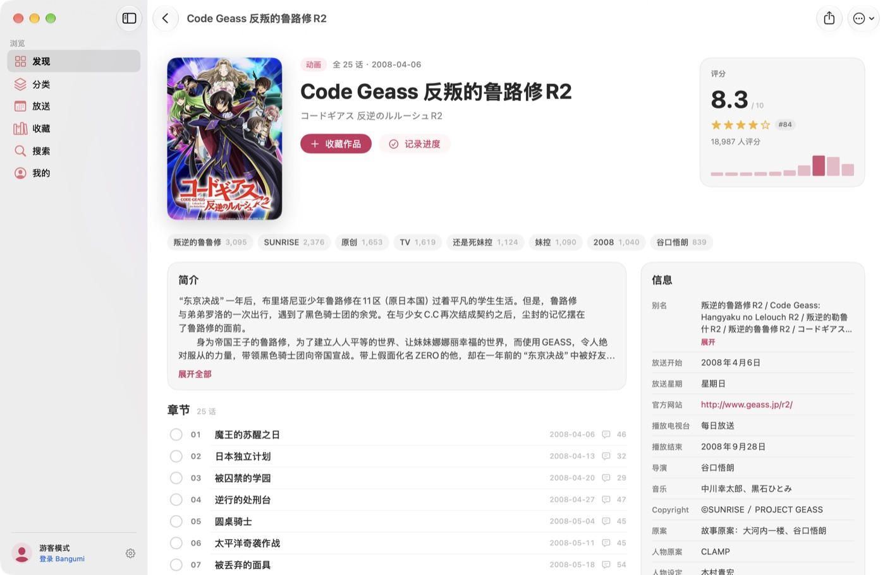
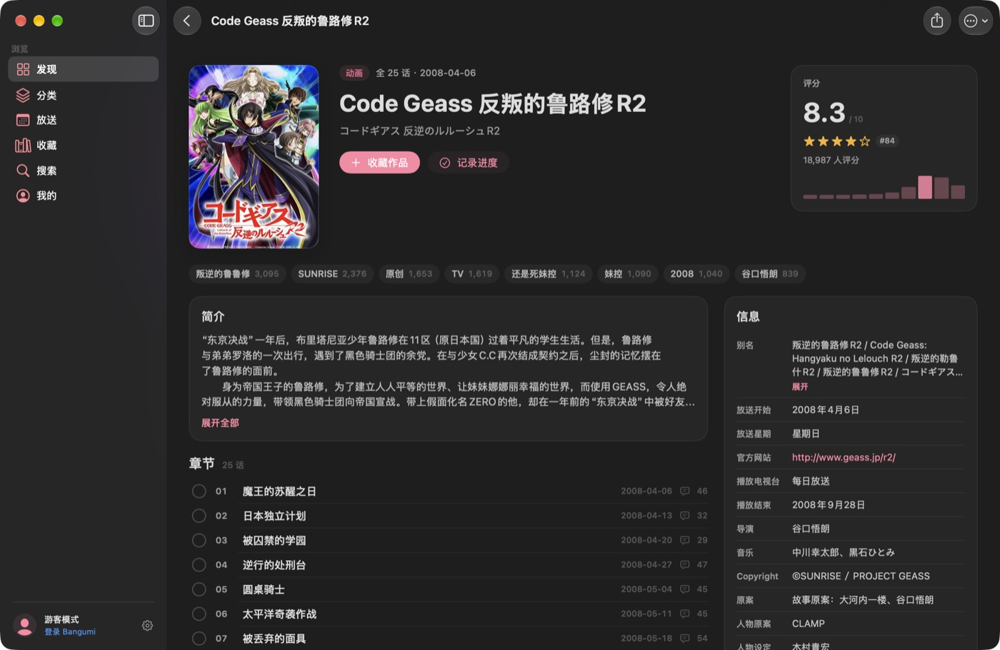
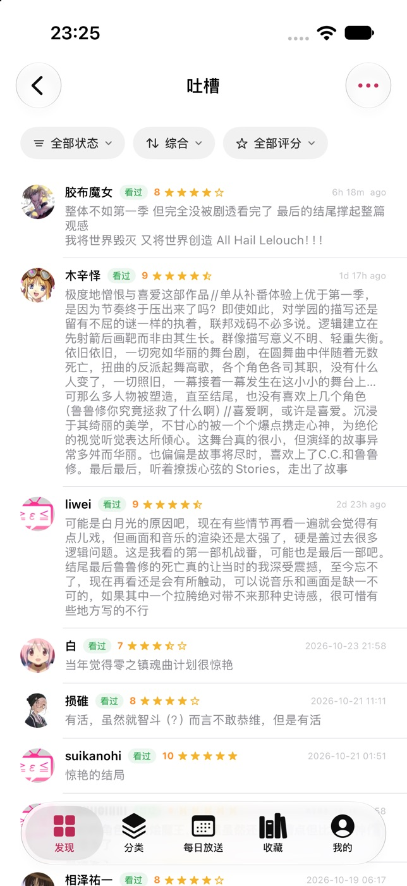

# 缓存优先加载验证

验证日期：2026-10-27。设备与系统：iPhone 17（iOS 27.0 模拟器）、当前 Mac（Mac14,2 / Apple M2 / macOS 27.0.1）。

## 截图

| 页面 | 浅色 | 深色 |
| --- | --- | --- |
| 条目（iPhone，第二次启动 1 秒截图） |  |  |
| 分类（iPhone） |  |  |
| 我的（iPhone，游客） |  |  |
| 条目（Mac） |  |  |

条目吐槽页使用真实公开数据解析：。Mac 首页：。

## 可控网络测试

`bash scripts/test-cache.sh` 使用 `URLProtocol` 桩，不修改系统网络设置、不使用真实凭证：

- 无缓存请求：网络桩延迟 2 秒。
- 旧缓存：缓存文件时间回拨 2 天。
- 收藏库：3 页共 120 条，每页延迟 120 毫秒；章节进度延迟 1.5 秒。

修改前基线（同一延迟 2 秒的网络桩）：过期缓存要等网络失败/完成才返回，耗时 **2.129 秒**。
修改后：`cachedSubject` 立即返回旧内容 **0.001 秒**，后台网络刷新 **1.283 秒**；刷新成功前旧内容保持可见。

收藏库：完整 120 条同步 **0.582–0.590 秒**（章节进度在后台继续）；第二实例从账号快照恢复 **0.002–0.005 秒**。分页第二页失败时保留上一份完整快照；首次同步中途失败不发布部分结果；切换账号后旧账号的迟到响应不会写回。

完整输出见测试日志；截图为本机实际运行结果，不包含登录凭证。

## 动画

发现页缓存内容被后台刷新结果替换时，旧内容与新内容做 0.5 秒 `easeInOut` 交叉淡化；首屏板块、正在看、今日放送等从无到有或从有到无时，以 0.42 秒透明度 + 0.985 缩放过渡进入，避免硬插入。`正在看` 的卡片列表也走同一套交叉淡化，进度或列表变化不会瞬间替换。开启“减少动态效果”时保持即时更新。
