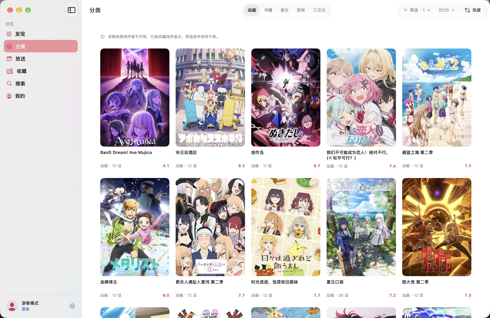
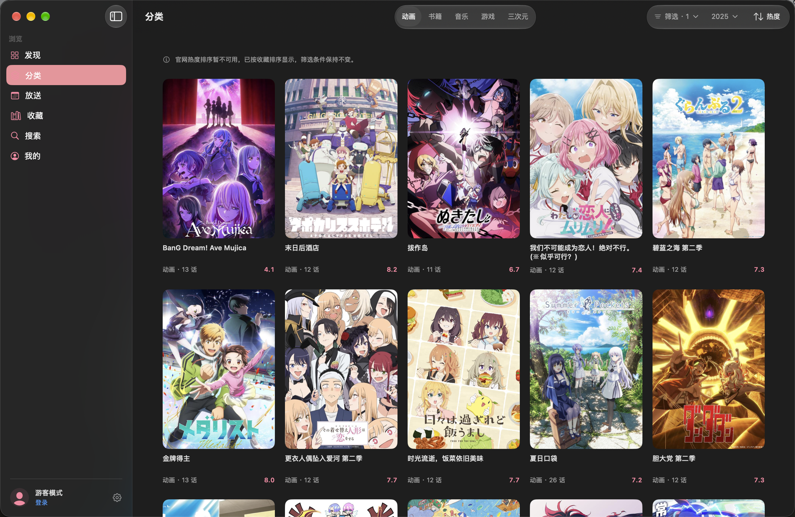

# 分类筛选遇到网页验证时自动回退

官网未筛选的热度页可以读取，但加上年份或分类路径后返回网页验证，导致原来的默认热度排序无法显示结果。

分类页现在会在热度或名称排序遇到验证、权限限制时，保留全部筛选条件，从第一页改用公开 API 的收藏排序，并在列表上方说明。后续分页、分页重试与缓存记录使用同一排序，防止拼接不同排序的结果。刷新时重新尝试官网；失败仍保留浏览器回退。

验证：

- `bash scripts/test-categories.sh`：验证拦截、组合筛选、分页游标、重试、缓存排序和官网恢复，以及原有分类回归通过。
- `bash scripts/test-categories.sh --live-filtered`：真实 2020 年、TV、2020 年＋TV＋科幻，以及名称排序的筛选通过；结果超过一页时检查连续分页，终页检查不再请求下一页。
- `bash scripts/test-shell-ui.sh all testCategoryFilteredResultsLightAndDark`：iPhone 17 / iOS 27.0 和当前 Mac / arm64，浅深色实际选择年份后再选择 TV，均显示作品；两端各 1 项测试，0 失败。
- `bash scripts/build-install-ios.sh --route categories` 与 `bash scripts/build-install-macos.sh`：构建、安装成功。

| 平台 | 浅色 | 深色 |
| --- | --- | --- |
| iPhone |  |  |
| Mac |  |  |
