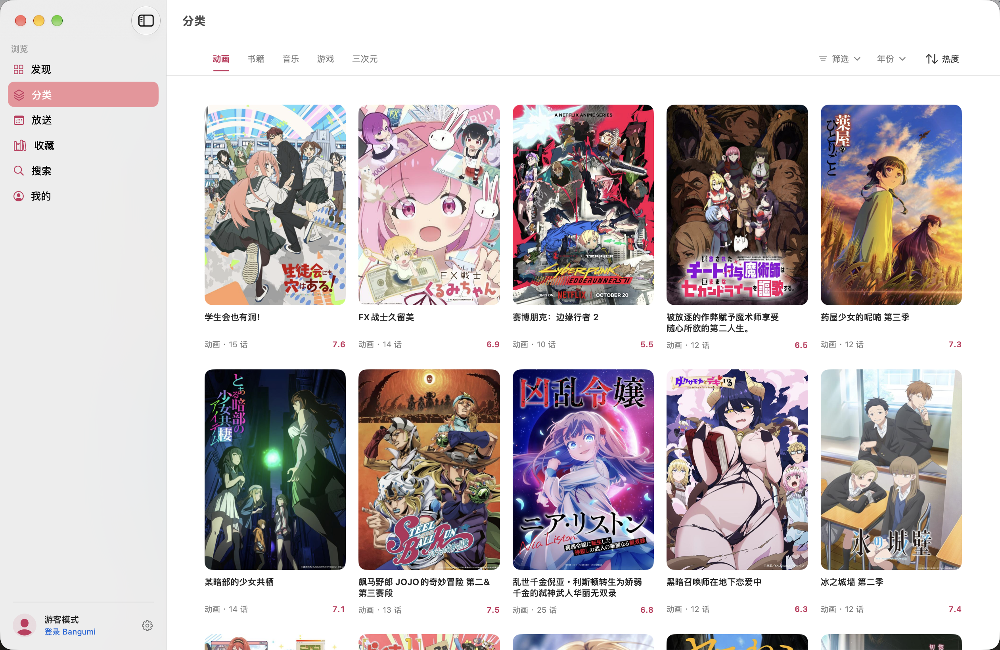
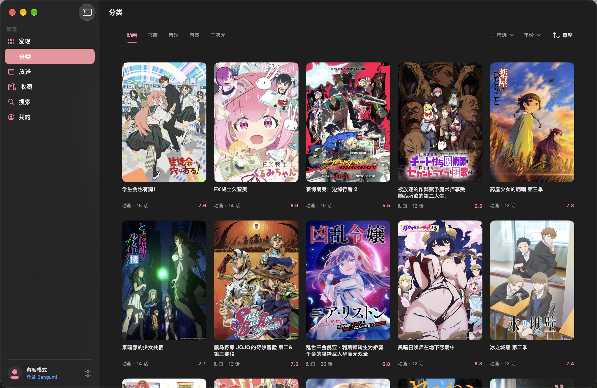

# 分类分页衔接（2026-10-28）

分类网格原先只在底部分页控件进入屏幕后加载下一页。每页经过内容过滤和去重，数量也不一定能整除当前列数，因此加载时末行会留下几个空位。

现在距离底部不足一屏时提前请求下一页，并且始终按整行展示真实作品。不足一行的作品保留在后台，等下一批补齐后一起显示；最后一页按实际作品数量展示。窗口改变列数时重新计算整行，保留所有已加载作品及其顺序。分页失败仍保留已展示的整行与后台作品，支持重试。

验证命令：

```bash
bash scripts/test-categories.sh
bash scripts/test-shell-ui.sh all testCategoryPaginationLightAndDark
bash scripts/build-install-ios.sh --route categories
bash scripts/build-install-macos.sh
```

UI 检查使用真实分类数据，确认网格能连续展示超过单页上限（24）的实际作品卡片。以下截图展示多页内容的浅色、深色界面。

分页回归还验证了：首批 23 个作品在五列下展示 20 个，余下 3 个保留；下一批 2 个到达后按原顺序补齐为 25 个。改变列数、分页失败重试，以及最后不足一行时均保留全部作品。

| iPhone 17 / iOS 27.0 | 当前 Mac / arm64 |
| --- | --- |
|  |  |
|  |  |
