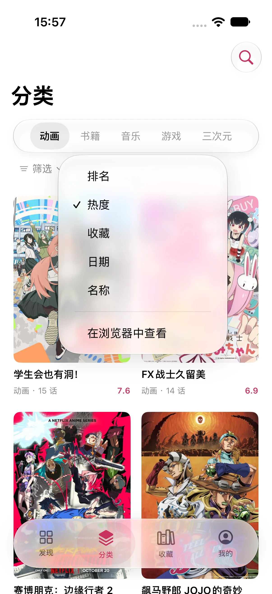
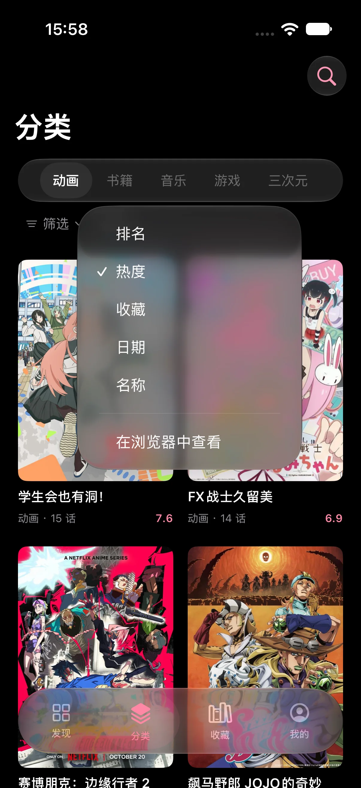
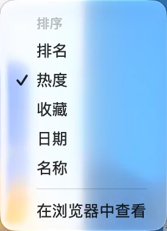
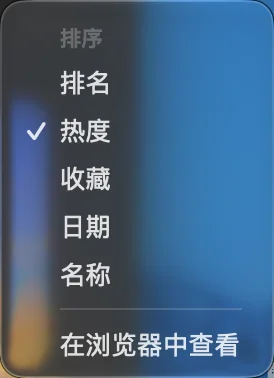
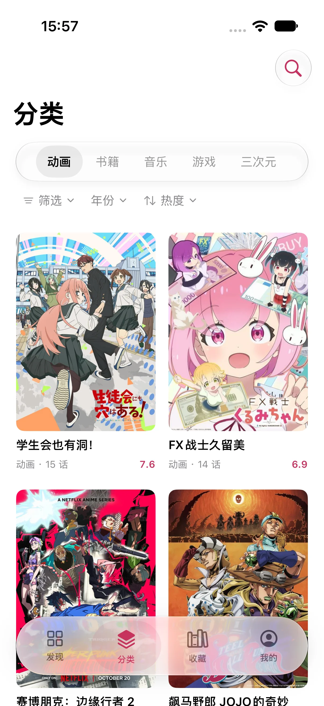
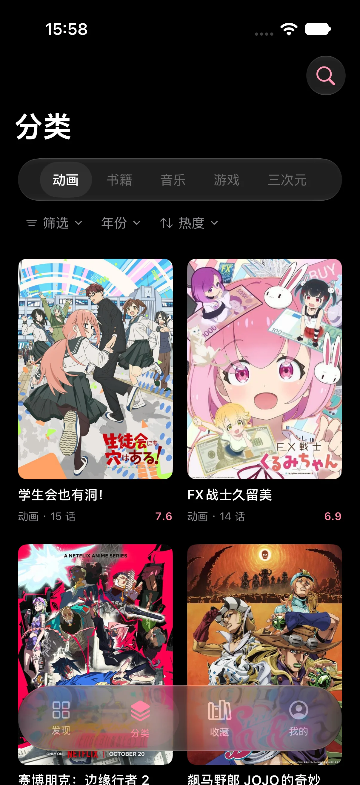
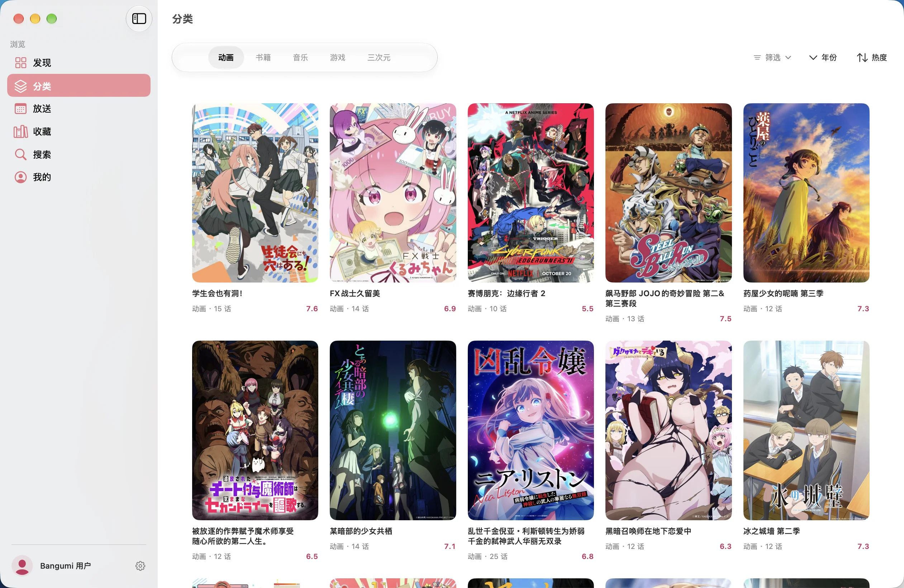
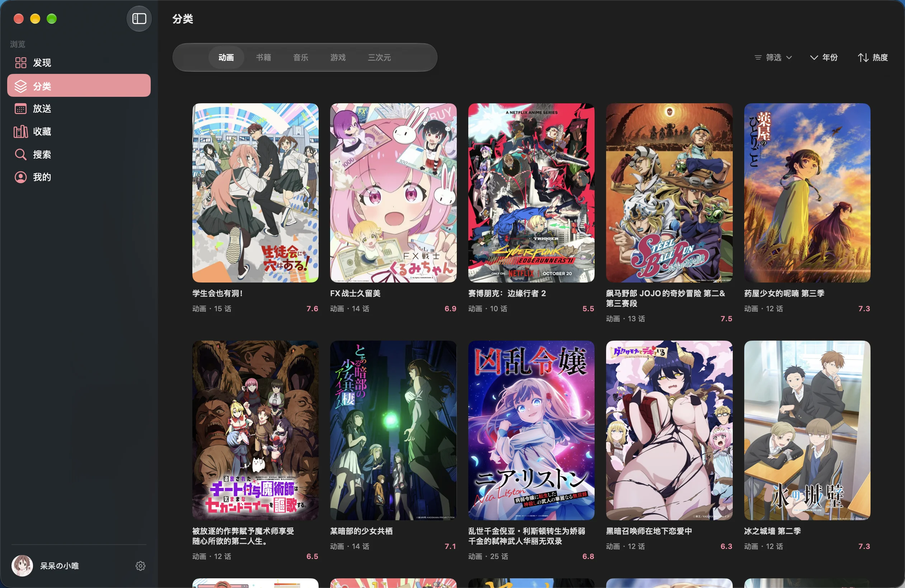

# 分类排序

分类页按 [Bangumi 官网](https://bgm.tv/anime/browser?sort=trends) 的顺序提供：**排名、热度、收藏、日期、名称**，默认选择热度。iPhone 与 Mac 共用排序模型，菜单直接展示五项。

热度使用官网近期热度顺序，与收藏人数排序分开；名称同样保留官网顺序。排名和收藏使用公开搜索接口，日期使用公开浏览接口，游客也能使用。组合筛选保留原有顺序，翻页按来源消费的条目数推进；网页读取或解析失败时可重试，也可打开对应网页。

2026-10-26 验证：

- iPhone 17 / iOS 27.0 与当前 Mac / arm64 的 Debug 构建通过。
- 两端 UI 检查通过：浅色、深色下显示五项，并逐项切换。
- `bash scripts/test-categories.sh` 通过，覆盖排序映射、HTML 解析、并发读取后保留顺序、组合筛选、完整标签检索、跨页读取，以及筛选后空页继续翻页。
- `bash scripts/test-categories.sh --live` 通过，核对真实官网热度与名称顺序、公开接口日期降序，以及原有五类筛选目录、组合筛选和分页。

| 平台 | 浅色菜单 | 深色菜单 |
| --- | --- | --- |
| iPhone 17 |  |  |
| 当前 Mac |  |  |

| 平台 | 浅色页面 | 深色页面 |
| --- | --- | --- |
| iPhone 17 |  |  |
| 当前 Mac |  |  |
