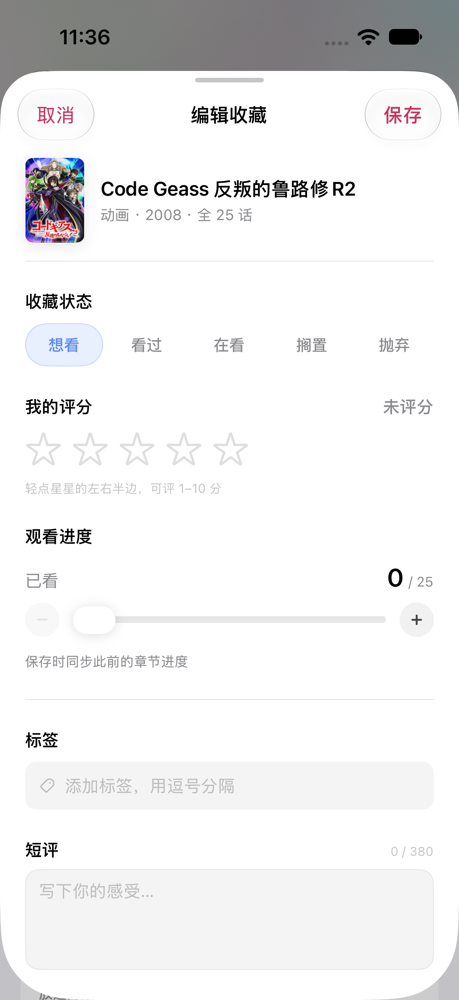
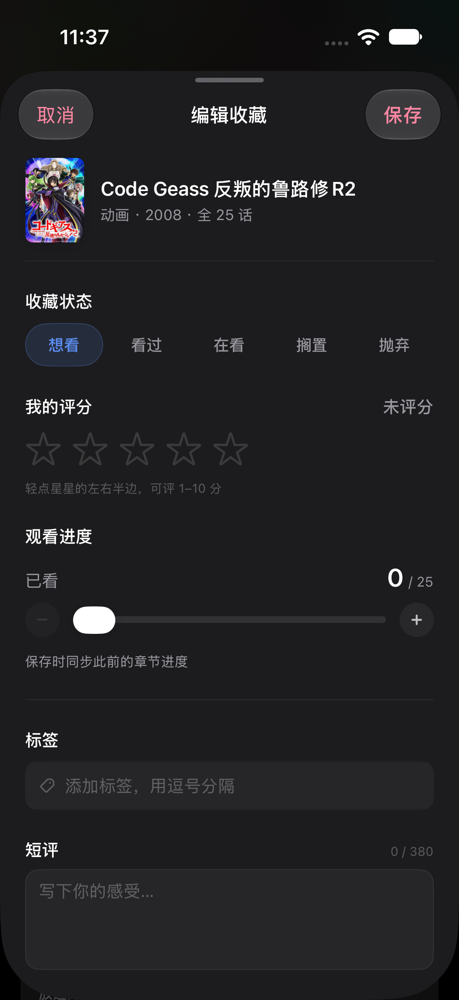
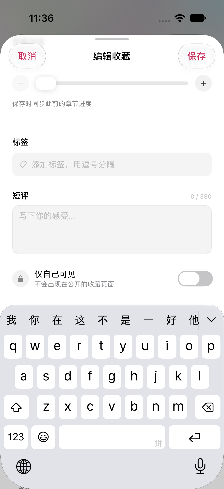
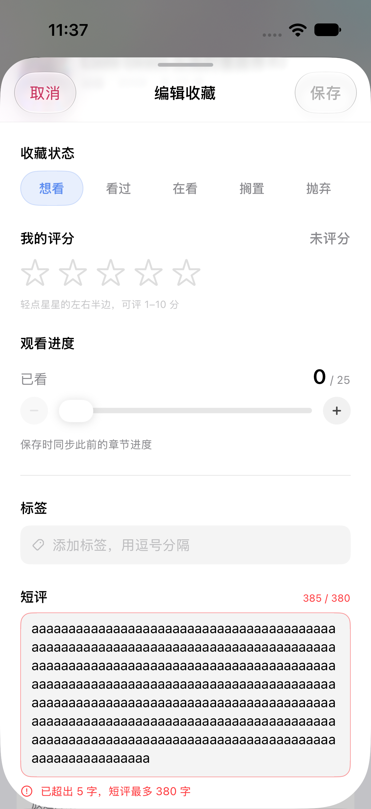
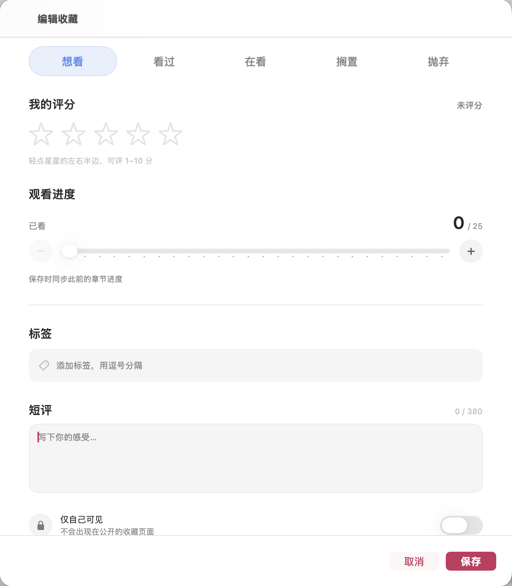
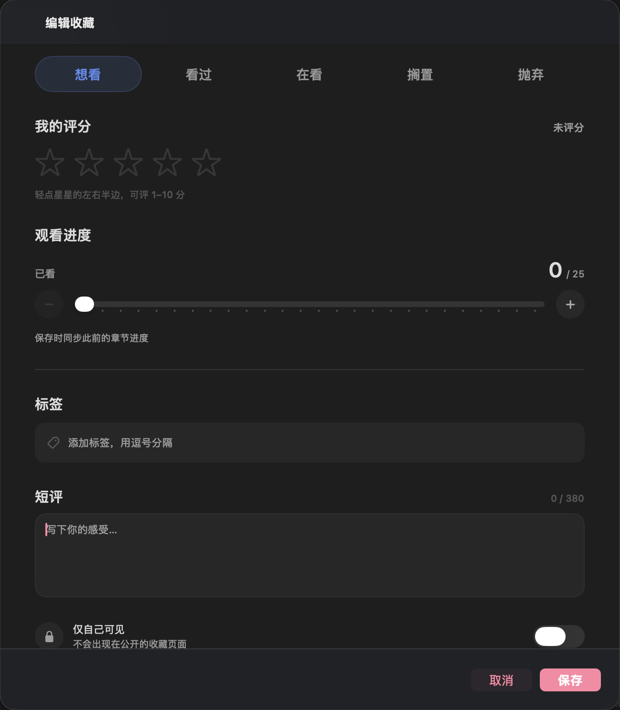

# 短评输入框与 380 字上限 · 2026-11-09

## 问题

用户反馈收藏编辑页的「短评」输入框有问题，而且没有 Bangumi 网站上的字数限制。

- 聚焦时输入框里同时出现粉色光标和灰色占位提示，两者还错开：截图像素测量显示光标从 `padding(8)` 起排，占位提示按 `padding(13)` 摆放，Mac 上纵向差约 5pt、横向约 1pt，看起来像一条悬空的竖线。
- 计数器只在有内容时显示 `N 字`，没有上限，`save()` 也不校验。v0 API 文档里 `comment` 没有 `maxLength`，服务端也只检查可见字符，所以超限内容能真的写进账号。
- iPhone 键盘弹起后不会把焦点字段滚进可见区域，光标藏在键盘下面。
- 730pt 高的 Mac sheet 比默认 1280×820 窗口高约 27pt，底部按钮被窗口边缘裁掉。

## 上限是 380 字

- 官方 iOS 客户端对这个字段就是 `wordLimit: 380`，超过 380 字时禁用提交。
- 抽样 30 个热门条目的 300 条公开短评：最长正好 380 字（4 条），没有一条更长。

## 修复

- `TextEditor` 换成 `TextField(axis: .vertical)`：占位提示由系统控件绘制，和光标共用同一文字容器，永远在同一条基线上；高度按 3–8 行随内容增长，也不再在滚动页里嵌一层滚动视图。
- 计数器常显 `n / 380`；超过 380 字时计数变红、输入框描边变红，并显示「已超出 N 字」，保存按钮同时禁用。保存前去掉首尾空白。
- 380 这个数字集中到 `CollectionCommentRules`（`Core/Models`），带纯逻辑用例。
- iPhone 聚焦短评后主动滚动，输入框不会被键盘挡住。
- Mac sheet 高度 730 → 680，完整落在默认窗口内。

## 截图

| iPhone 浅色 | iPhone 深色 |
| --- | --- |
|  |  |

| iPhone 聚焦 | iPhone 超出 380 字 |
| --- | --- |
|  |  |

| Mac 浅色 | Mac 深色 |
| --- | --- |
|  |  |

Mac 超出上限：[mac-overflow.png](mac-overflow.png)。

## 验证

- `bash scripts/test-shell-ui.sh all testCollectionCommentLimitLightAndDark`
  - iPhone 17 / iOS 27.0：通过；本机 Mac（arm64）：通过。
  - 断言：输入 385 字后计数为 `385 / 380`、保存禁用、超限提示存在；删掉 5 字回到 `380 / 380`、保存恢复可用；聚焦后输入框仍可见。
- `bash scripts/test-collection-presentation.sh`：380 字边界与首尾空白 trim 用例通过。
- Debug 构建：iPhone 17 / iOS 27.0 模拟器与当前这台 Mac 均通过。
- 截图由 UI 测试通过 `BGMORI_PREVIEW_COLLECTION_EDITOR=1` 以游客态直接打开编辑页得到：没有登录、没有提交任何收藏，短评内容是测试输入的占位字符。
