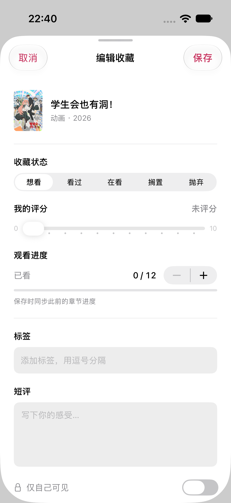
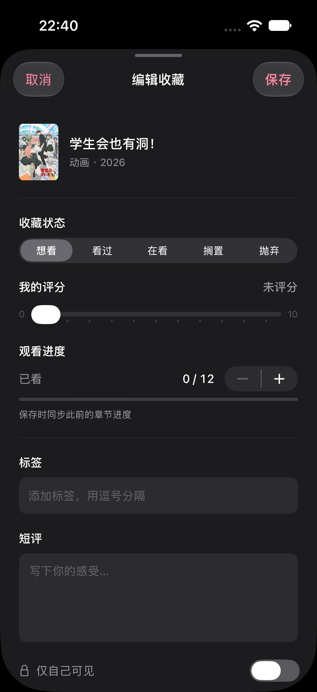
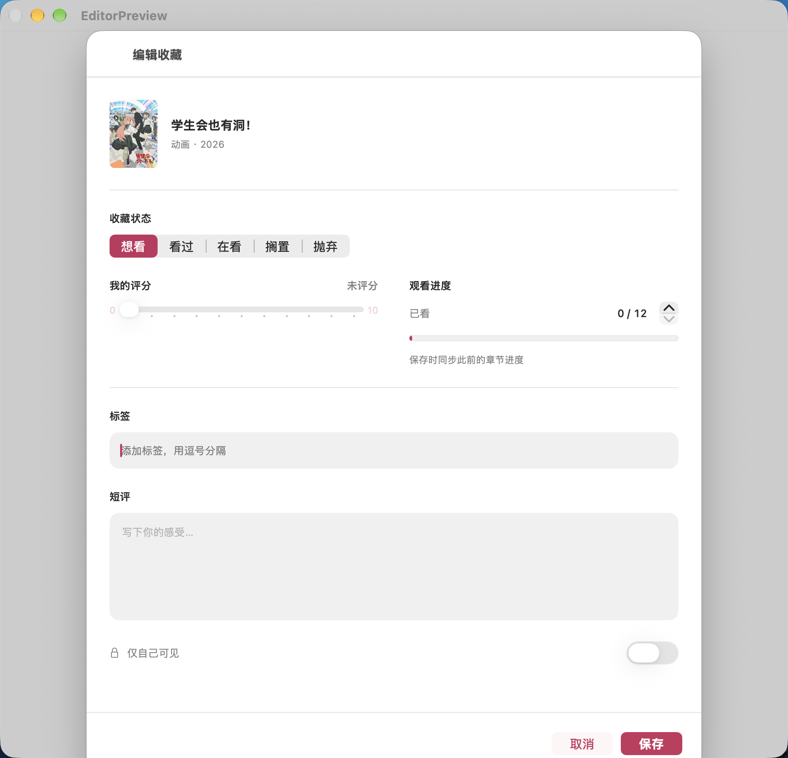
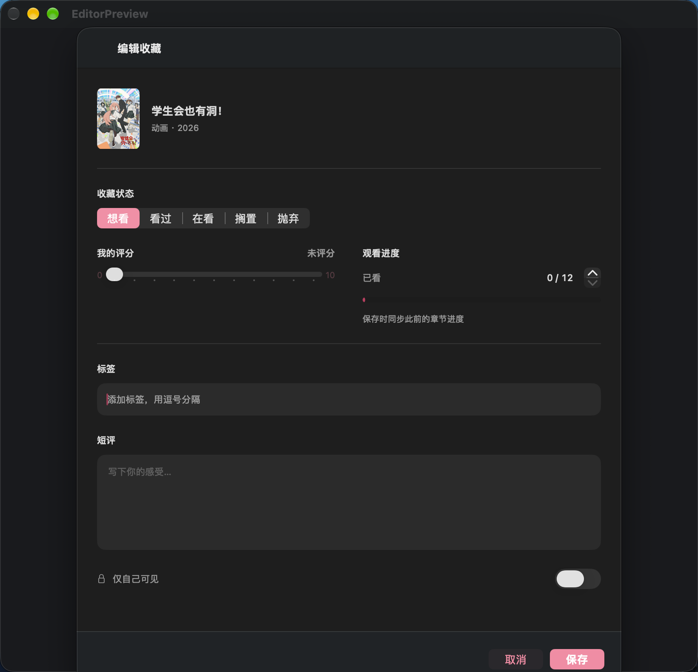

# 收藏编辑页排版 · 2026-10-26

收藏编辑页改为轻量表单。顶部用小封面和作品名明确编辑对象，状态改为原生分段选择；评分使用 0–10 分、每次一分的滑杆，支持清除评分。观看 / 阅读进度独立显示数字、步进控件和进度条。Mac 将评分与进度并排，手机按阅读顺序纵向排列。

标签输入改为简短的单行提示，输入后显示标签，并按原顺序去重。短评使用统一的浅色 / 深色输入背景与空白提示，移除原来突兀的白色内框。私密开关独立对齐，不再包在整块灰底中。保存中禁用编辑与退出，失败时继续显示错误并可再次保存。

同时修复书籍打开编辑页时，已有话数可能被动画章节数量错误清零的问题；动画编辑会读取当前章节进度。

| iPhone 浅色 | iPhone 深色 |
| --- | --- |
|  |  |

| Mac 浅色 | Mac 深色 |
| --- | --- |
|  |  |

书籍进度样例：[iPhone](iphone-book.png)、[Mac](mac-book.png)。

上方样式截图和输入检查使用仓库中同一份 `CollectionEditorView` 源码构建的独立本地预览。作品资料取自公开缓存，书籍进度和短评是本地样例；没有保存到账号，也没有测试远端写入。Mac 本地预览隔离了凭据读取。

验证范围为 iPhone 17 / iOS 27.0 模拟器与当前 arm64 Mac；正式应用的两端 Debug 构建通过。输入检查覆盖评分调整与清除、重复标签、短评、取消，以及已有书籍话数 / 卷数 / 评分的保留。两端均检查浅深色。

已在安装后的正式 Mac 应用中打开同一作品的编辑页，检查真实入口和布局：[本机应用截图](mac-installed.png)。仅打开编辑页，没有保存或修改账号收藏。

> 2026-11-09 更新：短评输入区已改为系统多行 `TextField` 并加上 380 字上限（聚焦时光标与占位提示不再错位），本页截图里的短评样式已过时，以 [短评输入框与 380 字上限](../collection-comment/README.md) 为准。
