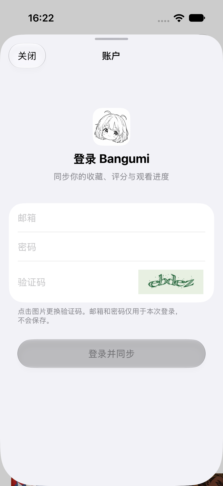
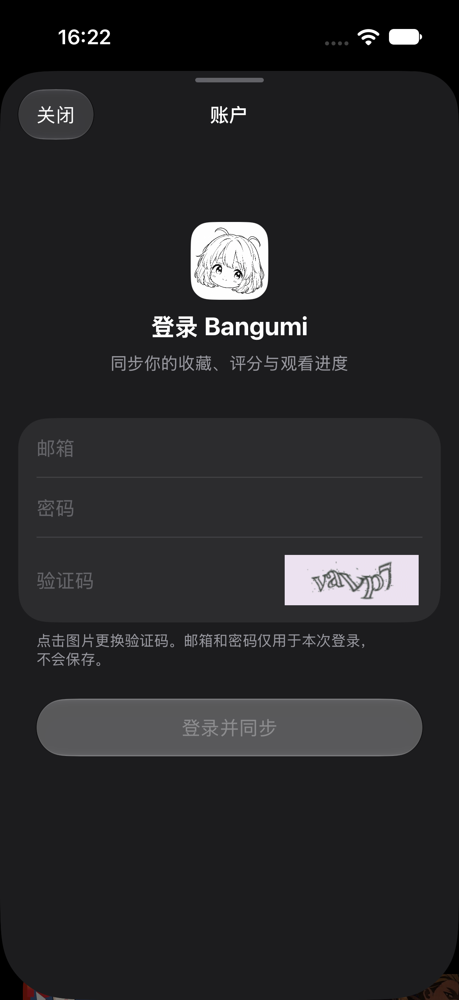
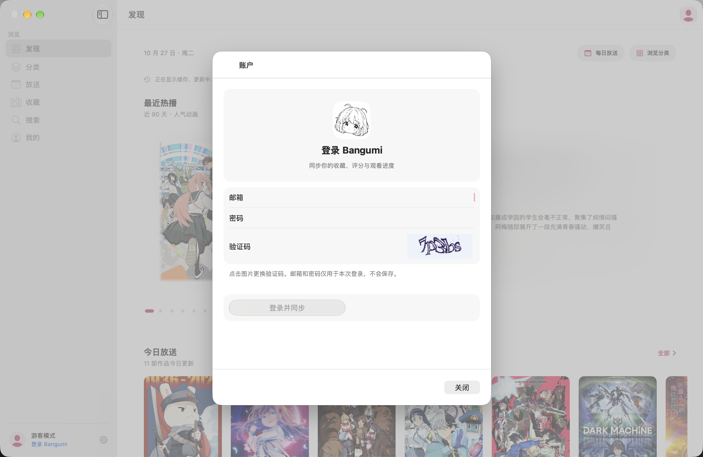
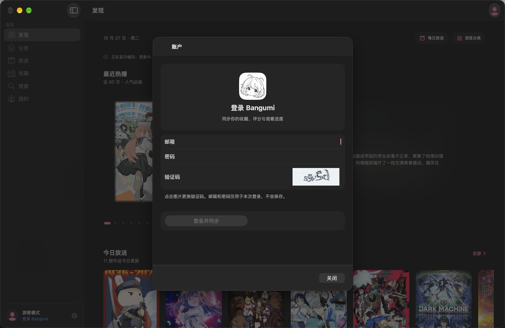

# 应用内账号登录

2026-10-27：按用户要求，仅保留邮箱、密码和图片验证码登录，移除 OAuth 配置、浏览器授权及手动 Token 入口。改动前的工作区已提交并推送到 GitHub：`c735131`（ECH 与启动加载）及 `0a4e8be`（既有布局验证截图）。本次登录改动与验证记录同步入库。

## 流程

1. 打开登录页，应用经官方或 ECH 获取 `/login` 的表单校验字段与临时 Cookie，再从 `/signup/captcha` 获取同一会话的验证码。
2. 填写邮箱、密码和验证码后，向官网 `/FollowTheRabbit` 提交一次登录请求。验证码错误时获取新图；不自动重放密码 POST。
3. 用临时登录 Cookie 在 `next.bgm.tv/demo/access-tokens` 创建 365 天有效的个人令牌。使用相同 User-Agent、固定线路，不跟随重定向。
4. 用令牌读取真实账号信息，验证通过后才存入 Keychain。若账户验证失败，重试使用已创建的令牌，不重复创建。安全存储失败会明确报错。
5. 登录页关闭或成功后清除临时会话，密码不持久化。收藏在后台同步，不阻塞关闭登录页。
6. 退出时先清除本地登录，再后台尝试撤销本次登录独有名称的令牌；不会撤销其他应用的令牌。离线时撤销可能失败，服务器上的令牌仍可有效到撤销或到期。

账号密码与 Cookie 不会经过社区镜像或自定义服务。普通 API、图片与社交 HTML 请求仍拒绝 Cookie；原生 URLSession 使用独立的无磁盘缓存会话，ECH 仅为白名单登录及令牌端点开放临时 Cookie。社交页面仍匿名只读。

旧版已有登录状态可以继续使用至失效或过期；不会强制清除用户当前有效令牌。OAuth Client ID/Secret 的旧本地配置会移除，URL Scheme、Bundle ID、部署目标和签名 Team 保持原设置。

## 验证

| 检查 | 结果 |
| --- | --- |
| `bash scripts/test-web-login.sh` | Mac、iPhone 17 模拟器通过本地协议桩：表单编码、Cookie 域/路径/过期/Host-only、同会话验证码、365 天令牌、验证失败重试、无效 200 响应、仅撤销本次令牌、错误验证码、线路变更、拒绝重定向、解析失败与取消 |
| `bash scripts/test-web-login.sh --live` | 两端通过真实官网表单、验证码读取和图片解码，以及令牌管理站点的未登录页面读取；使用严格 ECH，连接绑定 `en0` |
| `bash scripts/test-shell-ui.sh all testDirectLoginLightAndDark` | 两端浅深色登录界面、真实验证码和点击换图通过；邮箱/密码为空时不能提交；旧入口不存在 |
| `bash scripts/test-connections.sh` | 两端既有连接策略、凭证保护、超时、取消与加载策略回归通过 |
| `bash scripts/test-ech.sh --live` | 两端官方 API、网页、图片保持真实 ECH 直连 |
| `go test -race ./...`（`Native/ECH`） | 通过，新增临时登录 Cookie 与匿名请求隔离、端点边界及禁止重定向检查 |
| iPhone 17 / iOS 27.0、Mac arm64 构建 | 通过；Mac 安装至 `/Applications/Bgmori.app` |

未提交真实账号密码，未在真实账号中创建或撤销令牌；完整登录成功、失败和退出流程由本地协议桩验证。实际账号登录仍需用户本人在应用内输入；未在实体 iPhone 上运行。

## 浅色与深色

| 平台 | 浅色 | 深色 |
| --- | --- | --- |
| iPhone 17 |  |  |
| Mac |  |  |

验证码来自当次游客会话，截图不包含账号、密码、令牌或 Cookie。若官网页面改版导致无法解析，登录页明确报错，并保留官网查看链接。
