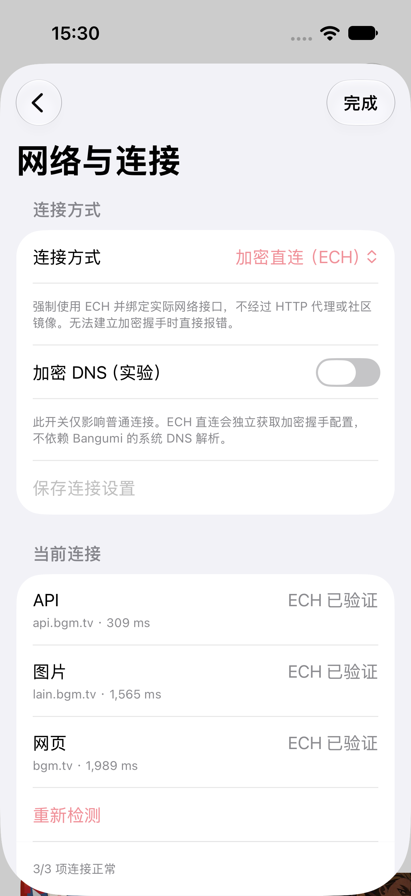
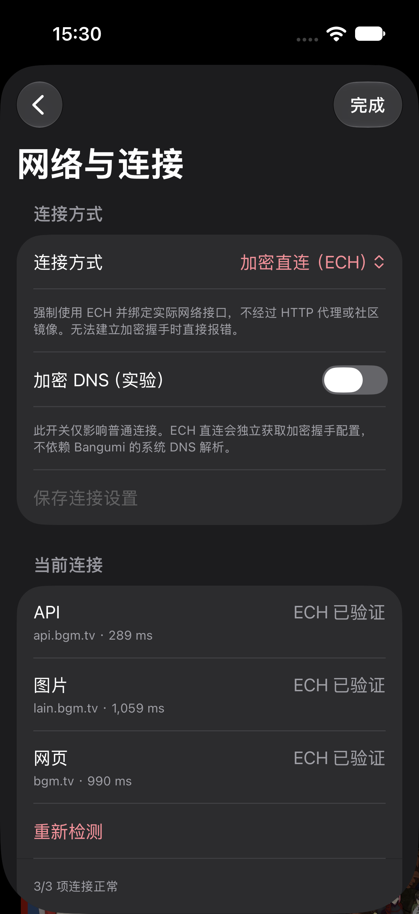
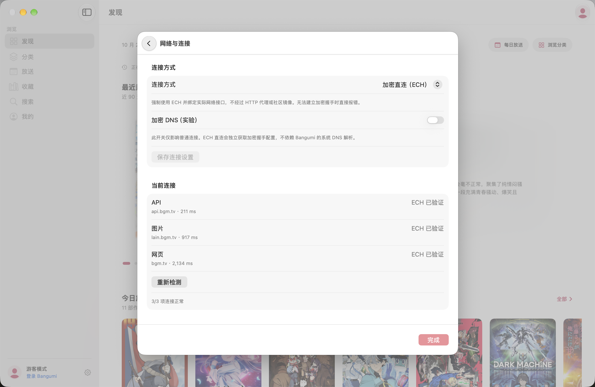
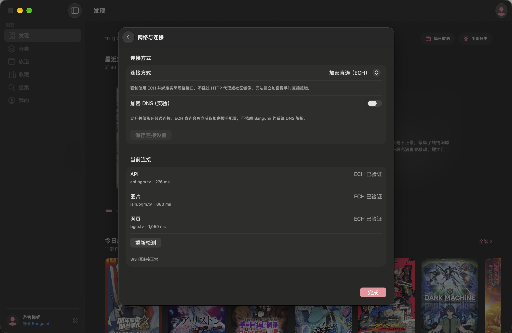

# ECH 国内直连验证

验证日期：2026-10-27。当前 Mac（Apple M2 / arm64）与 iPhone 17 / iOS 27.0 模拟器。

## 使用

默认自动模式优先 ECH 官方直连，再按线路健康状态尝试普通官方连接和既有镜像。要严格验证直连，打开「设置 → 网络与连接 → 加密直连（ECH）」并点重新检测。此模式下 API、网页和图片都只走 ECH，失败时不会借用普通连接或镜像。

连接使用嵌入的 Go 标准库 TLS 1.3 客户端，直接连接 Cloudflare IP，校验官方域名证书并要求 ECH 被接受。代理被禁用，套接字绑定物理 Wi-Fi/以太网或蜂窝接口。公开 IP 列表可以后台刷新，失败仍有内置 IP；镜像目录接口保持原配置。应用无需额外服务器。

## 实际证据

测试时系统默认路由是 `utun4`，HTTP/SOCKS 代理仍开启，没有关闭或修改系统代理及 VPN。两端连接层均绑定 `en0`；`/cdn-cgi/trace` 中 `api.bgm.tv`、`bgm.tv` 和 `lain.bgm.tv` 均返回 `loc=CN` 和 `sni=encrypted`，Go 的连接状态同时确认 `ECHAccepted=true`。

严格 ECH 模式下，真实条目 8 的 JSON 解码、条目网页 HTML 和封面图片解码均通过。Swift 取消可以传递到 Go 并释放请求上下文。游客模式验证未使用、记录或修改真实账号凭证及收藏。

验证命令与结果：

| 检查 | 结果 |
| --- | --- |
| `go test -race ./...`（`Native/ECH`） | 通过：配置解析、目标边界、物理接口、代理禁用、取消 |
| `bash scripts/test-ech.sh --live` | Mac、iPhone 17 模拟器均通过；三项加密握手与真实数据 |
| `bash scripts/test-connections.sh --live` | 两端既有连接策略回归通过 |
| `bash scripts/test-mirrors.sh --live` | 两端镜像目录与解析回归通过 |
| `bash scripts/test-shell-ui.sh ios testECHOnlyConnectionsLightAndDark` | 强制 ECH，三项真实检测、浅深色截图通过 |
| `bash scripts/test-shell-ui.sh mac testECHOnlyConnectionsLightAndDark` | 强制 ECH，三项真实检测、浅深色截图通过 |
| iPhone 17 / iOS 27.0 Debug 构建 | 通过 |
| Mac / arm64 Debug 构建、安装、签名校验 | 通过；已打开 `/Applications/Bgmori.app` |
| iPhone arm64 静态连接库构建 | 通过；未在实体 iPhone 上运行 |

当前安装的 Mac `.app` 约 27.1 MiB，增加的静态运行时约 7 MiB。开发构建需要 Go 1.27+，没有外部 Go 模块；完整许可证随应用提供。[连接层实现说明](../../../Native/ECH/README.md)。

## 浅色与深色

| 平台 | 浅色 | 深色 |
| --- | --- | --- |
| iPhone 17 |  |  |
| Mac |  |  |

## 验证范围

结果证明当前国内网络、上述设备环境中的连接实际使用 ECH 并走物理接口，不代表所有运营商和后续网络策略都永久可达。当前 ECH 线路需要物理接口具备 IPv4，纯 IPv6 网络尚未支持。账号登录现已改为应用内邮箱、密码和验证码，登录页及验证码经 ECH 获取；[新的登录验证记录](../direct-login/README.md)。收藏删除不在本次范围内。
