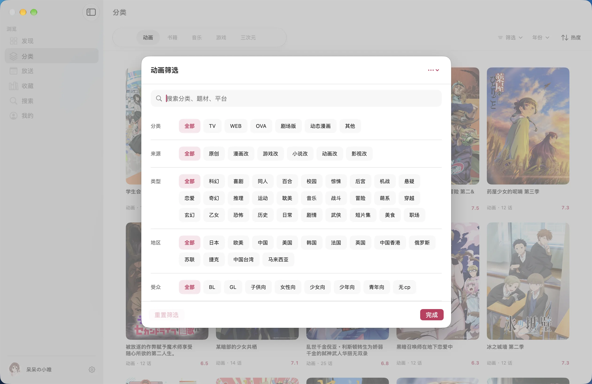
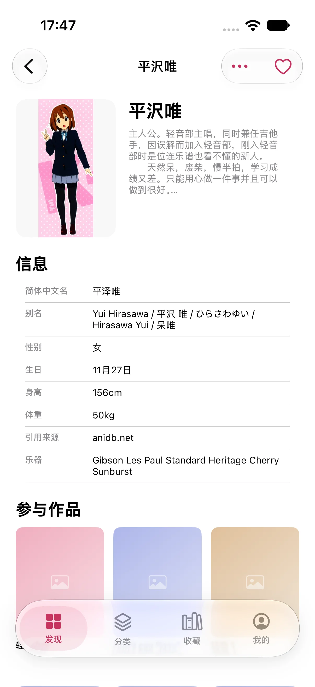

# 筛选排版、人物图与最近浏览

收藏筛选的两行使用相同的六列宽度，类型采用较大的文字与粉色选中态，状态使用较小的文字与低对比选中态。分类筛选改为分组标签，Mac 的分组名称独立成列；搜索筛选改为标签左对齐、选项右对齐的三行表单。两个面板共用标题和操作区，保留重置、完成，以及分类同步失败时的重试和网页入口。

平泽唯（角色 466）的原图为 430×1080，原来的居中填充会在 128×176 画框中截掉头部和脚部。人物详情改为完整缩放，并使用较大的图片源；角色列表、搜索人物结果及制作人员缩略图也使用完整缩放。最近浏览改用共用封面卡片，将类型移至标题下方，移除封面上的黑底标签。

2026-10-26 验证：

- iPhone 17 / iOS 27.0 与当前 Mac / arm64 的 Debug 构建通过。
- 两端浅色、深色下检查分类选择与重置、搜索年份选择与重置、完成关闭、真实平泽唯详情和最近浏览。
- 收藏控件的六列对齐、类型选择、状态选择均通过两端 UI 检查。此项使用游客调试预览，未覆盖登录后的收藏数据同步或写入。
- 调试预览：`BGMORI_ROUTE=library` 与 `BGMORI_PREVIEW_LIBRARY_FILTERS=1`。此开关只在 Debug 生效，不更改登录状态；人物详情可使用 `BGMORI_ROUTE=character:466` 或 `person:ID`。

| 界面 | iPhone 浅色 | iPhone 深色 | Mac 浅色 | Mac 深色 |
| --- | --- | --- | --- | --- |
| 收藏筛选预览 | [截图](iphone-library-filters-light.webp) | [截图](iphone-library-filters-dark.webp) | [截图](mac-library-filters-light.webp) | [截图](mac-library-filters-dark.webp) |
| 分类筛选 | [截图](iphone-category-filter-light.webp) | [截图](iphone-category-filter-dark.webp) | [截图](mac-category-filter-light.webp) | [截图](mac-category-filter-dark.webp) |
| 搜索筛选 | [截图](iphone-search-filter-light.webp) | [截图](iphone-search-filter-dark.webp) | [截图](mac-search-filter-light.webp) | [截图](mac-search-filter-dark.webp) |
| 平泽唯详情 | [截图](iphone-yui-portrait-light.webp) | [截图](iphone-yui-portrait-dark.webp) | [截图](mac-yui-portrait-light.webp) | [截图](mac-yui-portrait-dark.webp) |
| 最近浏览 | [截图](iphone-recent-covers-light.webp) | [截图](iphone-recent-covers-dark.webp) | [截图](mac-recent-covers-light.webp) | [截图](mac-recent-covers-dark.webp) |

