# 信息链接与吐槽筛选

人物、角色信息栏此前使用普通文字显示网址；现在与条目信息栏共用链接识别，支持文字中的 HTTP/HTTPS 地址、多个地址，以及 Twitter/X 字段中的账号。保留原始显示内容，链接使用主题强调色，点击交给系统浏览器。普通别名中的 @、邮箱及应用内部 ECH 地址不会被转换为网页链接。

Mac 吐槽筛选此前在自定义胶囊外又套用了系统菜单按钮外框。现在使用按钮式菜单并设为 plain，保留紧凑胶囊与下拉箭头，去掉重复背景；iPhone 同步使用 plain 按钮样式。

验证设备：iPhone 17 / iOS 27.0 模拟器、当前 Mac / arm64。两端构建、真实人物 17491 数据校验、浅深色下点击 Twitter 打开系统浏览器，以及吐槽 317613 排序菜单选择均通过。链接测试确认跳转交给浏览器；不以第三方网站成功加载作为应用跳转通过的依据。

```bash
bash scripts/test-infobox-links.sh --live
bash scripts/test-shell-ui.sh all testInfoLinksAndFiltersLightAndDark
```

| 页面 | iPhone 浅色 | iPhone 深色 | Mac 浅色 | Mac 深色 |
| --- | --- | --- | --- | --- |
| 信息链接 | 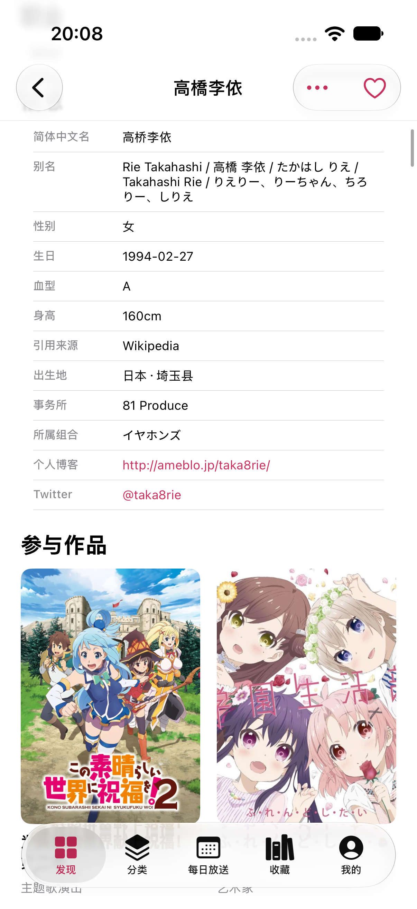 | 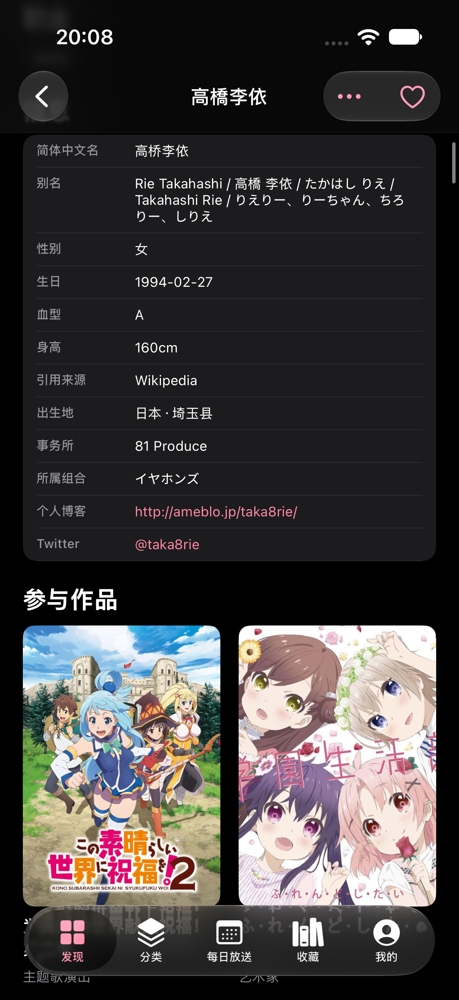 | 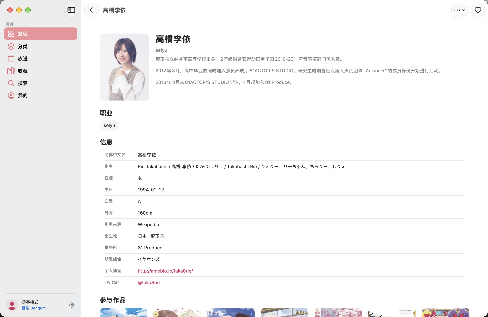 | 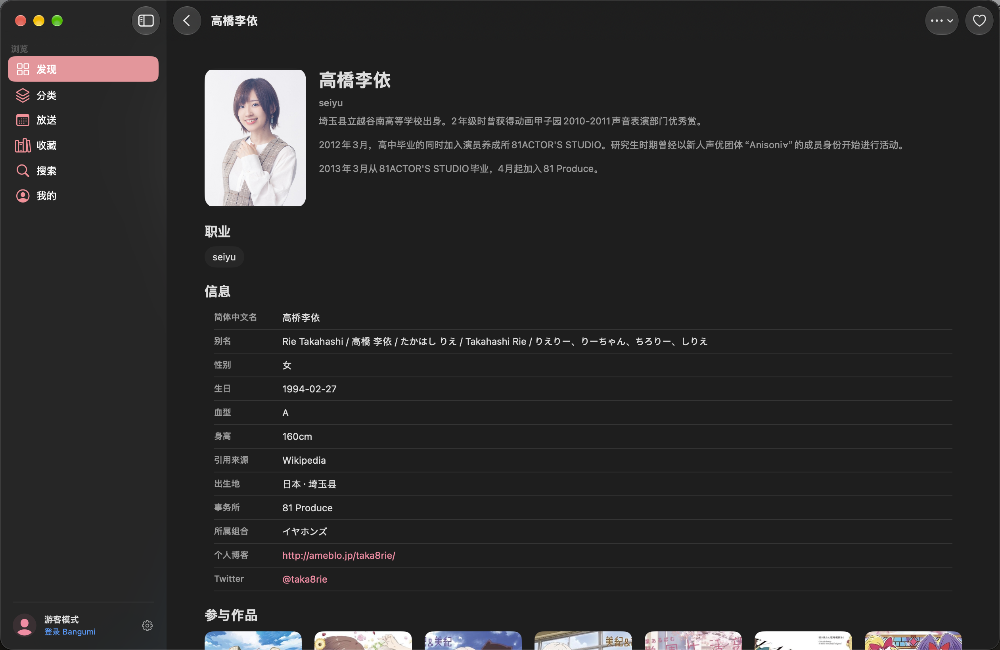 |
| 吐槽筛选 | 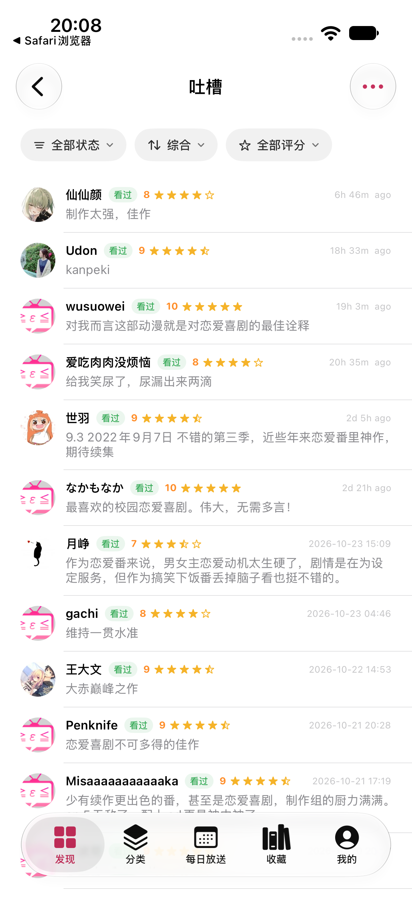 | 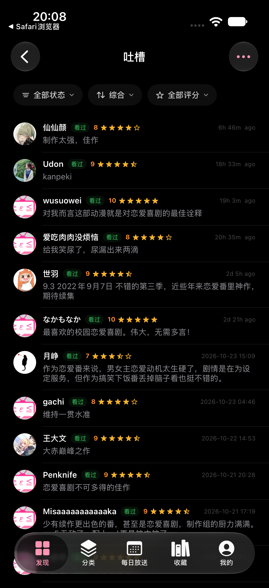 | 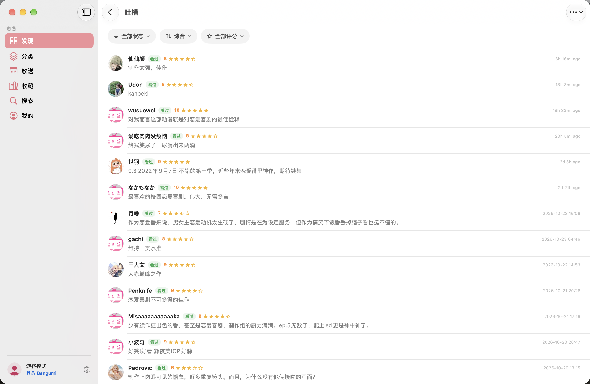 | 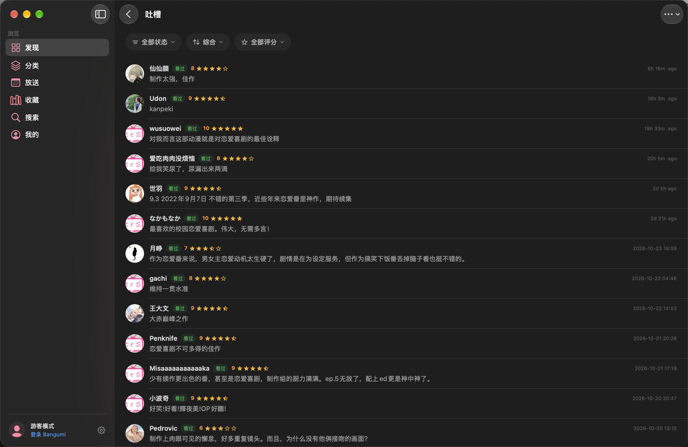 |
| 更改排序 | 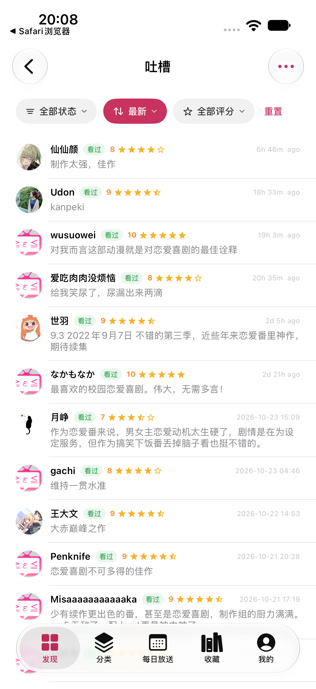 | 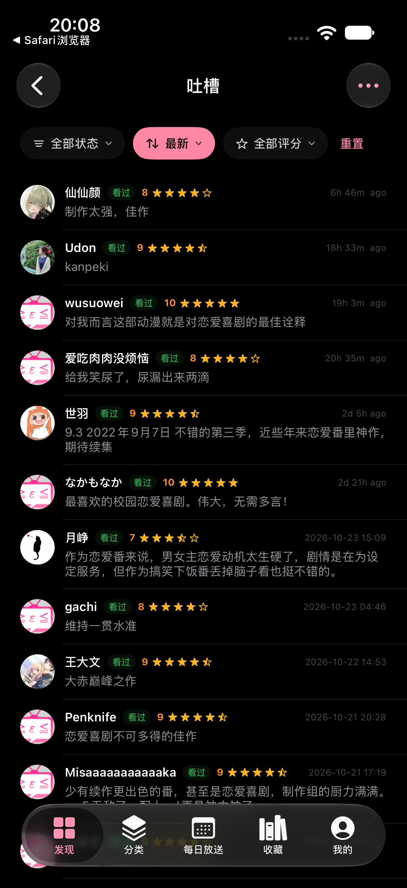 | 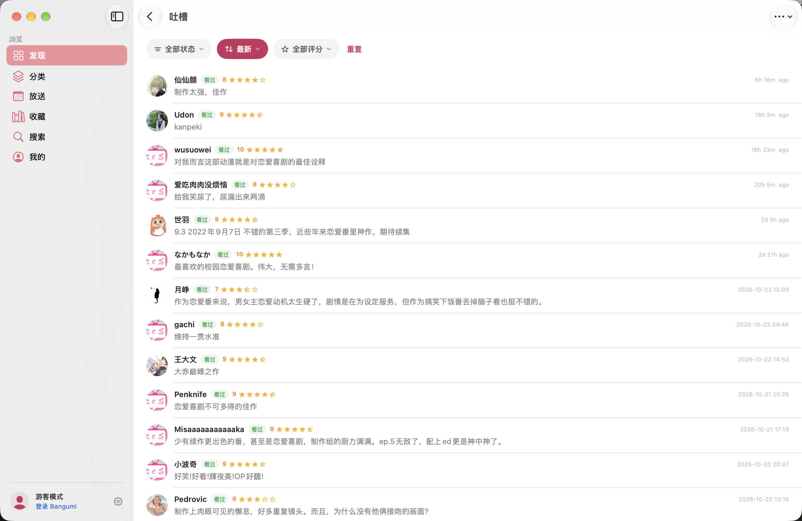 | 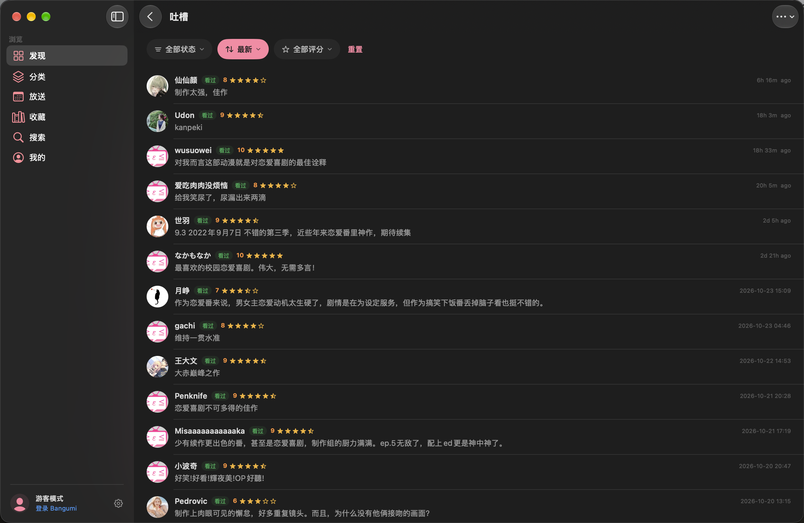 |
