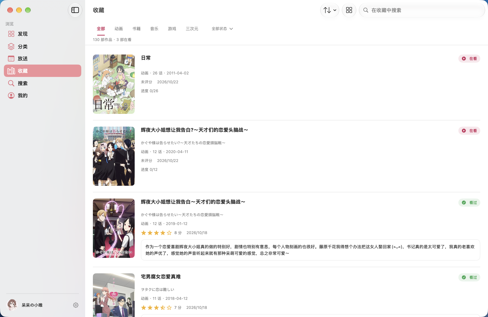
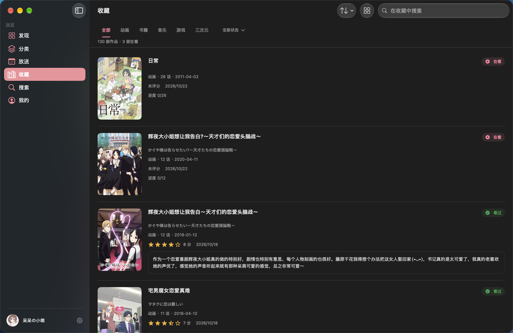
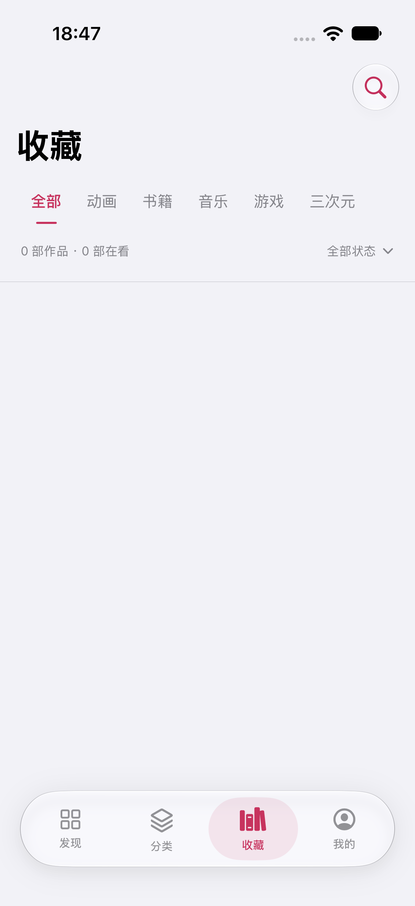
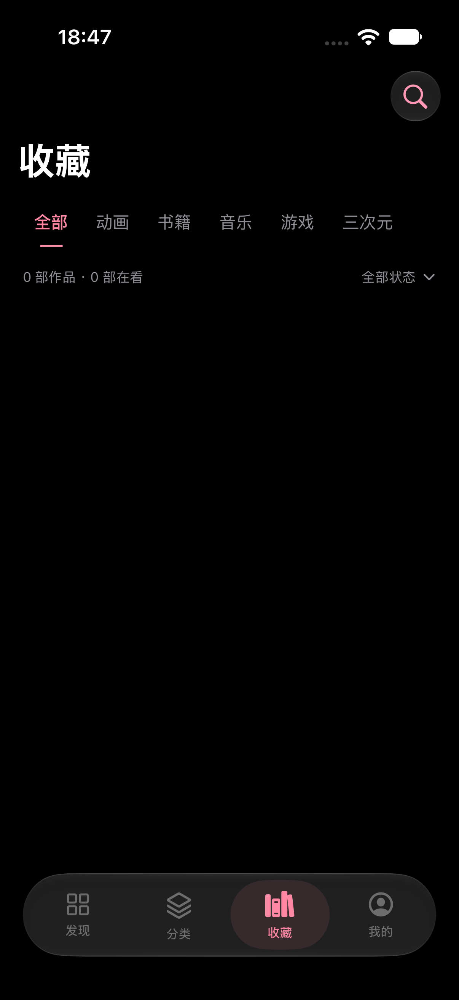

# 收藏筛选

类型是主导航：使用自然文字宽度与短下划线，不再把六个选项拉伸成大块按钮。状态是次级筛选，收进「全部状态」菜单，可与类型组合使用。

Mac 上类型与状态菜单同行，统计位于下方；iPhone 上类型横栏独立一行，状态菜单与统计同行。移除整块玻璃容器、阴影和重复的类型／状态标签。

验证设备：iPhone 17 / iOS 27.0 模拟器、当前 Mac / arm64。iPhone 使用已有 Debug 筛选预览入口（无登录数据），Mac 使用已登录的真实收藏。两端检查浅色、深色，以及类型切换、状态菜单、组合筛选。

| 平台 | 浅色 | 深色 |
| --- | --- | --- |
| Mac |  |  |
| iPhone |  |  |
