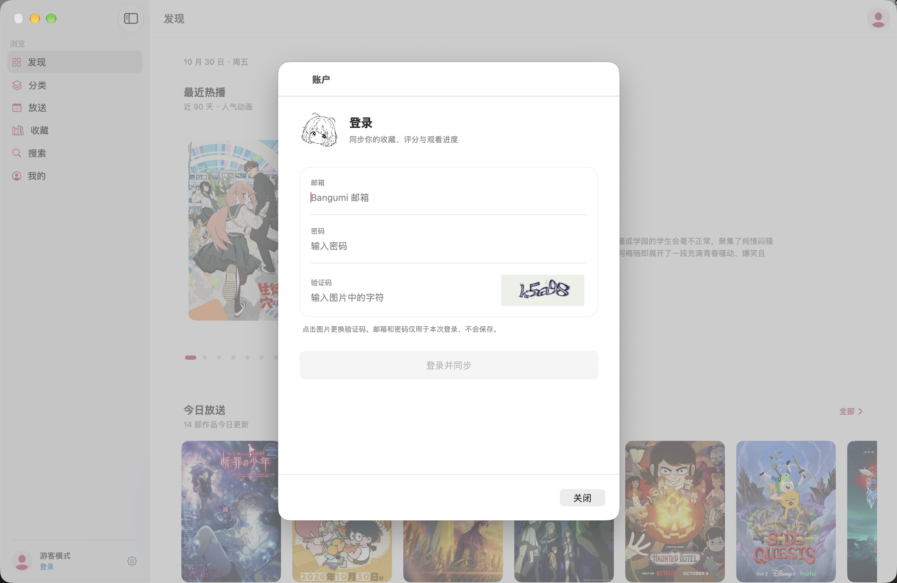
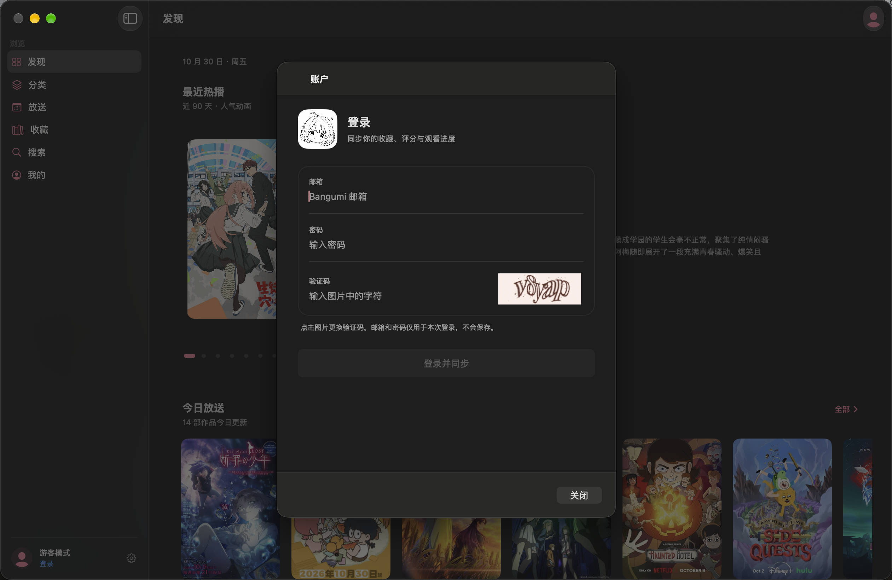
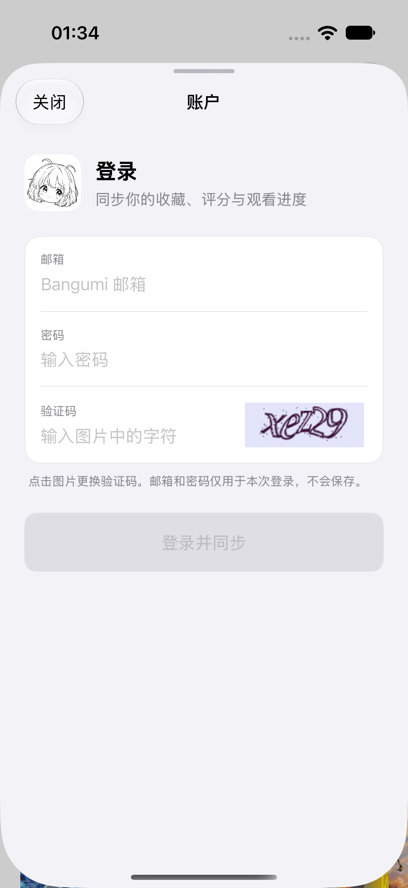
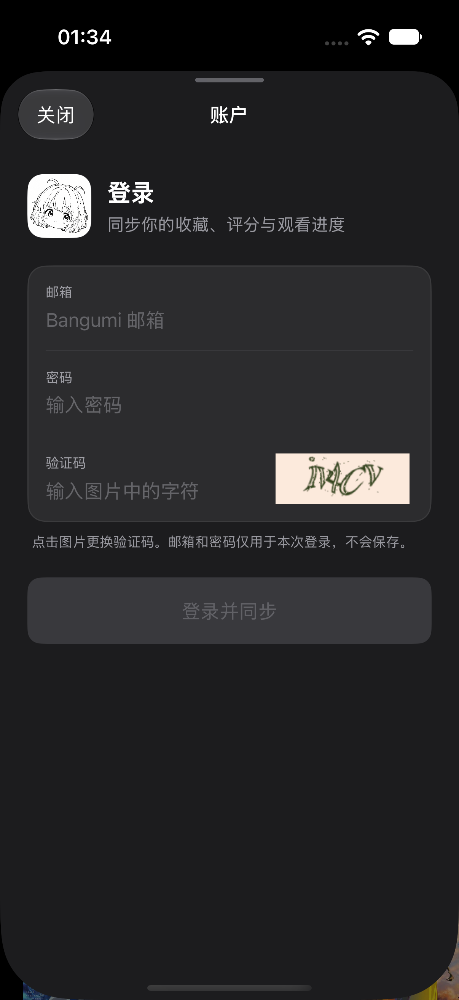
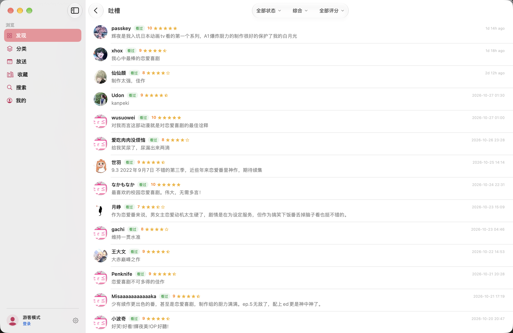
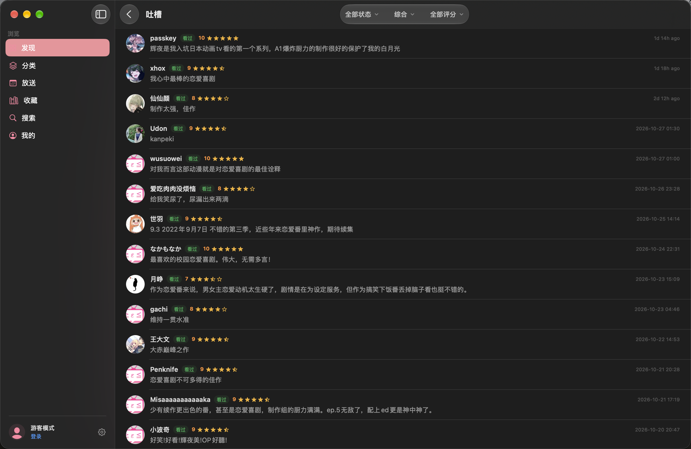
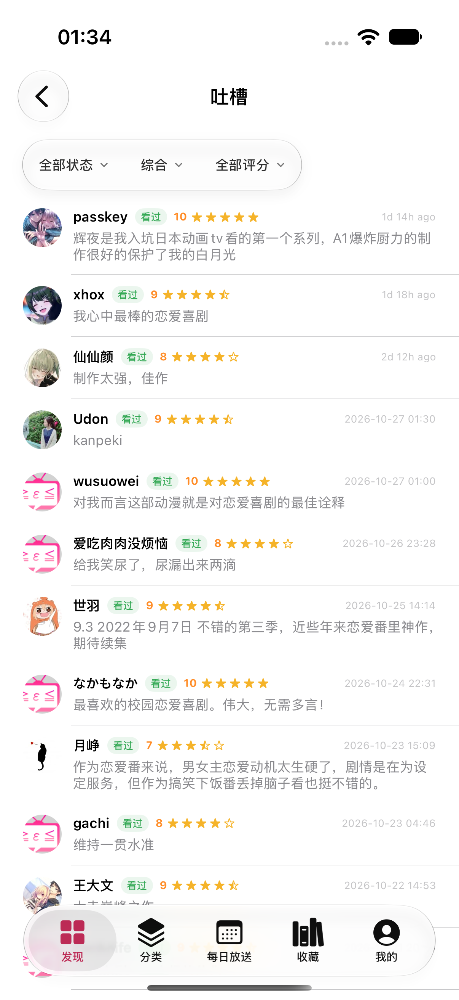
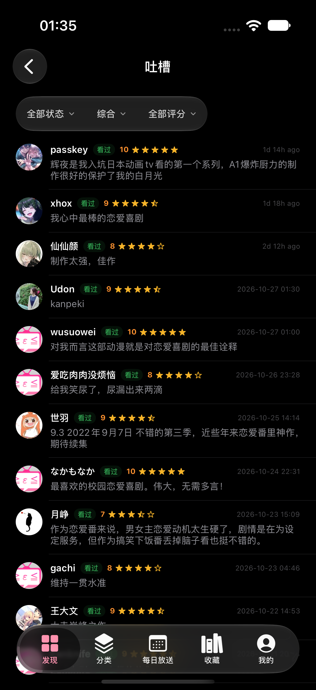

# 登录与吐槽筛选布局

吐槽筛选移除固定 460 点宽度和 Mac 工具栏里的横向滚动容器，改成随菜单内容收紧的原生工具栏。iPhone 保留一组紧凑玻璃背景，并限制横向滚动区域高度，避免占据正文空间。菜单用文字与小箭头表达，选中条件使用品牌色，保留排序、状态、评分和重置。

登录页使用紧凑横向标题、左对齐的字段说明与输入框，按钮独立于输入区且与其等宽。移除分组表单给头图和按钮添加的多余灰底。验证码刷新、键盘提交、错误展示和关闭清理逻辑保留。

验证：

- `bash scripts/build-install-ios.sh --route comments:317613`：iPhone 17 / iOS 27.0 构建、安装与二进制校验通过。
- `bash scripts/build-install-macos.sh`：当前 Mac / arm64 构建、安装通过。
- `testDirectLoginLightAndDark`：两端浅深色通过；检查邮箱与密码输入对齐、按钮宽度及可见性，并真实获取、更换验证码。未输入真实凭证、未执行账号登录。
- `testLiveCommentsLightAndDark`：两端浅深色通过；检查真实吐槽、紧凑筛选宽高、三个菜单可点击、切换最新排序和重置。Mac 原生工具栏的无障碍容器包含额外内边距，宽度断言保留该系统边距。

| 页面 | Mac 浅色 | Mac 深色 | iPhone 浅色 | iPhone 深色 |
| --- | --- | --- | --- | --- |
| 登录 |  |  |  |  |
| 吐槽 |  |  |  |  |
