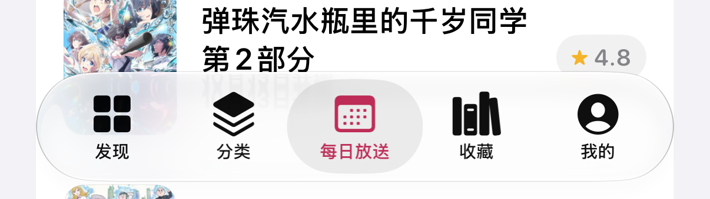
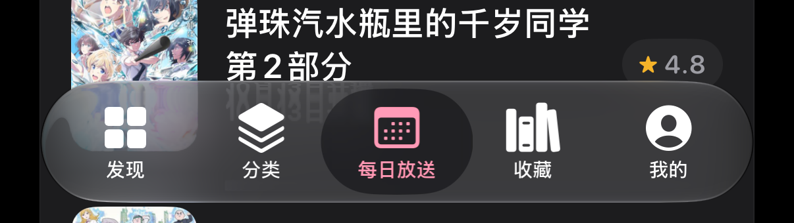
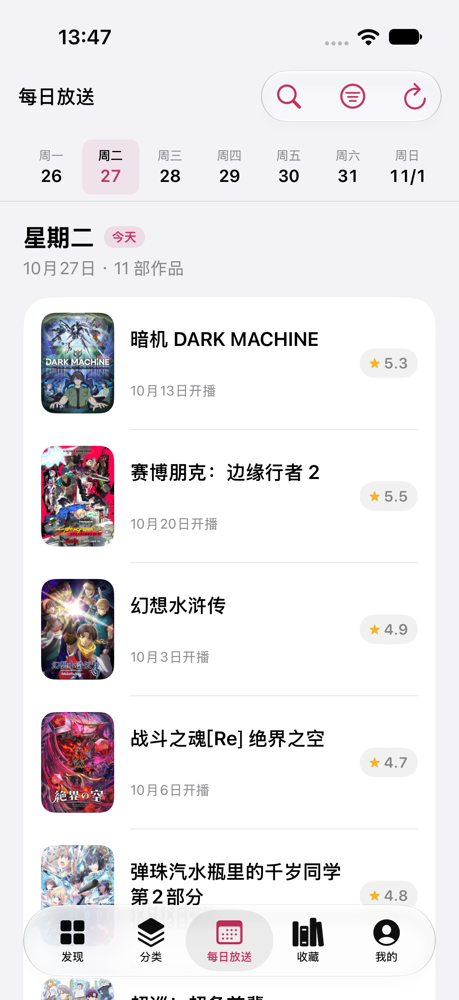
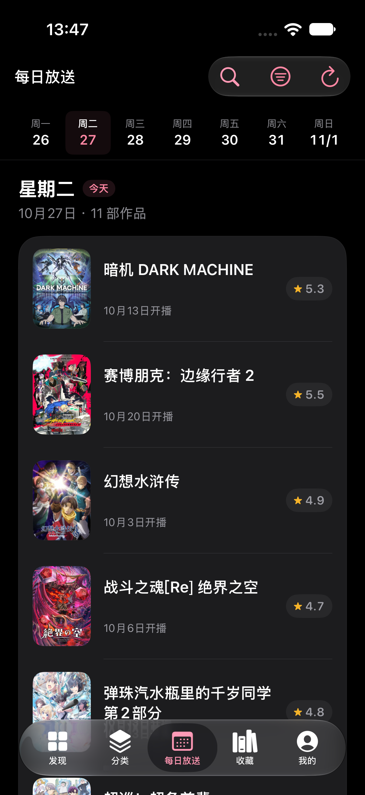
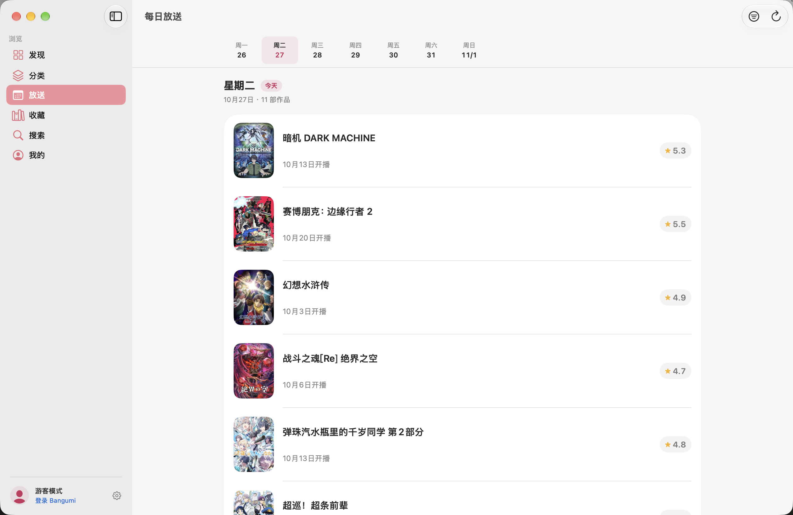
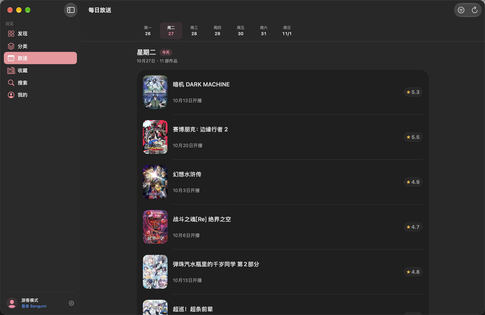

# iPhone 系统原生底部导航

2026-10-27，按用户明确要求移除自绘玻璃底栏、凸起圆泡及放大效果，改用系统原生 `TabView` / Tab Bar。选中态由系统绘制为底栏内部的横向胶囊，保留 Bgmori 的粉色主题。

栏目保持「发现 / 分类 / 每日放送 / 收藏 / 我的」。各栏目拥有独立导航历史；关闭滚动时自动缩小底栏的行为。条目详情显示收藏/进度操作栏，返回后恢复原生底栏。Mac 保持侧栏。

验证结果：iPhone 17 / iOS 27.0 和 Mac arm64 构建通过；手机底栏浅深色及导航恢复两项 UI 测试通过，Mac 放送页浅深色 UI 测试通过。

UI 测试定位真实的系统 Tab Bar，检查五个按钮、选中态、浅深色、连续栏目切换、搜索历史、后台返回及详情返回。

| 浅色底栏 | 深色底栏 |
| --- | --- |
|  |  |

| iPhone 浅色 | iPhone 深色 |
| --- | --- |
|  |  |

| Mac 浅色 | Mac 深色 |
| --- | --- |
|  |  |
