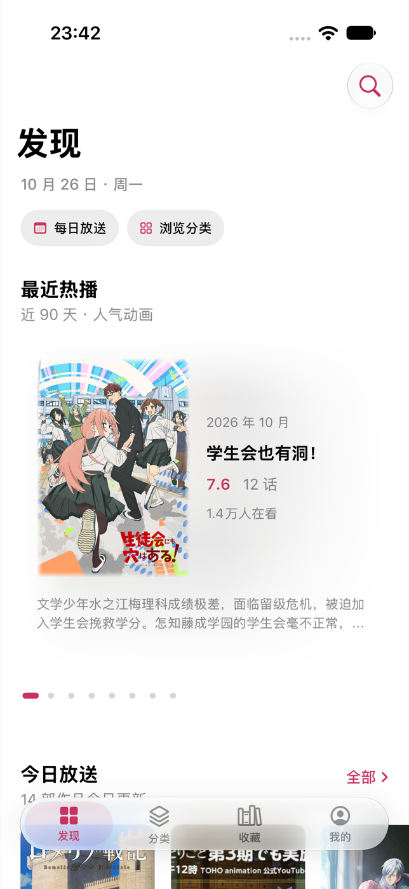
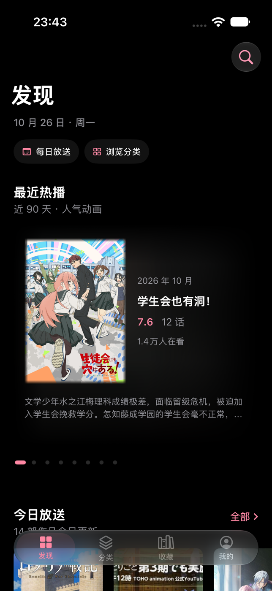
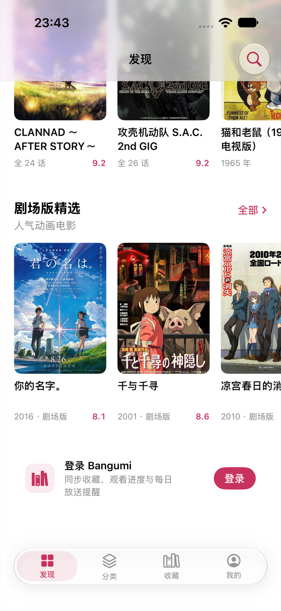
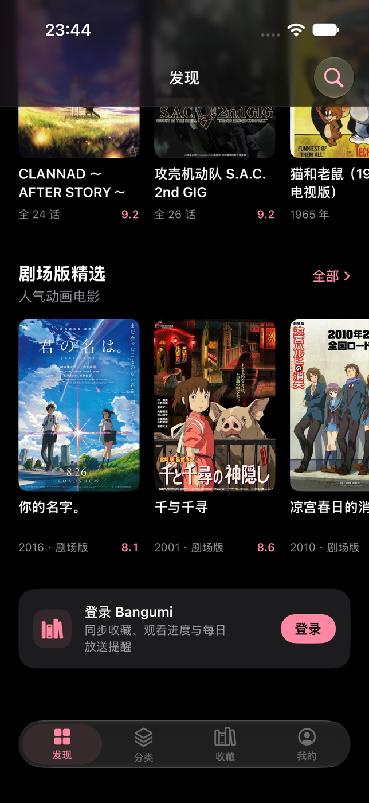
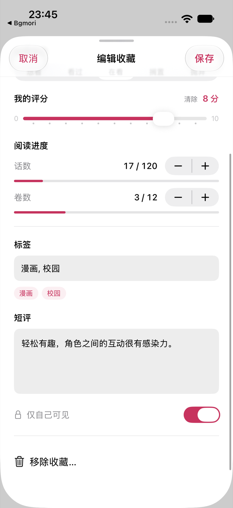
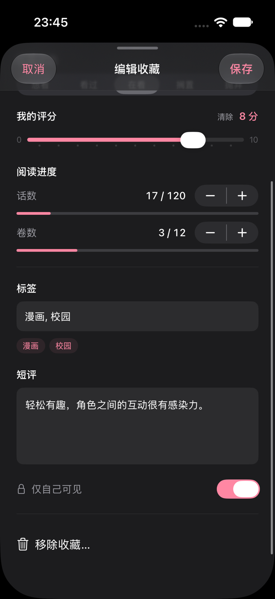
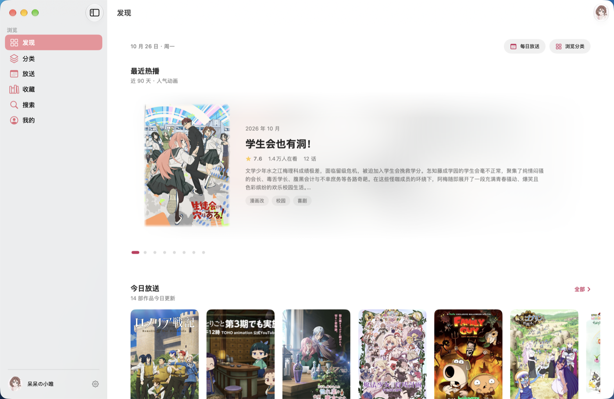
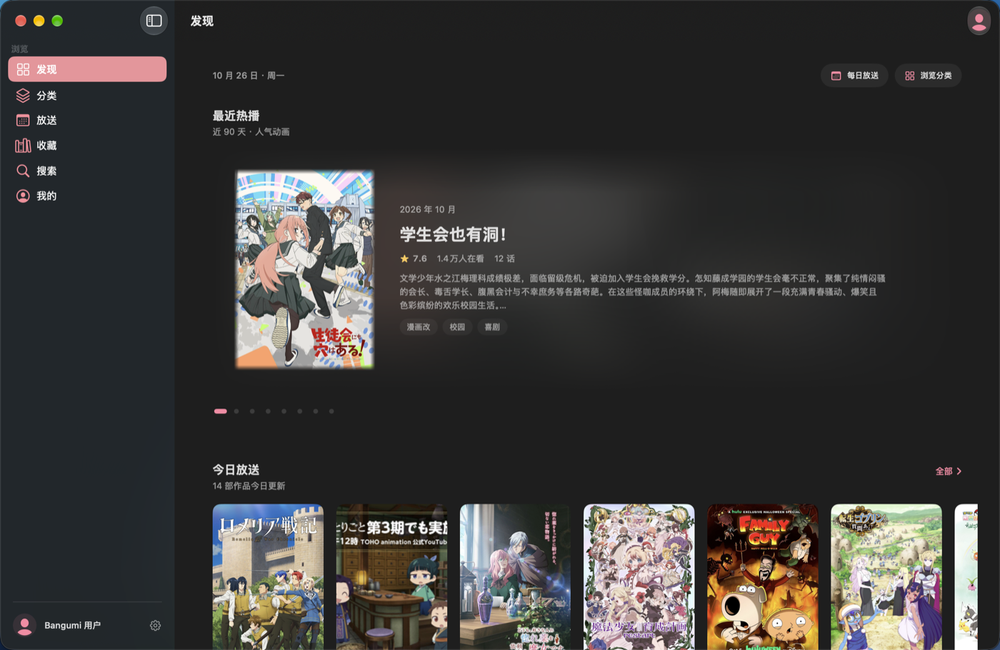
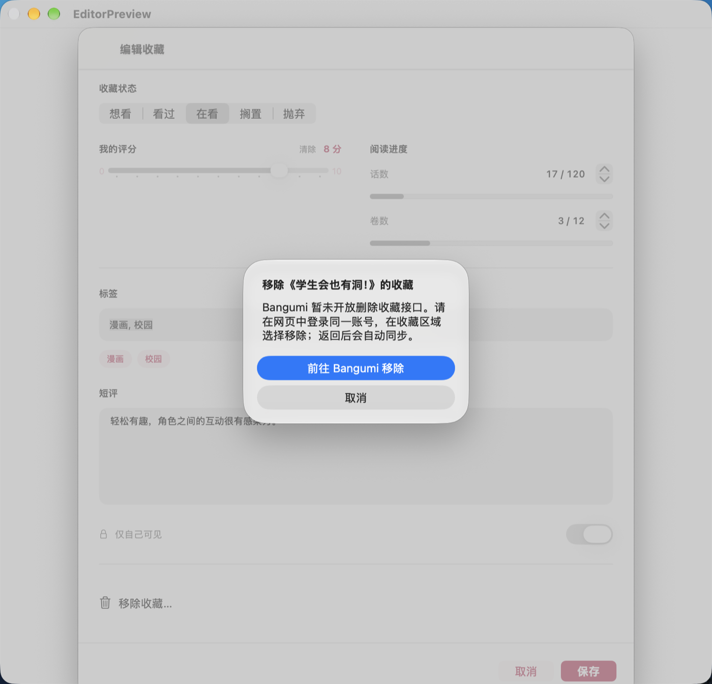
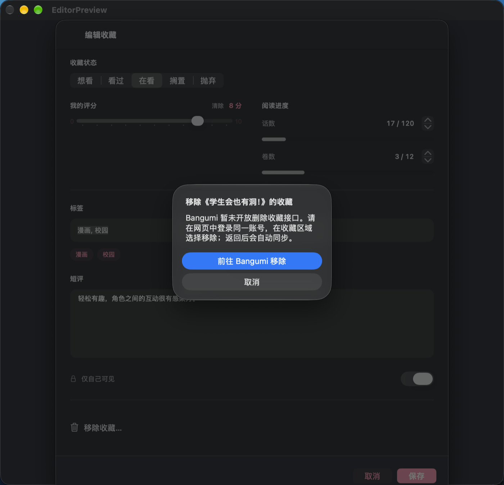

# 底部导航、发现快捷入口与收藏移除

验证设备：iPhone 17 / iOS 27.0 模拟器、当前 Mac / arm64。

- iPhone 底栏从默认字号下约 70 pt 缩至 52 pt，按钮保留 44 pt 点击区域。每个导航页面在内部预留底栏空间，仅当前页面显示底栏，滚动到底部后登录卡片完整可见且可点击。
- 「每日放送」「浏览分类」按内容宽度布局，文字固定单行；日期与按钮放不下时整组按钮换到下一行。
- 收藏列表和网格均提供「…」操作菜单，编辑已有收藏时底部提供「移除收藏…」。新建收藏不显示移除按钮。
- 官方公开 API 目前仅支持新增、修改条目收藏，未提供删除端点，因此入口会说明限制并跳转 Bangumi 条目网页，由用户登录同一账号移除。返回 App 后强制同步，绕过新旧缓存；同步失败保留已有数据并允许重试。不会在本地假删，也不把「抛弃」当成删除。

官方依据：[v0 API 文档](https://github.com/bangumi/api/blob/master/open-api/v0.yaml)、[删除收藏 API 请求](https://github.com/bangumi/api/issues/15)。

## 验证

- iPhone 17 / iOS 27.0、Mac arm64 构建通过。
- iPhone 首页浅深色 UI 检查通过：按钮宽度、底栏高度、底部登录卡片可见且可点击、放送进入/返回、分类/收藏/发现切换。
- Mac 首页浅深色 UI 检查通过：快捷入口尺寸、排列及跳转。
- 两端收藏编辑 UI 检查使用隔离预览（复用生产组件，不读取或写入用户凭据）：已有收藏显示入口、打开说明弹窗、取消、新建收藏隐藏入口。
- `bash scripts/test-collection-refresh.sh` 两端通过：强制刷新替换旧缓存、后续读取不恢复已移除条目、服务端错误显式抛出并保留上次成功缓存。
- 导航与收藏展示脚本通过。
- `bash scripts/test-collection-refresh.sh --live` 的匿名真实 API 检查遇到 TLS 连接失败；未验证账号网页删除和返回同步的完整在线流程，也未操作真实账号收藏。

## iPhone

| 首页浅色 | 首页深色 |
| --- | --- |
|  |  |

| 页面底部浅色 | 页面底部深色 |
| --- | --- |
|  |  |

| 收藏移除入口浅色（隔离预览） | 收藏移除入口深色（隔离预览） |
| --- | --- |
|  |  |

## Mac

| 首页浅色 | 首页深色 |
| --- | --- |
|  |  |

| 移除说明浅色（隔离预览） | 移除说明深色（隔离预览） |
| --- | --- |
|  |  |
