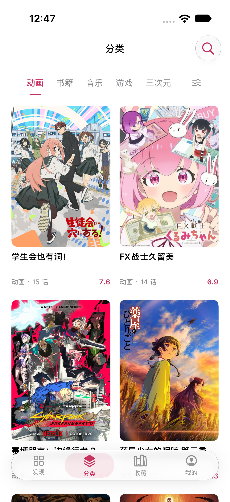
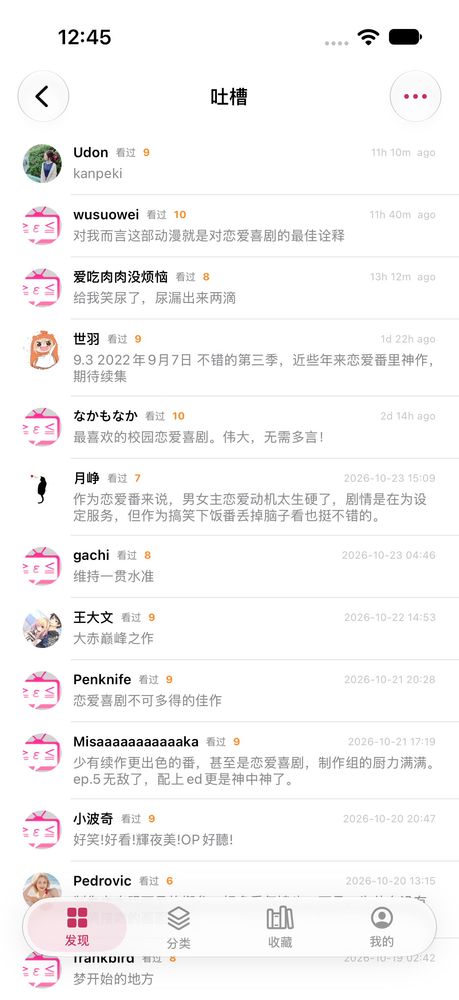
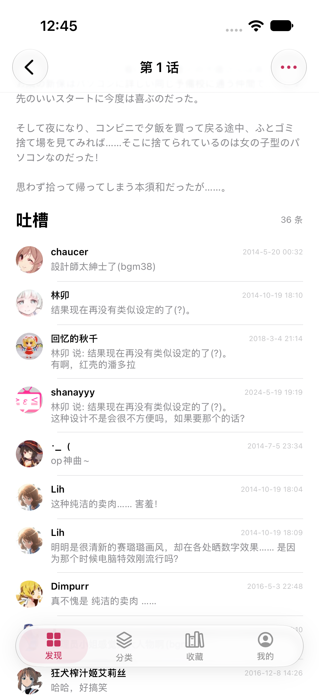
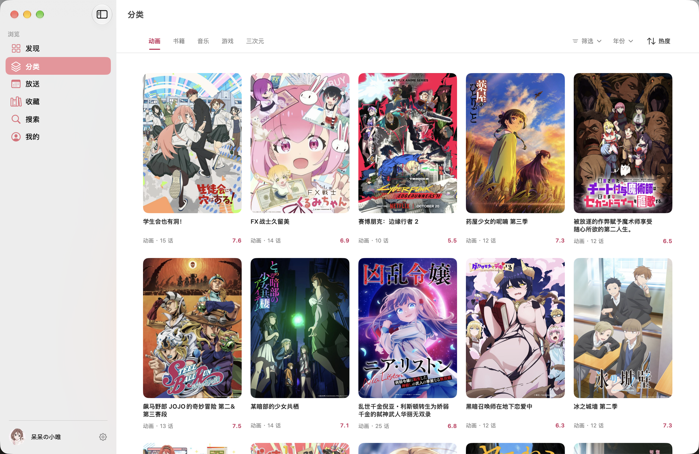
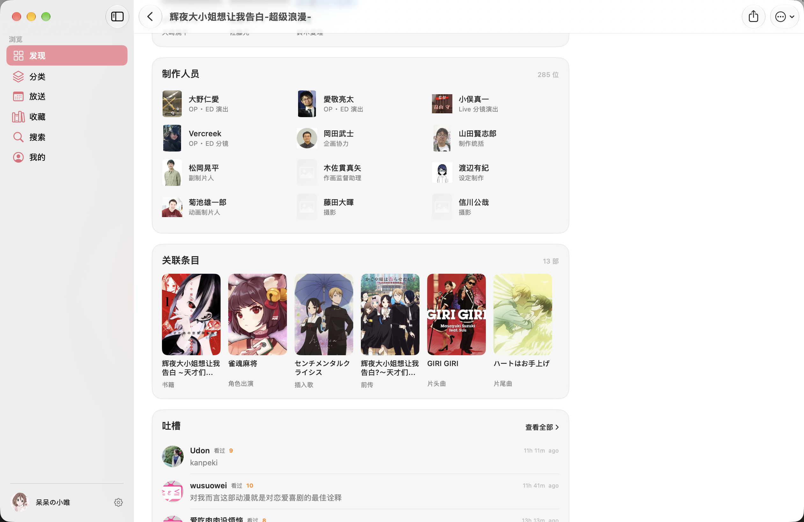
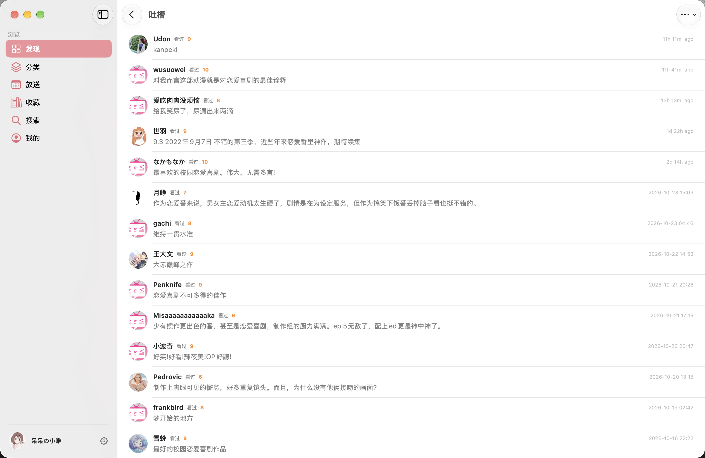
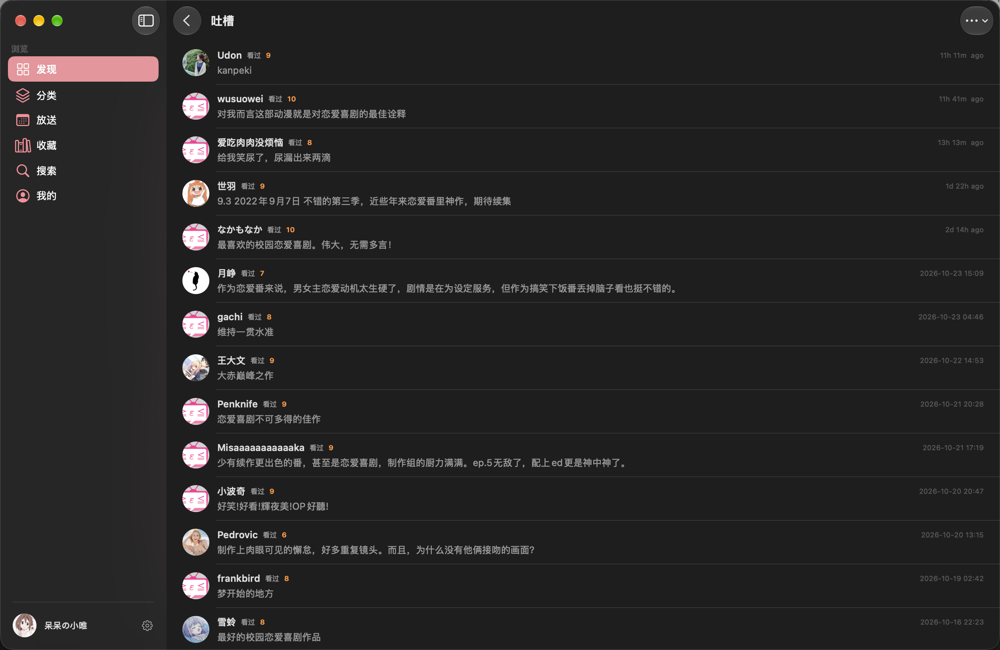
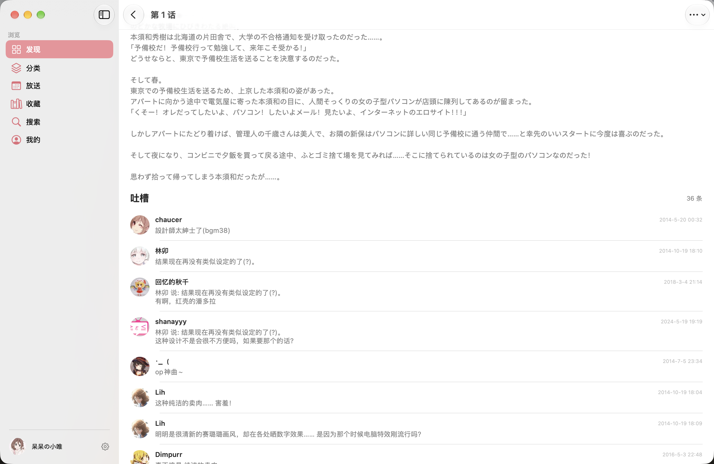

# 导航稳定性、近期注目与吐槽修复

2026-10-27，验证设备：iPhone 17 / iOS 27.0 模拟器、当前 Apple M2 Mac / arm64。

手机端用系统原生 `TabView` 承载独立导航栈，恢复「发现 / 分类 / 每日放送 / 收藏 / 我的」五个栏目。条目详情继续使用自己的收藏/进度操作栏，返回后恢复系统底栏；[原生底栏最终截图](../native-tabbar/README.md)。

匿名网页优先读取官网，失败再尝试镜像。吐槽和分类排序会检查缓存及响应的页面结构；验证页、登录页或损坏的内容不会被当作空列表。近期注目失败时可重试、打开官网，或切换到公开 API 的收藏热度。

条目与章节吐槽独立加载，不再等待章节、人物或收藏同步；分别显示加载、空内容和失败状态，支持重试及网页回退。章节解析保留嵌套回复，避免把反应网格混进正文。

可复用检查：

```bash
bash scripts/test-navigation.sh
bash scripts/test-mirrors.sh
bash scripts/test-social.sh --live
bash scripts/test-categories.sh --live
bash scripts/test-shell-ui.sh       # 或 ios / mac
```

吐槽加载修复阶段两端构建通过，UI 测试各 4 项全部通过；导航、镜像、真实社交页面与分类回归脚本通过。真实条目 317613 读取到首页 20 条吐槽，章节 1027 读取到 36 条主贴及回复。

UI 脚本使用临时工程和源码副本，保留仓库中现有的 Team/签名设置。手机检查连续栏目切换、搜索历史、详情返回、后台返回；两端检查真实条目 317613 的吐槽列表、浅深色、详情预览，以及章节 1027 的吐槽。

以下吐槽截图记录加载修复阶段，底栏最终效果见上方原生底栏截图。

## iPhone

| 分类及详情返回 | 吐槽浅色 | 吐槽深色 |
| --- | --- | --- |
|  |  |  |

| 条目吐槽预览 | 章节吐槽 |
| --- | --- |
|  |  |

## Mac

| 近期注目 | 条目吐槽预览 |
| --- | --- |
|  |  |

| 吐槽浅色 | 吐槽深色 |
| --- | --- |
|  |  |



原始反馈来自真机，偶发白屏没有可用的崩溃栈；本次修正了导航栈重叠和底栏分散管理的问题，模拟器检查不能代替真机长期使用观察。
