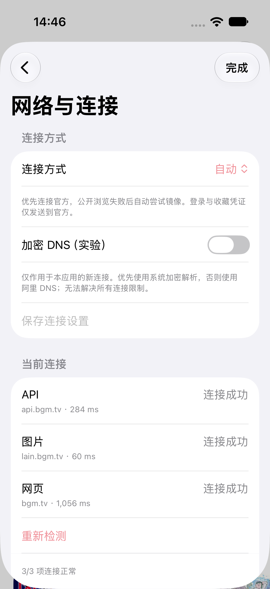
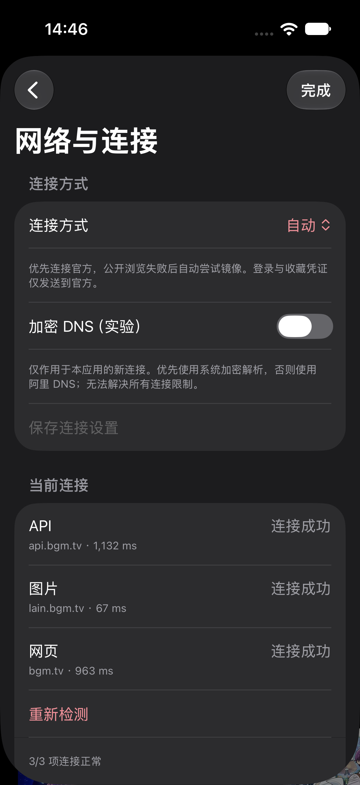
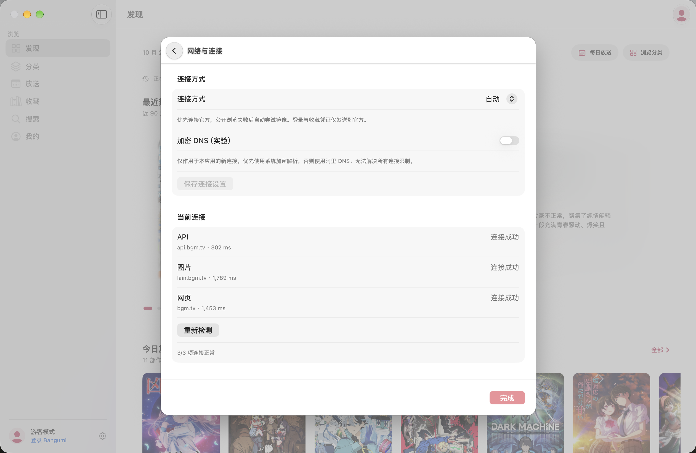
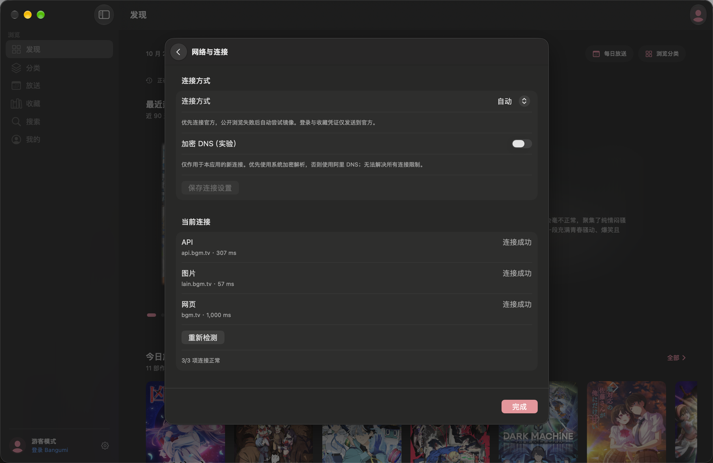

# 网络与连接优化

入口：设置 → 网络与连接。iPhone 17 / iOS 27.0 与当前 Mac / arm64 均使用原生表单和导航。

## 已实现

- 自动模式按 API、图片、网页分别记录健康状态，默认依次尝试 ECH 官方直连、普通官方连接和动态镜像目录。成功线路复用 30 分钟，随后重新尝试优先线路。
- 失败线路按 15、30、60、120、240、300 秒冷却；全部冷却时快速失败，手动重新检测会清除冷却。网络路径改变后清除旧健康状态，不修改系统代理或 VPN。
- 支持仅官方、强制 ECH、自定义通配反代根域名；强制 ECH 失败时不退回普通连接或镜像。自定义服务只在明确选择并保存后参与请求。设置持久化，旧缓存中的镜像、自定义域名仍可还原到官方 URL。
- 邮箱密码登录仅发送到官方或 ECH，临时会话不跟随重定向。带凭证的收藏请求只发送到官方或明确配置的自定义服务；跨域凭证重定向和 HTTPS 降级被拒绝。
- 镜像目录合并并发更新、保留 ETag 和上次可用目录，在后台刷新。官网正常时不等待目录；回退等待也受到页面总时限约束。
- 未验证的普通线路最多尝试 5 秒，ECH 线路为 8 秒；已成功线路最多 12 秒；API、网页的一次读取总预算为 18 秒，图片下载为 14 秒。写操作保留 30 秒预算。排队限流也受预算和取消约束。
- 写请求不自动重放；收藏写入的响应不确定时用强制读取核对目标字段。章节写入不确定时读取服务器进度，保留实际结果，避免错误回滚。
- 401、403、404 和 429 保留业务含义；验证页、无效 JSON、无效图片会被识别。取消不会伪装成缓存成功，HTML 结构校验与 Safari 回退继续保留。
- 图片下载统一限制为 4 个并发，保留同 URL 请求合并、CDN 尺寸选择、旧原图缓存、缺失缩略图回退及清缓存保护。检测绕过图片磁盘、内存和 HTTP 缓存。
- 首页快照按 NSFW 设置分开保存，七天内可先显示缓存并标注后台更新；冷启动准备首张主视觉和两张放送封面。全量收藏同步不阻塞首屏。
- 加密 DNS 默认关闭，可手动开启；使用 Apple 的应用内 PrivacyContext，优先系统加密解析，否则使用阿里 DoH，不安装系统配置文件。保存后重置应用连接池。此选项不是 ECH。
- 诊断最多保留最近 40 条内存记录，仅包含服务、域名、耗时和固定错误类别，不包含完整 URL、服务器错误正文或凭证。重新检测执行真实 API、网页与封面读取。

## ECH 验证结论

`scripts/check-native-ech.sh` 对当前 macOS 和 iPhone 模拟器 SDK 做编译探测，两端的 `sec_protocol_options_set_enable_encrypted_client_hello` 都被标记为不可用。现已增加 Go 标准库静态连接层实现 ECH，正常验证目标域名证书，绑定物理接口并禁用代理。两端已取得 `sni=encrypted`、`ECHAccepted` 和 `en0` 绑定三项证据；[当前实现、浅深色截图与验证记录](../ech-direct/README.md)。下方截图保留早期普通连接界面，当前 ECH 界面以上述记录为准。

应用内加密 DNS 的接入方式参考 [Apple：Enable encrypted DNS](https://developer.apple.com/videos/play/wwdc2020/10047/)。测试验证启用配置后，新建且正常验证证书的 URLSession 可以读取官方条目；没有通过抓包断言每次连接所用的 DNS 协议，系统缓存、代理和 VPN 仍可能影响解析过程。

## 验证

- iPhone 17 / iOS 27.0 和当前 Mac / arm64 实际构建；Mac 应用通过本地签名校验并安装到 `/Applications/Bgmori.app`。
- `bash scripts/test-connections.sh --live`：两端通过官方优先、服务隔离、冷却和粘性过期、网络恢复、设置持久化、自定义域名校验、凭证及 OAuth 路由、跨域和降级重定向、429、超时与取消、不阻塞目录更新、限流取消、图片并发及快照往返编码；两端启用原生加密 DNS 的真实 API 请求通过。
- `bash scripts/test-mirrors.sh --live`：两端通过目录发现、ETag、动态域名、验证页回退、HTML 结构校验及真实条目和封面解码。
- `bash scripts/test-images.sh`：两端通过尺寸选择、请求合并、内存与磁盘缓存、原图回退、重试及清理中取消。
- `bash scripts/test-collection-refresh.sh`：两端通过强制同步，以及写入结果不确定时仅强制读取核对、禁止缓存误确认；使用本地协议桩，没有操作真实收藏。
- `bash scripts/test-shell-ui.sh all testConnectionsLightAndDark`：两端浅深色设置页面与三项真实检测通过，截图为游客模式。
- 没有切换用户设备的 Wi-Fi/VPN 做运营商矩阵测试；网络变化、离线和超时的策略由受控测试验证。启动页失败重试、慢网提示和减少动态效果尚未覆盖自动化 UI 测试。

| 平台 | 浅色 | 深色 |
| --- | --- | --- |
| iPhone 17 |  |  |
| Mac |  |  |
