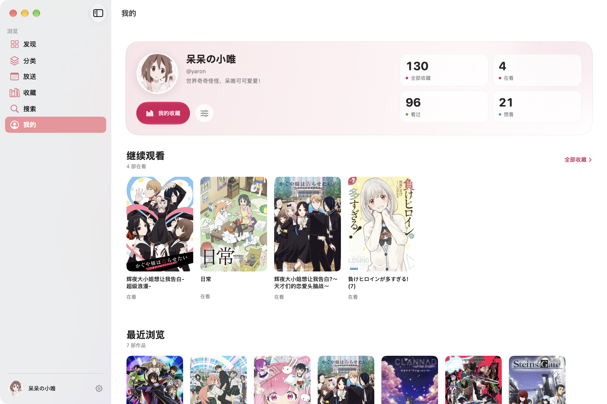
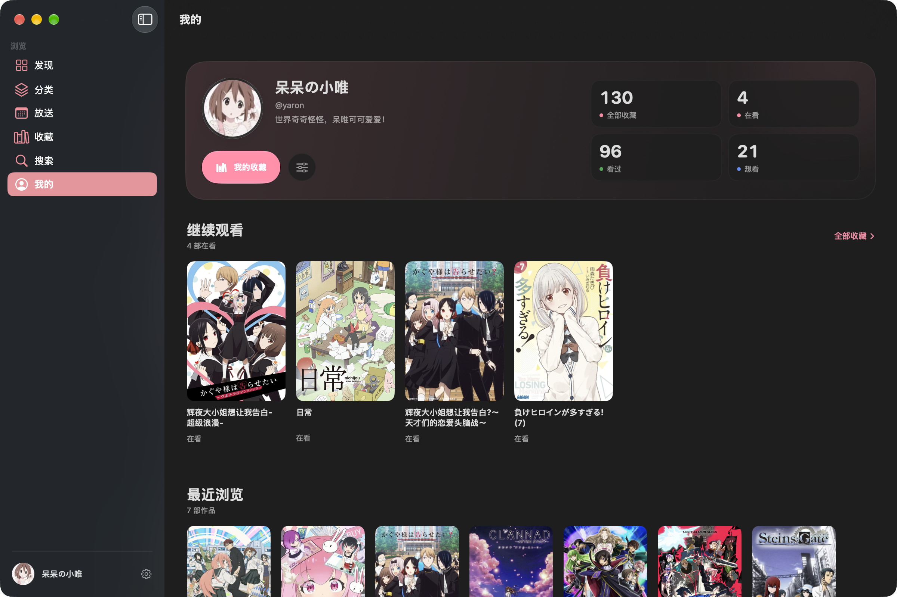
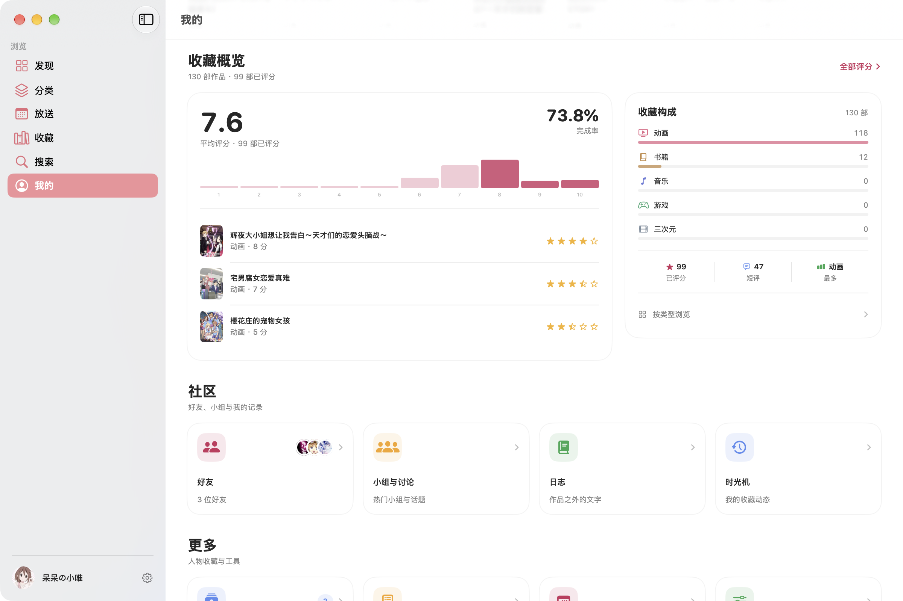
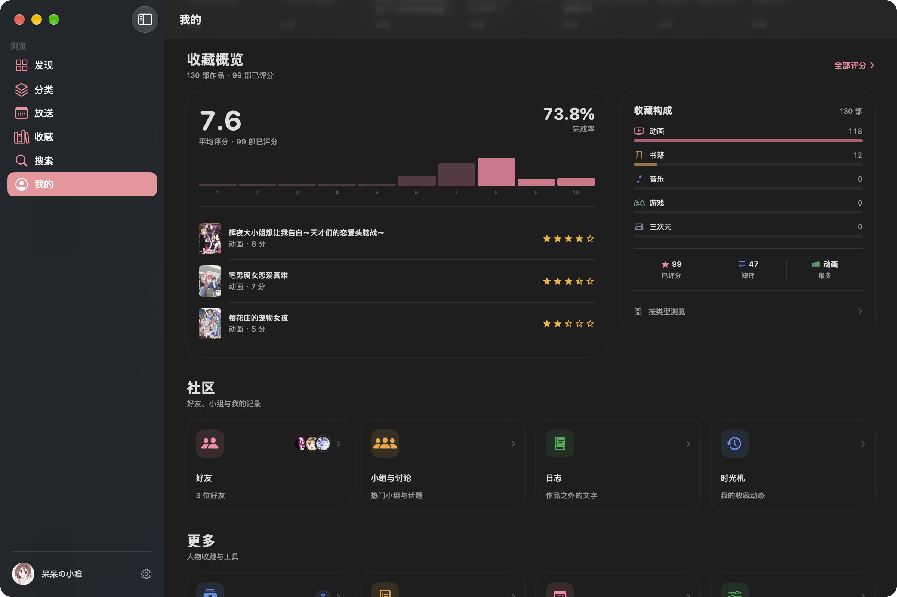
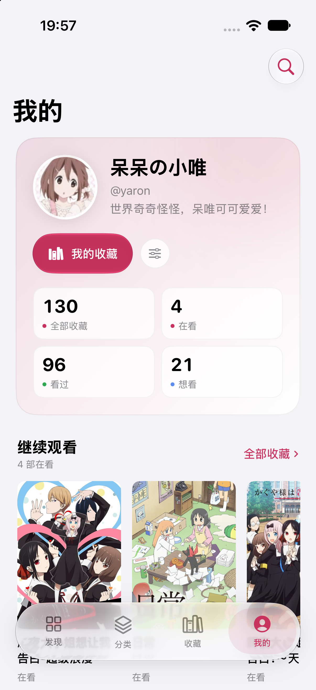
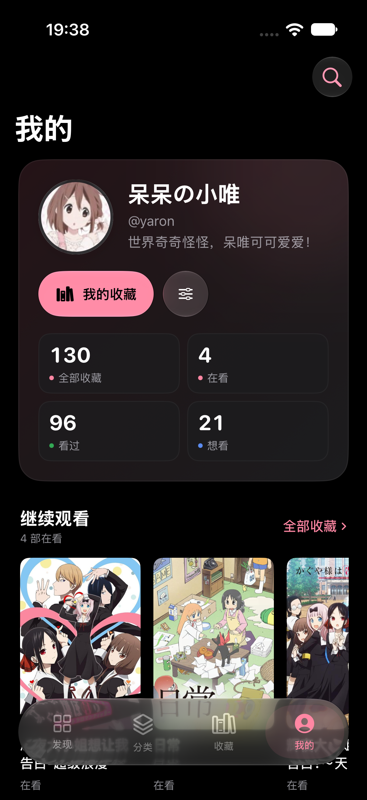
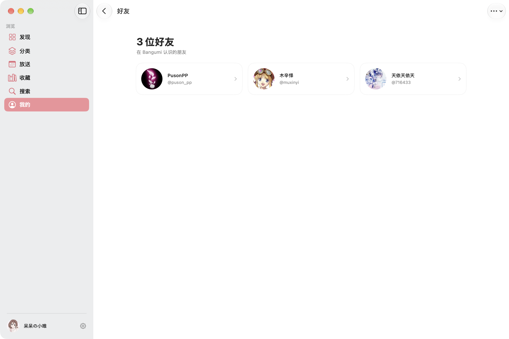
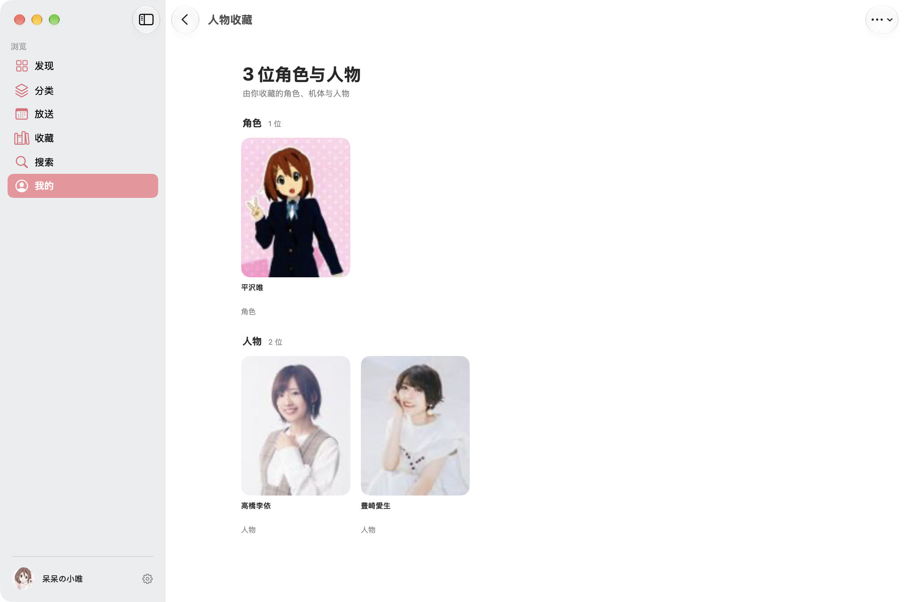
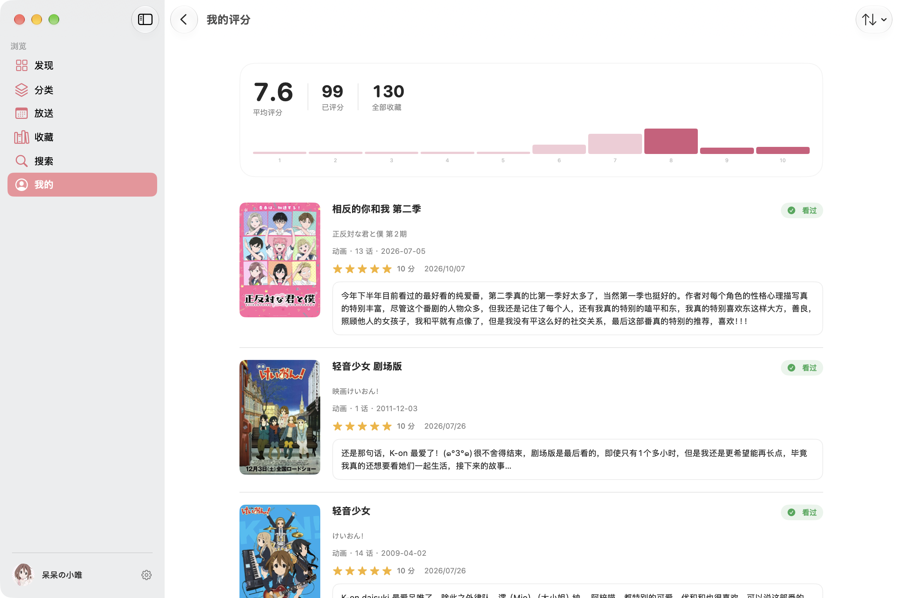

# 我的页改版

在最新源码上重做「我的」，把原来的单列入口页改为个人仪表盘，并补上好友、角色/人物收藏和评分列表。

## 页面结构

- **账号 Hero**：头像、昵称、签名、我的收藏与设置入口；收藏数 2×2 直接嵌在 Hero 右侧（Mac）/ 下方（iPhone）。
- **继续观看**：当前在看作品、进度与跳转；空数据时隐藏。
- **最近浏览**：本地阅读历史；受 NSFW 设置过滤。
- **收藏概览**：平均分、完成率、1–10 分分布、最近三条评分；旁边为按动画 / 书籍 / 音乐 / 游戏 / 三次元的收藏构成。
- **社区**：好友（带头像预览）、小组与讨论、日志、时光机。
- **更多**：人物收藏、目录 ID 查询、每日放送、偏好设置。
- **独立页面**：好友页面（HTML 只读）、角色/人物收藏（API 只读）、我的评分（本地收藏数据 + 短评）。

## 截图

| Mac 浅色 | Mac 深色 |
| --- | --- |
|  |  |

| Mac 收藏概览（浅色） | Mac 收藏概览（深色） |
| --- | --- |
|  |  |

| iPhone 浅色 | iPhone 深色 |
| --- | --- |
|  |  |

| 好友 | 人物收藏 | 我的评分 |
| --- | --- | --- |
|  |  |  |

## 验证

- 构建：`xcodebuild` iPhone 17 / iOS 27.0 模拟器 + 当前 Mac（arm64）均通过。
- Mac 截图使用当前源码的 Debug 构建；iPhone 截图使用 iPhone 17 / iOS 27.0 模拟器。
- 好友列表使用 Bangumi 公开 HTML，角色/人物收藏使用公开 API，均为只读；我的评分来自本地收藏缓存。
