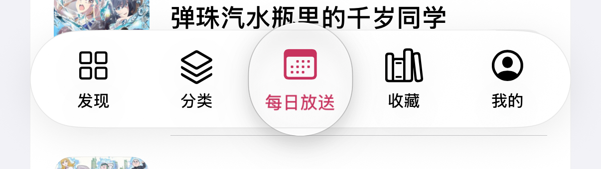
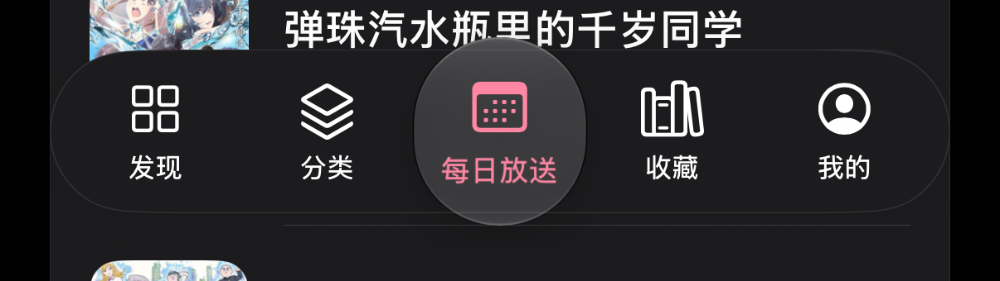
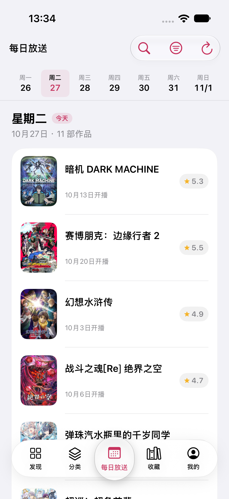
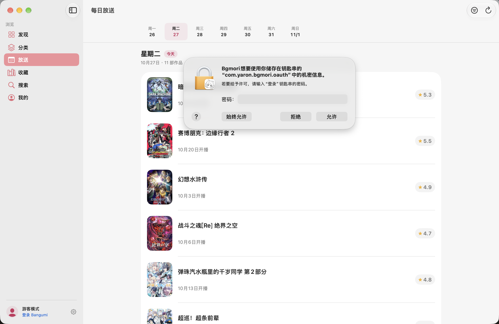
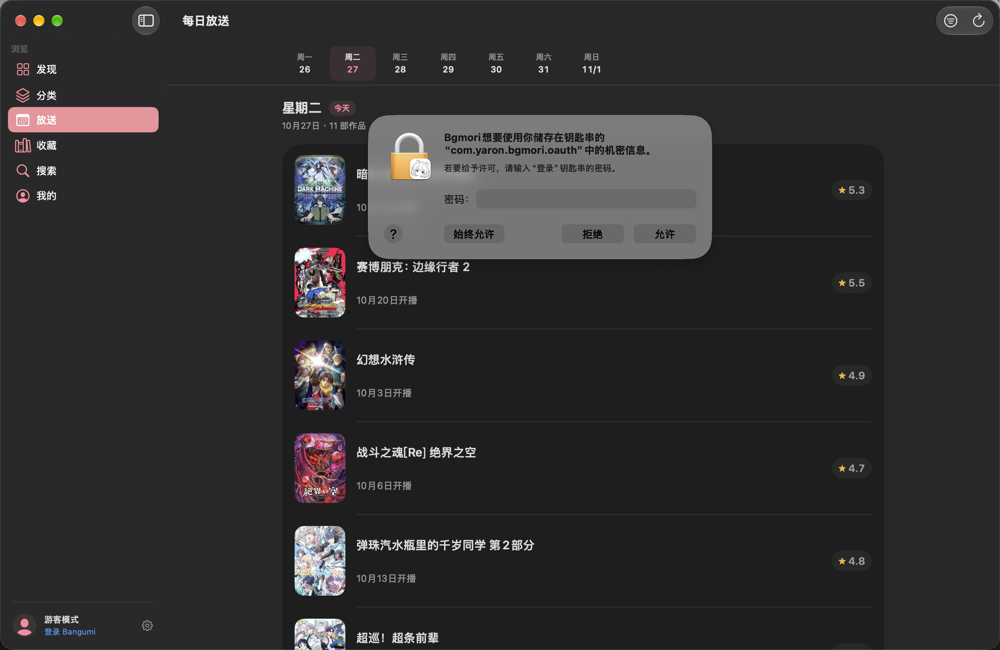

# 历史方案：五栏导航与凸起玻璃选中效果

此方案不符合用户要求，现已由[系统原生底栏](../native-tabbar/README.md)替代。

2026-10-27：按参考图改为浅净胶囊底板，选中项采用高于底板的玻璃透镜，保留轻微放大与切换动画。底板使用语义色实色表面，内容封面不会透进整条底栏；开启降低透明度时改为普通表面。

底部栏目为「发现 / 分类 / 每日放送 / 收藏 / 我的」。发现页的放送快捷入口直接切换到放送栏目，该栏目独立保留导航历史。Mac 继续使用原生侧栏。

验证：iPhone 17 / iOS 27.0 与 Mac arm64 构建通过；导航脚本两端通过；手机浅深色、五个栏目切换、搜索历史、后台返回、详情返回检查通过；Mac 放送页浅深色检查通过。UI 测试通过 Debug 专用 `BGMORI_GUEST_MODE=1` 使用游客模式，不读取用户钥匙串。

| 浅色底栏 | 深色底栏 |
| --- | --- |
|  |  |

| iPhone 浅色 | iPhone 深色 |
| --- | --- |
|  |  |

| Mac 浅色 | Mac 深色 |
| --- | --- |
|  |  |
