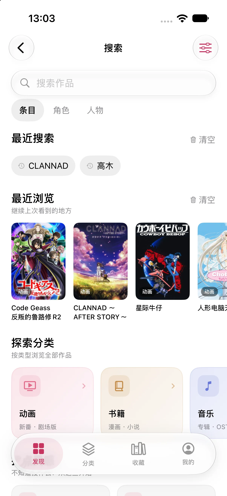
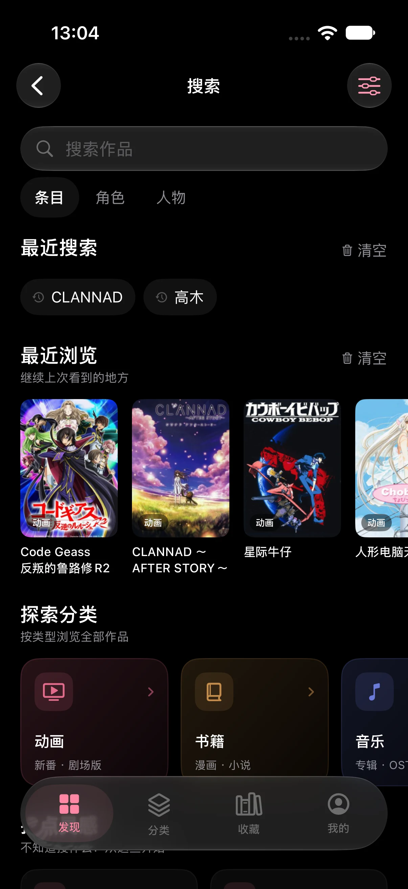
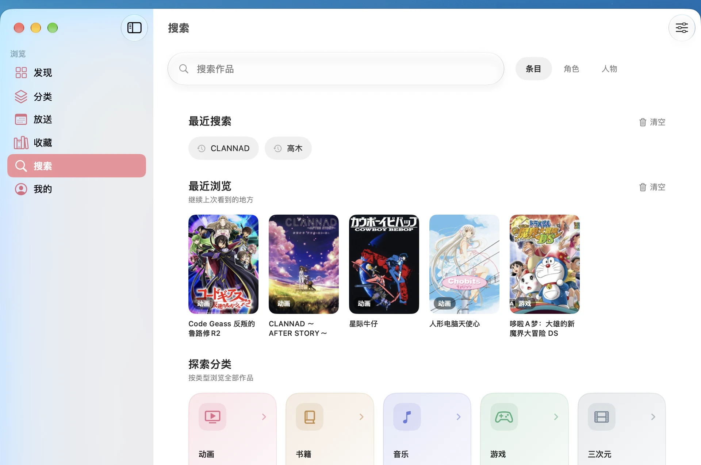
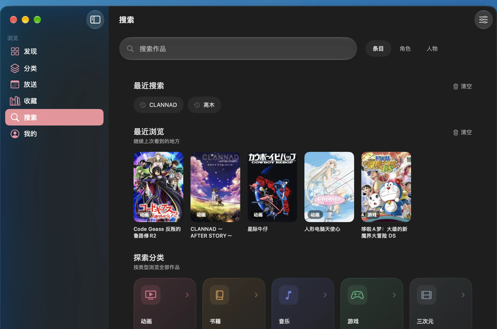
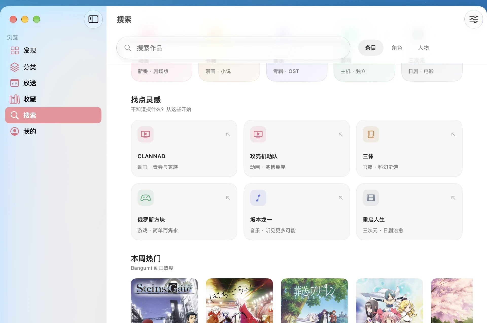
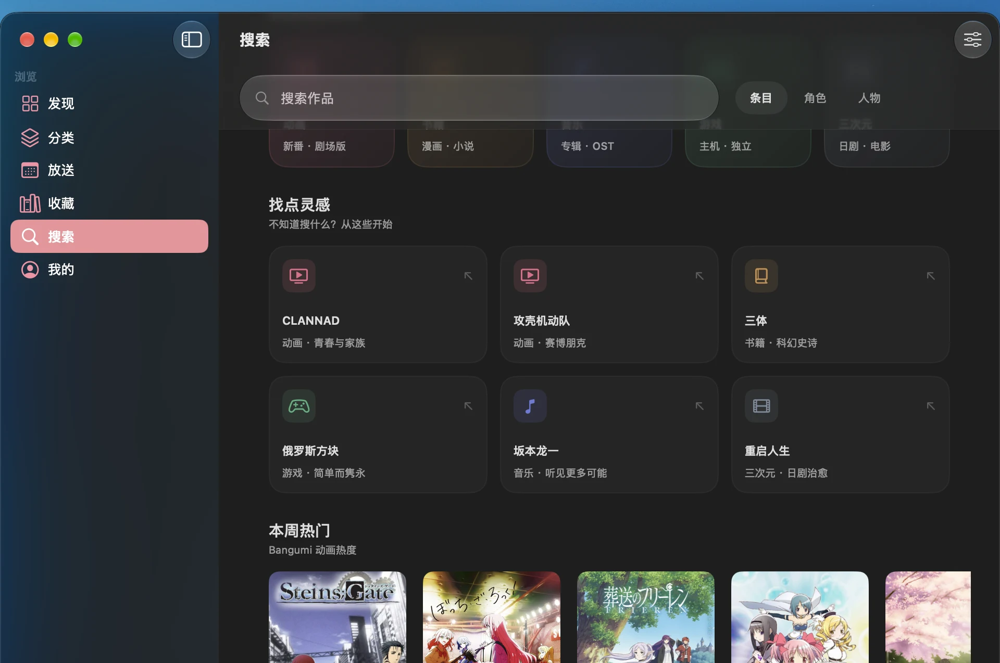

# 搜索落地页 · 2026-10-26

搜索页在没有关键词时不再是一大片空白。顶部保留玻璃搜索栏和条目 / 角色 / 人物范围切换，内容区不使用大面积渐变引导卡，直接从最近记录和分类入口开始：

- **最近搜索**：本地保留最近 10 个关键词，可清空。
- **最近浏览**：打开过的条目最多保留 12 个，横向封面书架，可清空；仅写入本地 `UserDefaults`，NSFW 条目按设置过滤。
- **探索分类**：动画 / 书籍 / 音乐 / 游戏 / 三次元五个入口，Mac 上五列铺满，iPhone 上横向滑动；点击直接进入对应分类。
- **找点灵感**：六个跨类型的示例关键词，点击即发起条目搜索。
- **本周热门**：通过分类接口按热度加载动画书架；加载失败时在区块内提供重试，不阻塞搜索。

## 截图

### iPhone 17 · iOS 27.0

| 浅色 | 深色 |
| --- | --- |
|  |  |

### Mac · 960 pt 窄窗口

| 浅色 | 深色 |
| --- | --- |
|  |  |

滚动到分类与热门区域：

| 浅色 | 深色 |
| --- | --- |
|  |  |

## 验证

- iPhone 17 / iOS 27.0 模拟器 Debug 构建通过。
- macOS Debug 构建通过。
- 浅色、深色截图检查；Mac 使用 960 pt 窄窗口检查分类五列与横向书架。
- 截图使用游客模式；最近搜索 / 浏览为演示数据，未写入真实账号信息。
