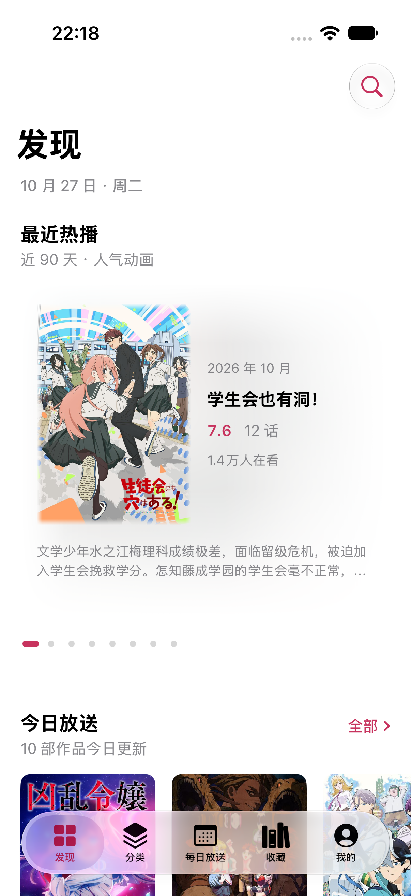
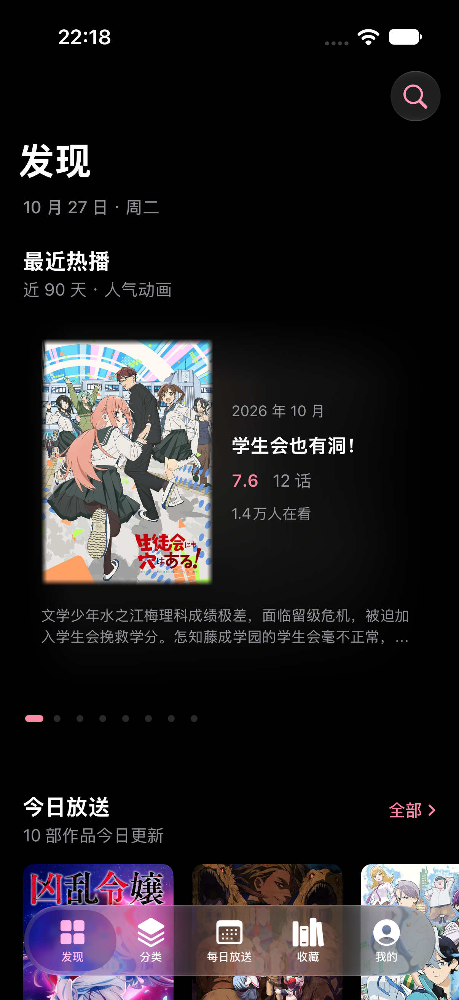
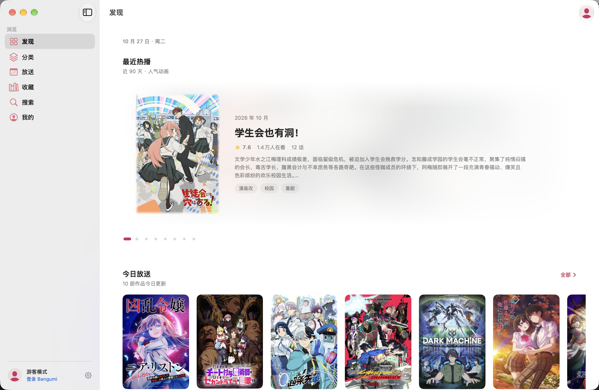
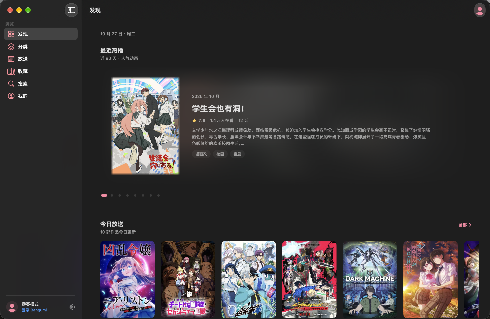

# 首页静默刷新

2026-10-27，iPhone 17 / iOS 27.0 与当前 arm64 Mac。

- 有缓存立即进入首页，移除首页缓存状态行和启动时“正在读取缓存…”文字。
- 后台刷新保留已有内容；自动请求失败时不弹 Toast，错误仍保留供首次加载失败页使用。主动刷新保留失败反馈，失败后不再提示“已刷新”。
- 热播、今日放送、本季新番、口碑佳作、剧场版分别比较完整数据；只有变化的板块执行 0.25 秒交叉淡化。开启减少动态效果时直接替换。
- 页面、轮播和横向书架滚动期间暂缓替换，保留仍存在的轮播选中条目与书架滚动锚点；不重建整个首页。
- 替换前预加载选中主视觉或前两张书架封面，最多等待 800 毫秒，慢图继续后台缓存。

验证：

- `bash scripts/build-install-ios.sh --route home`：构建、安装、构建号和二进制哈希核验通过。
- `bash scripts/build-install-macos.sh`：arm64 构建、签名核验、安装 `/Applications/Bgmori.app` 并重新打开通过。
- `BGMORI_UI_RESULT_DIR=... bash scripts/test-shell-ui.sh all testSilentHomeRefreshLightAndDark`：两端均通过；读取真实首页后重启，检查缓存启动、无缓存提示、浅深色和轮播切换。
- 模拟器受控旧缓存检查：仅临时将公开条目的缓存中文名改为其原名，使用真实网络刷新，确认同一 ID 的标题更新能替换旧标题；结束后恢复原缓存。录像在忽略入库的 `build/silent-home-ui/refresh-demo.mp4`。

| iPhone 浅色 | iPhone 深色 |
| --- | --- |
|  |  |

| Mac 浅色 | Mac 深色 |
| --- | --- |
|  |  |
