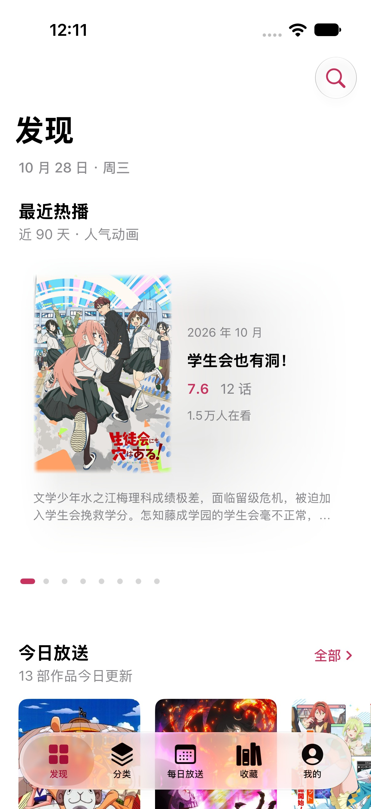
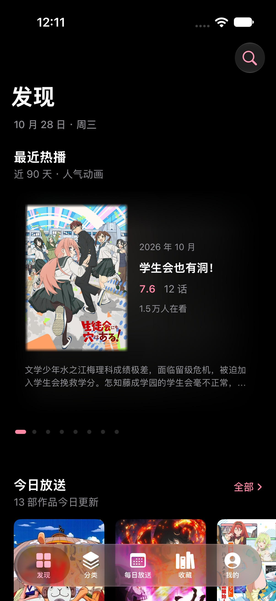
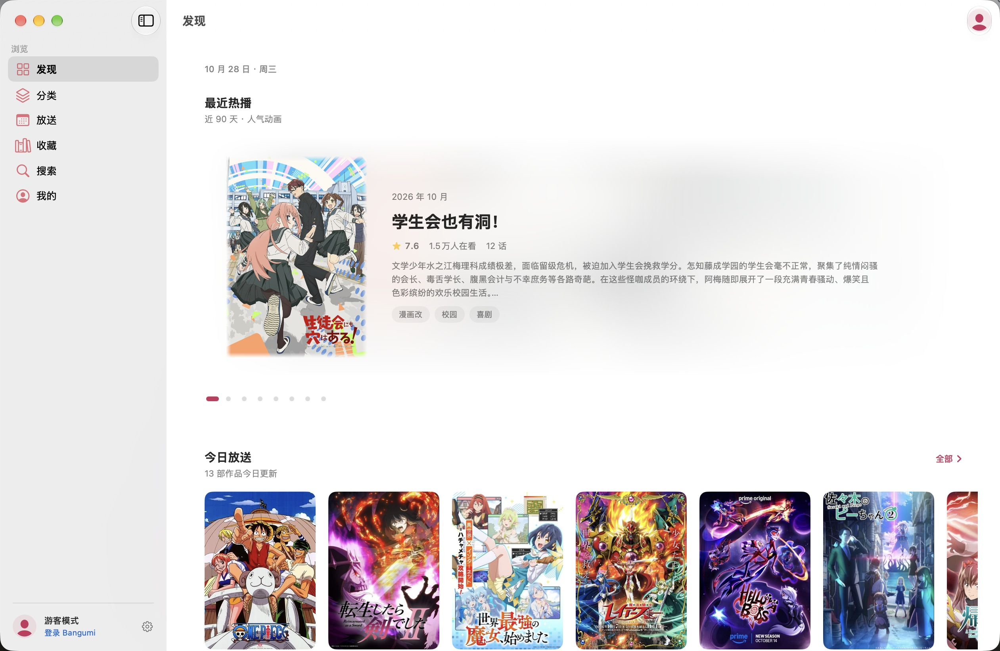
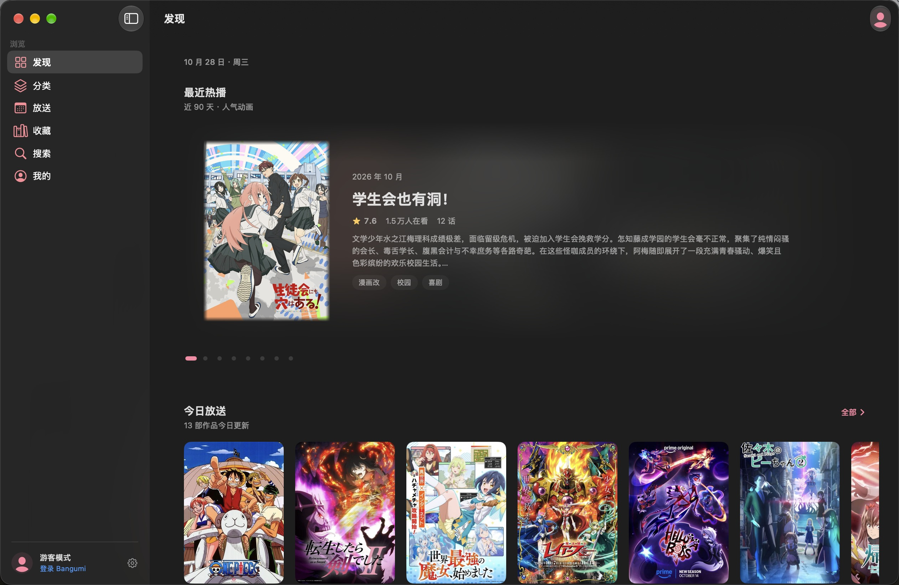

# 发现页稳定刷新

2026-10-28，iPhone 17 / iOS 27.0 与当前 arm64 Mac。

- 首页刷新保持同一棵视图树，移除整块内容的交叉淡化和临时旧视图。
- 卡片与轮播分页按作品 ID 保持身份；轮播的两个边界副本拥有独立身份，列表换序后仍保留当前作品。
- 首页展示快照同时比较完整内容，避免模型的 ID-only equality 吞掉同一作品的标题、评分或封面更新。内容变化不会成为视图的新 ID。
- 同一作品更换封面或调整清晰度时，旧图一直保留到新图成功；失败保留旧图，取消和迟到请求不会覆盖新的作品。没有稳定作品身份的通用图片按 URL 隔离，防止串图。
- 仅新封面使用短透明度过渡；清晰度变化不重启动画。遵循减少动态效果设置。
- 图片直接按真实显示尺寸加载，移除刷新前固定 400 像素、只预热前两张的等待逻辑；页面与书架滚动时仍暂缓发布新内容。

验证：

- `bash scripts/test-images.sh`：Mac 与 iPhone 17 模拟器均通过，包含图片缓存、并发下载、换清晰度、慢图、替换失败重试、取消/迟到响应、不同作品隔离和同 ID 元数据更新。
- `bash scripts/build-install-ios.sh --route home`：构建、安装、构建号与二进制哈希核验通过。
- `bash scripts/build-install-macos.sh`：arm64 构建、签名核验、安装 `/Applications/Bgmori.app` 并打开通过。
- `testSilentHomeRefreshLightAndDark`：两端检查真实首页、缓存启动、浅深色和分页选择；结果位于忽略入库的 `build/cover-refresh-ui-final/`。
- iPhone 受控旧缓存：临时修改公开条目 622288 的中文标题、调整其他作品顺序，并从热播缓存移除条目 554779；真实后台刷新将列表从 7 项补回 8 项，当前作品仍为 622288，标题恢复为“FX战士久留美”。检查 30 帧/秒录像，封面在标题恢复、分页位置变化时没有变成占位图或整体变淡。检查后恢复原始公开数据缓存。
- 受控录像和像素检查位于 `build/cover-refresh-ui/controlled-refresh.mp4`、`controlled-pixel-check.json`；录制后第 2–7 秒的 150 张采样帧中，封面中央区域对参考帧的最大平均 RGB 差约为 1.63/255（包含视频压缩差异）。此结果只覆盖本次录制场景。

| iPhone 浅色 | iPhone 深色 |
| --- | --- |
|  |  |

| Mac 浅色 | Mac 深色 |
| --- | --- |
|  |  |
