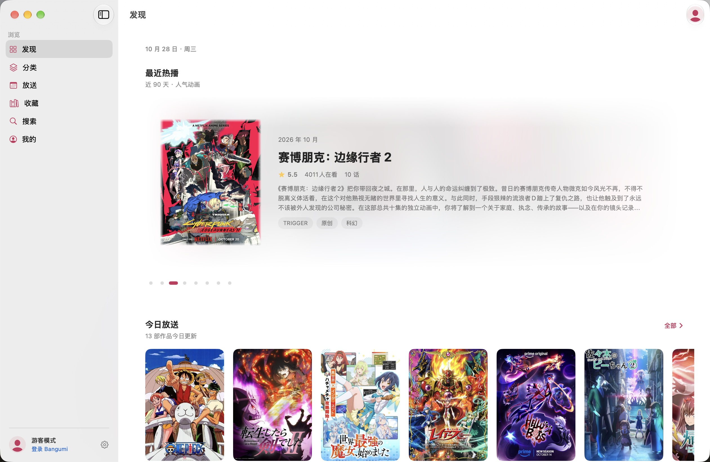
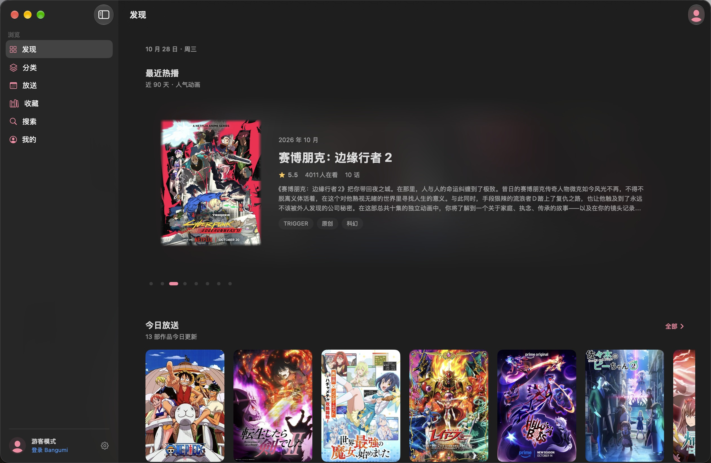
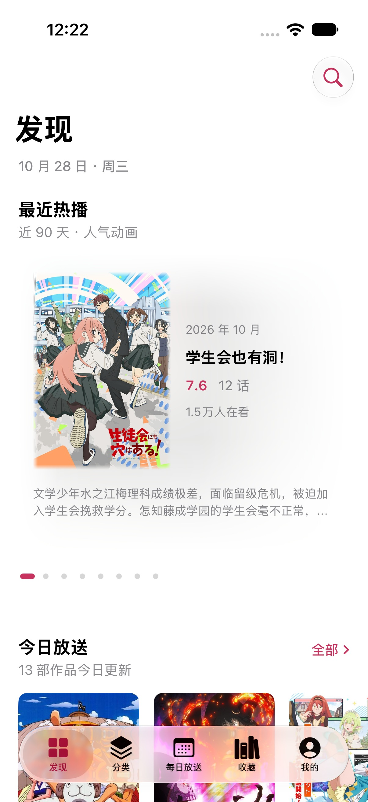
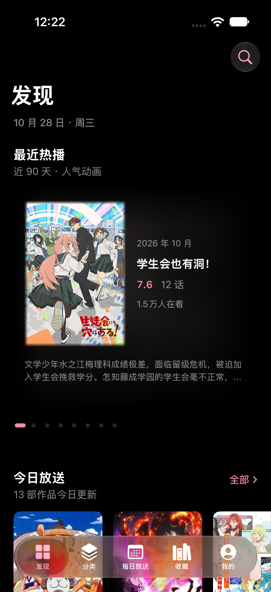

# Mac 台前调度恢复后的侧栏图标

2026-10-28，当前 Apple M2 Mac / macOS 27.0.1 与 iPhone 17 / iOS 27.0。

用户报告：从台前调度切回 Bgmori 时，侧栏文字正常，但图标消失或很淡；更新后用户已确认问题解决。

调整仅作用于 Mac 侧栏：

- 保留原生 `NavigationSplitView`、`List(selection:)` 与系统选中态。
- 使用明确的 `Label` 图标/文字内容与 `.titleAndIcon`，避免依赖自动标签样式。
- 图标明确使用单色 SF Symbols 与 `Color.brandPink`，文字使用 `Color.bgmInk`，不再只依赖从根视图继承的 tint。

实现依据：[Apple 的 titleAndIcon 接口](https://developer.apple.com/documentation/swiftui/labelstyle/titleandicon)、[foregroundStyle 接口](https://developer.apple.com/documentation/swiftui/view/foregroundstyle(_:))。这些文档说明显示与着色行为，并未证明此问题是已知系统缺陷。

验证范围：

- 本机 `com.apple.WindowManager GloballyEnabled` 为 1，检查期间未修改台前调度设置。
- `bash scripts/build-install-macos.sh`：arm64 构建、签名校验、安装 `/Applications/Bgmori.app` 并启动。
- `bash scripts/build-install-ios.sh --route home`：iPhone 17 构建、安装、构建号与二进制哈希校验。
- `testSidebarWindowRestoreLightAndDark`：iPhone 浅深色截图与五栏检查通过（`build/sidebar-restore-ui/ios.xcresult`）；Mac 在浅、深色下各执行三次 Finder → Bgmori 的激活往返，六个侧栏图标的实际截图像素检查通过（`build/sidebar-restore-ui-final/mac.xcresult`）。
- 自动化覆盖的是台前调度开启时的应用激活往返，没有自动点击台前调度缩略图；未稳定复现用户原始故障，不能据此断言具体系统内部根因，也不代表完成所有台前调度/多窗口场景验收。

| Mac 浅色恢复后 | Mac 深色恢复后 |
| --- | --- |
|  |  |

| iPhone 浅色 | iPhone 深色 |
| --- | --- |
|  |  |
