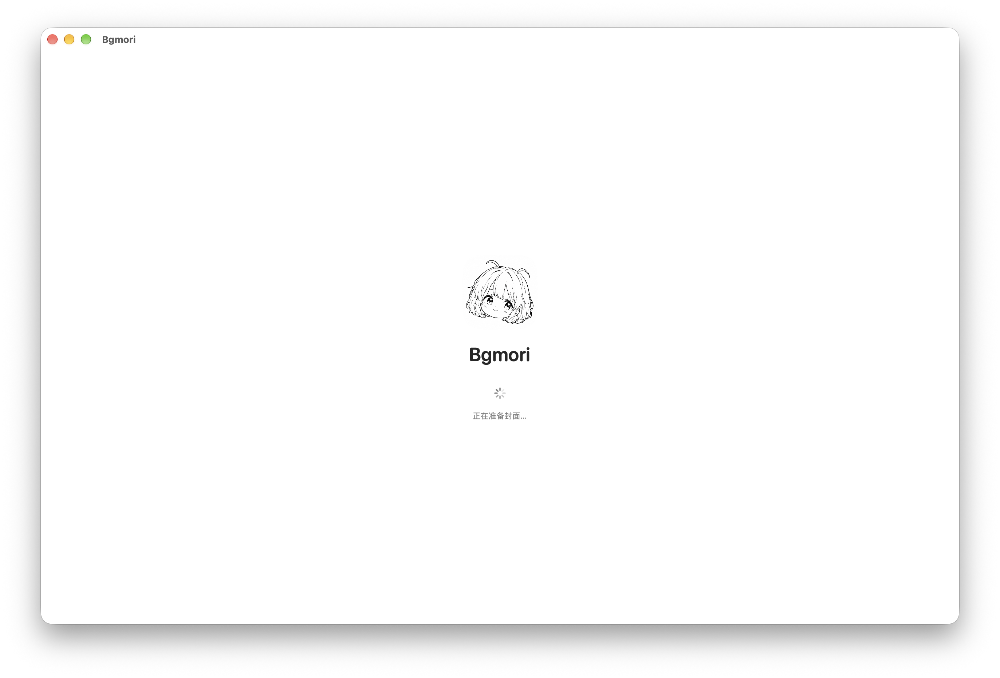

# 启动页

- 启动时显示品牌图标、轻微呼吸动画与真实加载阶段，首页和放送数据完成、首张主视觉封面尝试加载后淡入主界面。
- 不等待全量收藏同步或屏幕外的所有图片；封面失败时保留正常占位，不将图片问题冒充为页面成功加载。
- 首页无可用数据时显示重试；超过十秒显示「先进入应用」，后台请求继续执行。减少动态效果时关闭呼吸及切入动画。
- iPhone 17 / iOS 27.0 与当前 Mac / arm64 构建通过，实际观察两端浅深色启动和首页。网络失败重试、十秒慢网及减少动态效果分支尚未进行自动化验证。

| 平台 | 浅色启动 | 深色启动 |
| --- | --- | --- |
| iPhone 17 |  |  |
| Mac |  |  |

加载后的首页见同目录的 `iphone-home-light.png`、`iphone-home-dark.png`、`mac-home-light.png`、`mac-home-dark.png`。

## 删除收藏调查（2026-10-27）

- [Izuko SubjectService](https://github.com/GrahamZen/izuko-tv/blob/main/app/shared/app-data/src/commonMain/kotlin/data/network/SubjectService.kt#L367) 的 `deleteSubjectCollection` 直接抛出不支持错误，注释说明 UI 已隐藏该入口。
- [Bangumi 私有 API 文档](https://bangumi.github.io/dev-docs/) 中，条目收藏有查询、更新和进度操作，没有条目收藏删除；角色、人物、目录收藏的删除是不同接口。
- [czy0729/Bangumi](https://github.com/czy0729/Bangumi/blob/master/src/stores/user/action.ts#L213) 在应用内执行网页删除；[地址定义](https://github.com/czy0729/Bangumi/blob/master/src/constants/html/index.ts#L460) 使用 `/subject/{id}/remove?gh={formhash}`，[请求封装](https://github.com/czy0729/Bangumi/blob/master/src/utils/fetch/xhr.ts#L30) 带网页登录 Cookie。这证明应用内删除存在实现方式，但并非仅凭 OAuth 调用公开删除接口。
- 本次没有操作账号、测试删除，或改变 Bgmori 的匿名网页只读约定；现有浏览器移除与返回同步流程保留。
