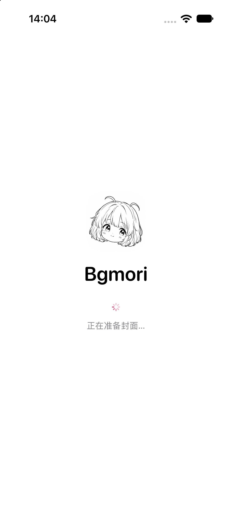
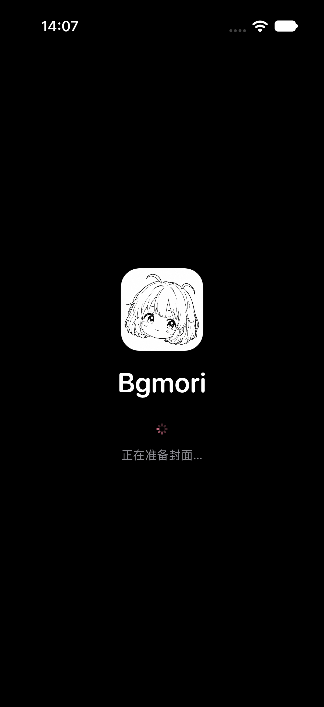
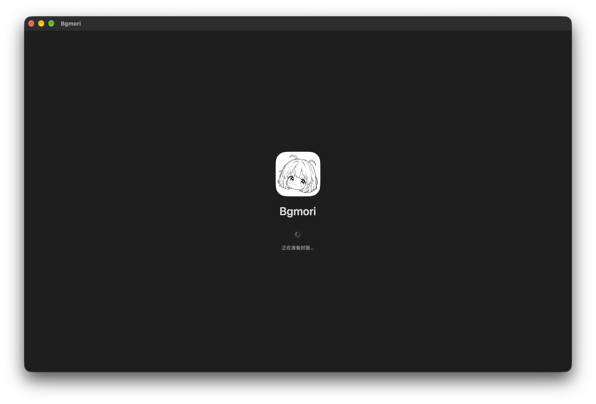

# 启动页

- 启动时显示品牌图标、轻微呼吸动画与真实加载阶段，首页和放送数据完成、首张主视觉封面尝试加载后淡入主界面。
- 不等待全量收藏同步或屏幕外的所有图片；封面失败时保留正常占位，不将图片问题冒充为页面成功加载。
- 首页无可用数据时显示重试；超过十秒显示「先进入应用」，后台请求继续执行。减少动态效果时关闭呼吸及切入动画。
- iPhone 17 / iOS 27.0 与当前 Mac / arm64 构建通过，实际观察两端浅深色启动和首页。网络失败重试、十秒慢网及减少动态效果分支尚未进行自动化验证。

| 平台 | 浅色启动 | 深色启动 |
| --- | --- | --- |
| iPhone 17 |  |  |
| Mac |  |  |

加载后的首页见同目录的 `iphone-home-light.png`、`iphone-home-dark.png`、`mac-home-light.png`、`mac-home-dark.png`。

## 删除收藏的实现依据（2026-10-27）

- 官方 v0 API 文档中，条目收藏提供查询、更新和进度操作，没有删除条目收藏的接口；角色、人物与目录收藏的删除属于不同接口。
- 官网网页提供条目移除入口（`/subject/{id}/erase_collect?gh=...`，旧版为 `/remove`），需要登录会话与 formhash。Bgmori 因此使用 Keychain 中保存的官网会话调用该入口，再用 v0 API 查询确认，不依赖未公开的删除接口。
- 本次没有操作账号、测试删除，或改变 Bgmori 的匿名网页只读约定；现有浏览器移除与返回同步流程保留。
