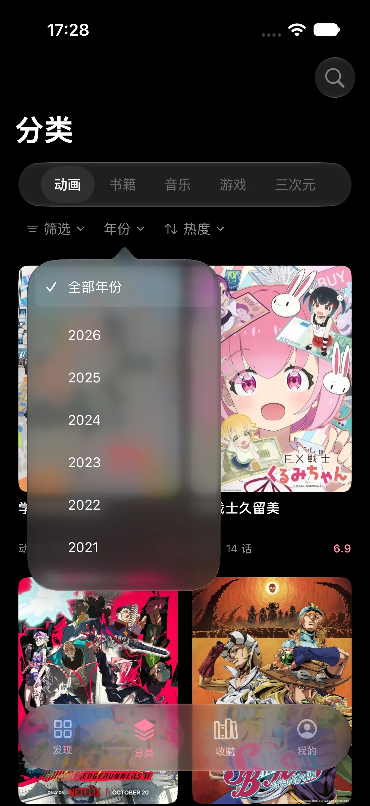
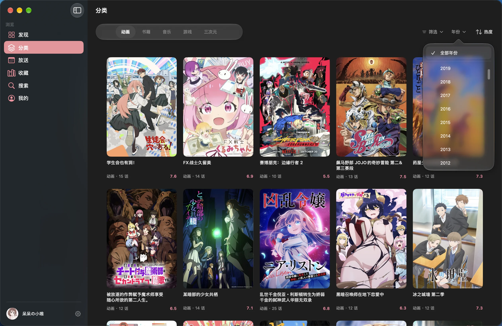
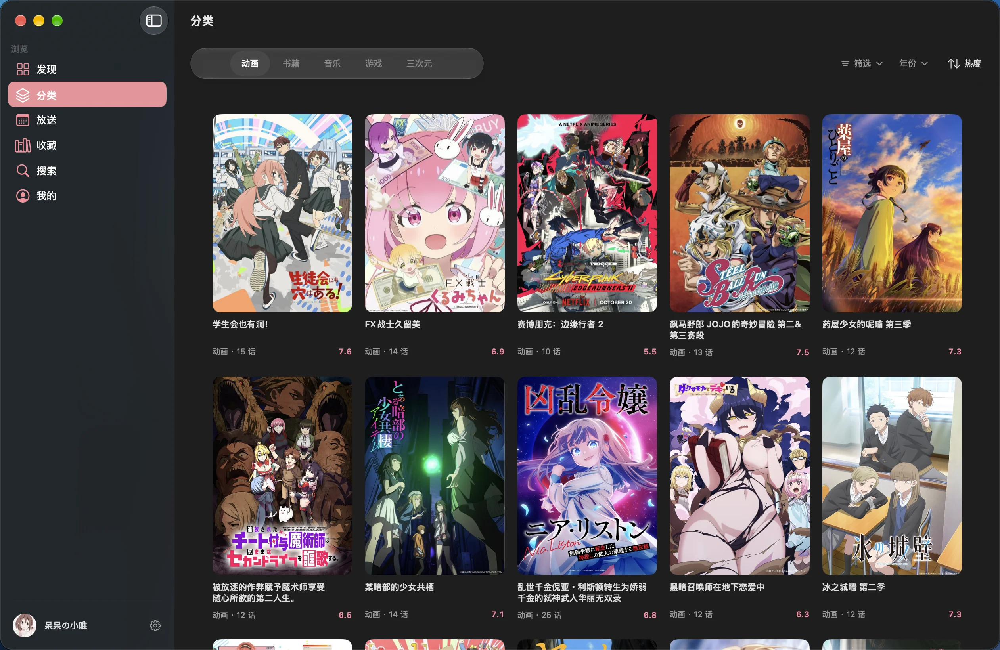

# 紧凑年份选择与封面标题

分类与搜索筛选共用固定高度的年份弹层，列表上下滚动；「全部年份」固定在顶部，重新打开时定位已选年份。

封面卡片标题最多两行，短标题保留第二行空间，超出两行在末尾省略。共用封面组件、最近浏览、参与作品、关联条目与目录中的封面标题均采用此规则。共用组件也预留信息行与已提供的进度行，减少同组卡片的高度差异。

2026-10-26 验证：iPhone 17 / iOS 27.0 与当前 Mac / arm64 构建通过；两端检查浅色、深色下的卡片布局、年份滚动、选择、重新定位与清除选择，搜索筛选中的年份选择及重置也通过 UI 检查。

| 平台与外观 | 年份弹层 | 滚动至较早年份 | 封面卡片 |
| --- | --- | --- | --- |
| iPhone 浅色 |  |  |  |
| iPhone 深色 |  |  |  |
| Mac 浅色 |  |  |  |
| Mac 深色 |  |  |  |

搜索筛选使用相同控件：
